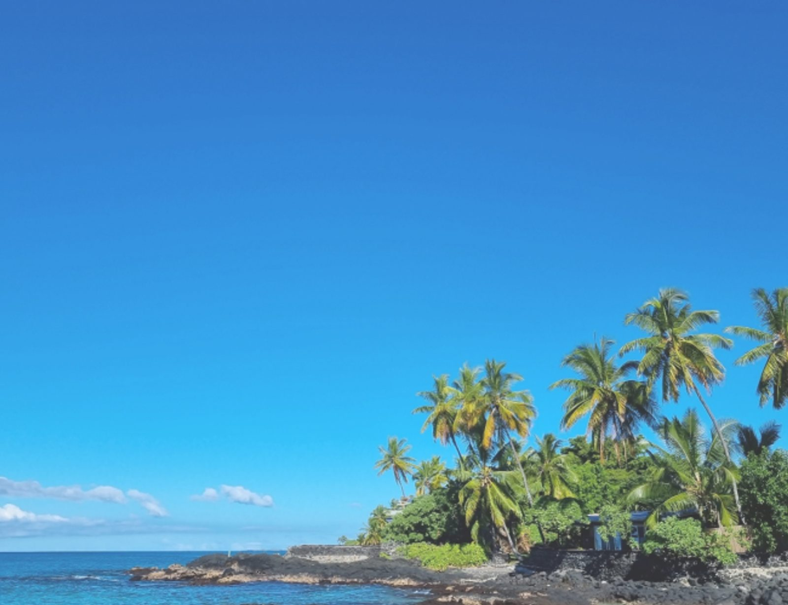
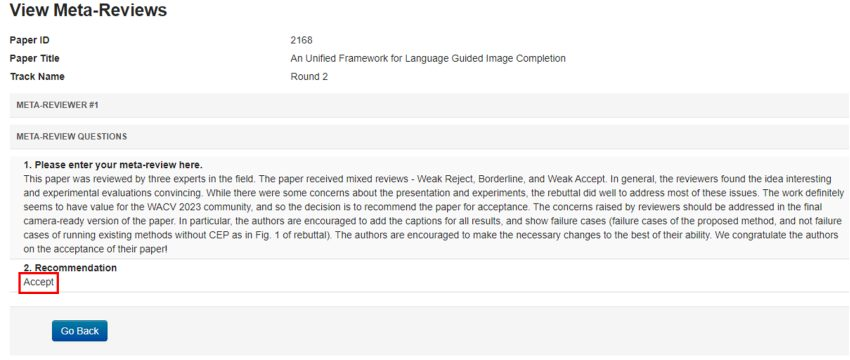
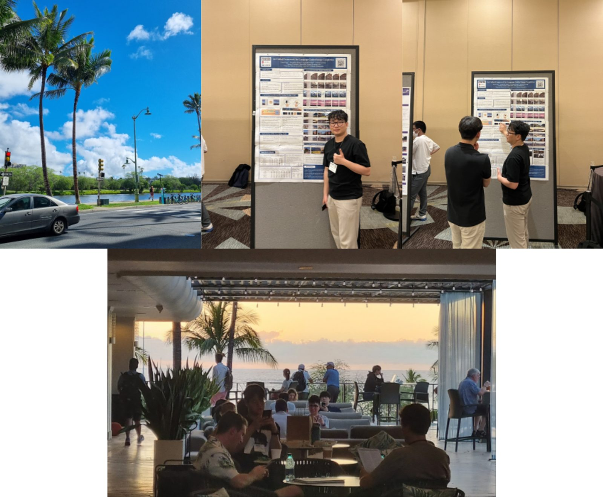

<figure class="board-fig"></figure>

대학원에 진학하고 1년 동안은 이러저러한 이유로 인해 제대로 된 연구를 진행하지 못한 상황이었습니다. 당시 지도교수님께서는 제게 이도저도 못하는 상황인 제게 인공지능 분야로 전향해 보는 것을 추천해주셨고, 저는 2021년 12월 말부터 새로운 지도교수님이 되어주신 공경보 교수님 밑에서 인공지능을 공부하기 시작했습니다.

교수님께서는 인공지능에 대한 기본 지식이 없었던 제게 기초부터 배울 수 있도록 많은 부분에서 지원해주셨고, 저도 뒤가 없다는 마인드로 열심히 공부했습니다. 다행히 어느 정도 인공지능 분야에 적성이 있었고 배운지 5개월 만에 국내 논문을 작성할 수 있었습니다.

*정성훈, 공경보 "딥러닝 기반 단일 이미지 생성적 적대 신경망 기법 비교 분석" 방송공학회 논문지 27.3 pp.437-450 (2022) : 437.*

빠르게 배우는 저를 보신 교수님께서는 해외 학회에 논문을 한번 작성해 보자고 제안해주셨고, 수많은 시행착오와 수많은 밤샘 실험을 통해 논문을 작성할 수 있었습니다. 학회는 IEEE/CVF Winter Conference on Applications of Computer Vision(WACV)으로 인공지능 분야에서는 저명한 국제 학회 중 하나로, 하와이에서 개최되기 때문에 하와이에 가보자는 열망으로 열심히 논문을 작성했습니다.

하지만 인공지능에 대해 배운지도 얼마 되지 않았기 때문에 논문이 Accept되는 것에 대해서는 큰 기대를 하지 않았고, 논문을 쓰면서 인공지능 분야에 대해 정말 쉽지 않은 분야라는 것을 체감했기에 ‘해외 학회에 논문을 썼다는 경험을 바탕으로 앞으로 잘해보자!’라는 마인드로 결과를 기다리고 있었습니다.

결과 발표 아침,

<figure class="board-fig"></figure>

> ？ “이게 되네!”

논문이 Accept되었다는 것을 확인하고 정말 기뻤습니다. 평생 갈 일이 없을 것만 같았던 하와이에 가는 것도 물론 기뻤지만, 배운지 얼마 되지 않아 국제 학회에 도전하여 성공했다는 것이 앞으로 더 나아갈 수 있는 큰 원동력이 되었습니다.

<figure class="board-fig"></figure>

하와이 학회에서도 인공지능을 공부하는 많은 사람을 만나 교류하면서 본인들의 연구와 지식을 아낌없이 다른 사람들과 공유하고 토론하는 모습을 보며 앞으로도 더 열심히 해야겠다는 생각이 들었습니다.

위와 같은 경험은 제 인생의 변곡점이 되어 저는 이전과는 다른, 전혀 새로운 방향으로 나아가고 있습니다. WACV에서 얻은 경험과 성취를 바탕으로 앞으로도 더 열심히 연구를 진행하여 더욱더 발전하고자 합니다.

감사합니다.

Mahalo !
