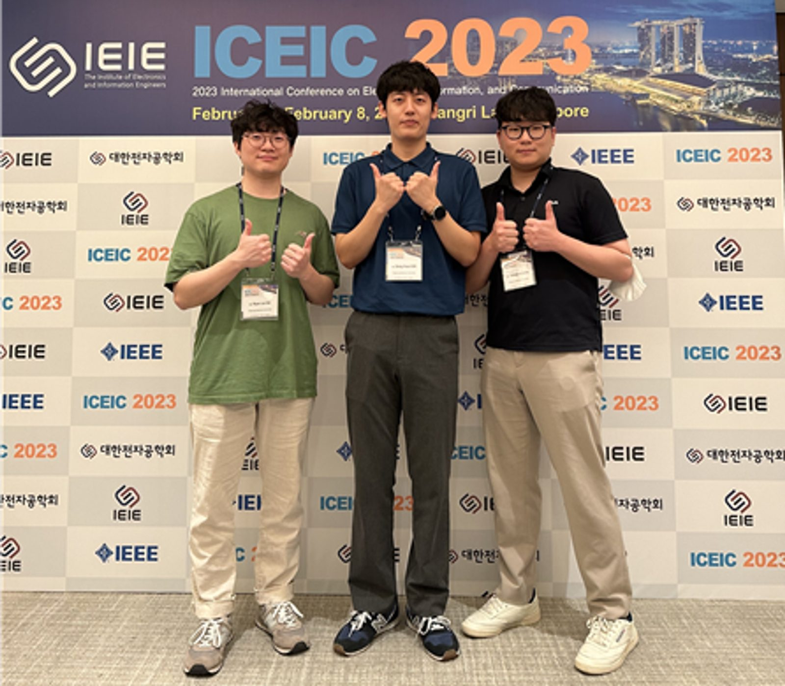
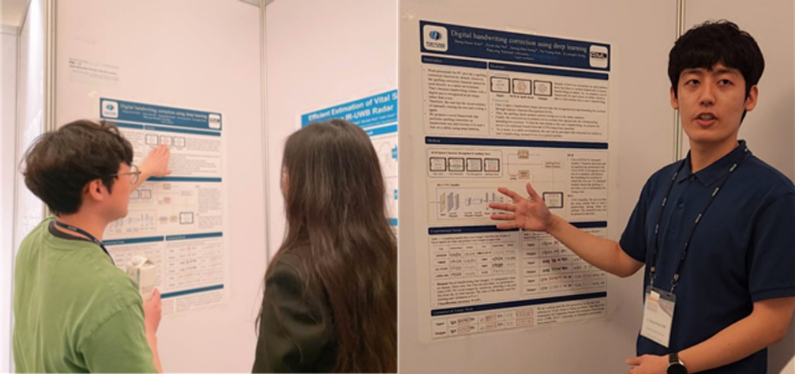
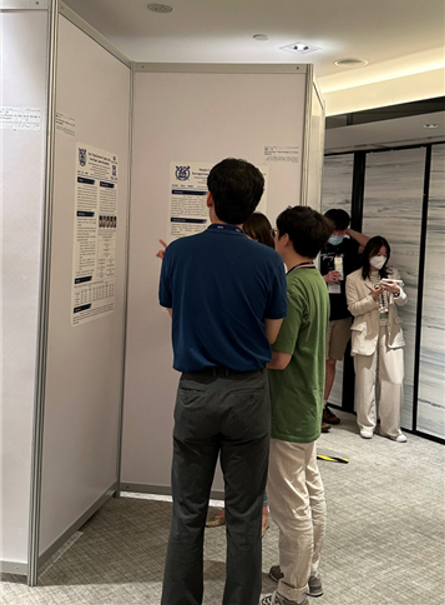
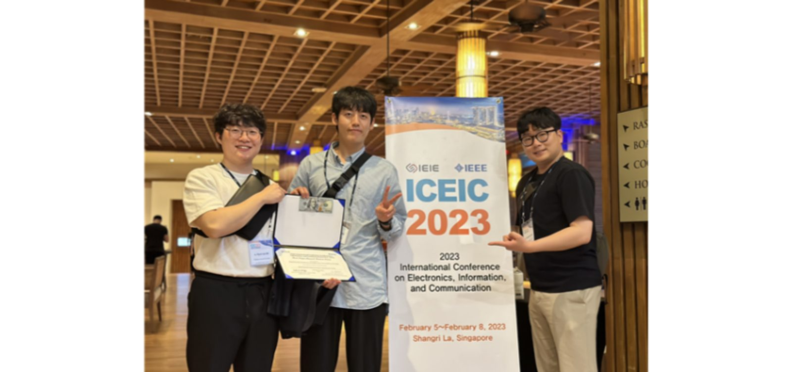
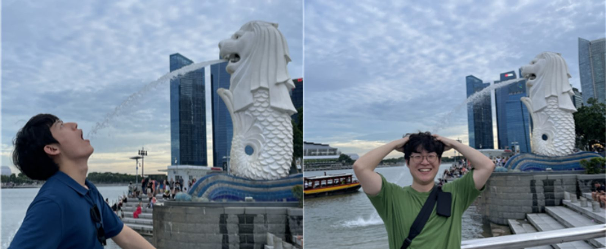
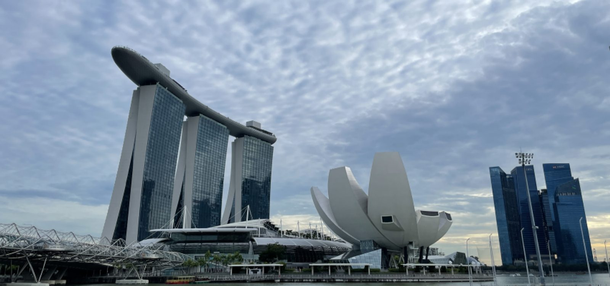

‘공대 수업을 내가 따라갈 수 있을까?’  
휴먼ICT융합전공을 복수전공하기 시작하면서 가장 걱정했던 부분입니다.  
그랬던 제가 공경보 교수님과 정성훈 조교님의 도움으로 생애 첫 논문을  
무려 국제 학회에(!) 제출하게 되었습니다.

그 시작은 2022년 1학기 공경보 교수님의 ‘인공지능미디어기초’ 수업이었습니다.  
한 학기 동안 배운 인공지능 모델을 실제로 활용해보는 것이 기말 프로젝트의 목표였고  
이때 발표했던 프로젝트를 구체화한 것이 논문이 되었습니다.

그렇게 제출한 학회가 바로 International Conference on Electronics, Information, and Communication (ICEIC)입니다.

<figure class="board-fig"></figure>

프로젝트의 내용은 간단히 말해 맞춤법 교정인데요,  
사용자의 글씨체와 비슷한 폰트로 교정해주는 것이 특징이고  
비슷한 폰트를 찾을 때 인공지능 분류기를 활용합니다.

말로만 듣던 인공지능을 실제로 구현해보는 것은 역시나 쉽지 않았습니다.  
단순히 수업 과제물을 목표로 하는 것과 논문 제출을 목표로 하는 것은 분명한 차이가 있었습니다.  
아무래도 논문으로 만들기 위해선 수업 때보다 이론적으로 더 깊은 이해가 필요했고  
인공지능을 구현하고 그것으로 실험까지 해보려면 실제적인 코딩 실력도 필요했습니다.

교수님께서도 이러한 필요를 아시고 여름방학동안  
인공지능 학도라면 꼭 알아야 하는 기초적인 이론들을 차근차근 가르쳐주셨습니다.  
그리고 실제로 모델을 구현하면서 조교님의 도움으로 코딩 실력도 많이 늘었습니다.

본격적으로 논문을 쓸 때 우여곡절도 있었습니다.  
잘 돌아가던 코드가 갑자기 안 돌아간다거나  
급히 자료를 주고받아야 하는데 카카오톡이 먹통이 된다거나…

그렇게 만들어진 논문을 가까스로 제출했고, 몇 주 뒤 Accept 되었다는 메일을 받았습니다.  
이제 고생 끝! 2월에 싱가포르에서 학회가 열린다고 했으니  
오랜만에 해외에 간다는 사실만으로도 은근한 기대에 부풀어있었습니다.

<figure class="board-fig"></figure>

다른 연구자분과 심사위원님 앞에서 발표도 하고

<figure class="board-fig"></figure>

다른 참가자분들 발표도 들으면서 학회 첫날을 보냈습니다.  
그리고 다음 날…

<figure class="board-fig"></figure>

상을 받으리라고는 기대도 하지 않았는데  
하늘이 (많이) 도우셨나봅니다.

*‘공대 수업을 내가 따라갈 수 있을까?’*

으음…. ‘일단은’ 잘 따라간 것 같습니다.  
‘일단은’의 의미는, 결과는 좋았지만, 아직 배울 것이 많다는 의미입니다.

그래서 이번 겨울방학은 코딩 수업도 듣고,  
인공지능 분야에서 중요한 논문들을 위주로 연구실 내에서 세미나도 하고 있습니다.

다음엔 이번 논문에서 사정상 덜어냈던 부분을 보충한 논문을 쓸 계획입니다.  
논문 쓰다가 힘들 때면 이번 학회에 다녀온 추억을 되새기며 힘을 얻을 수 있을 것 같습니다.

<figure class="board-fig"></figure>

정말 많이 가르쳐주시고 좋은 경험 하게 해주신 공경보 교수님,  
늦은 시간까지 저희를 도와주신 정성훈 조교님,  
그리고 함께 고생한 김동훈, 열심히 한 과거의 ‘나’에게  
정말 감사합니다-!

<figure class="board-fig"></figure>
