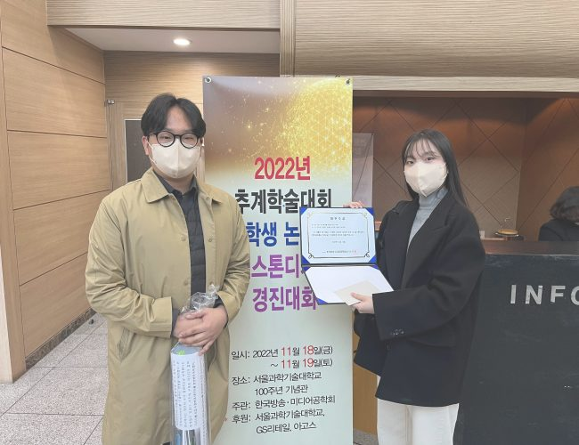
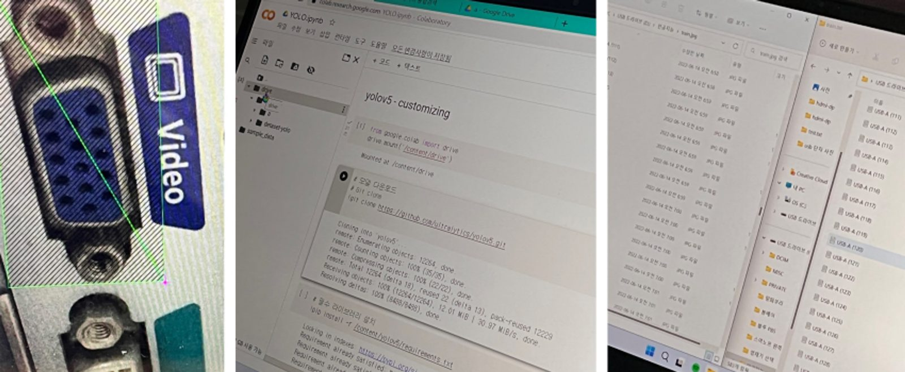
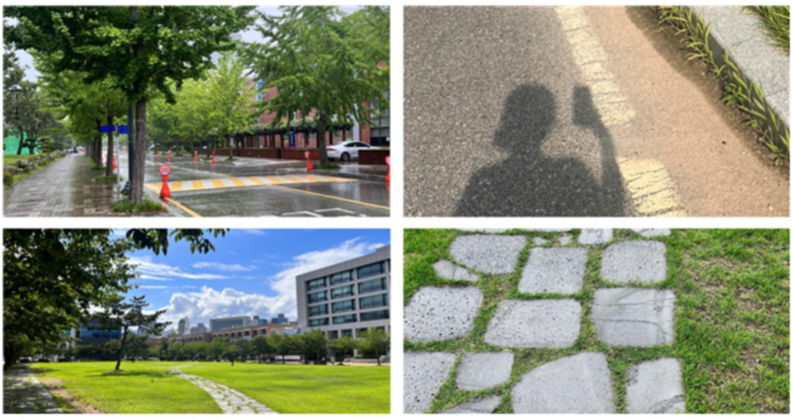
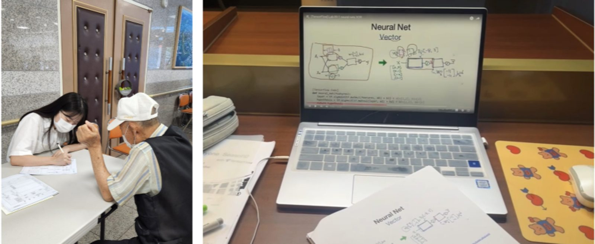
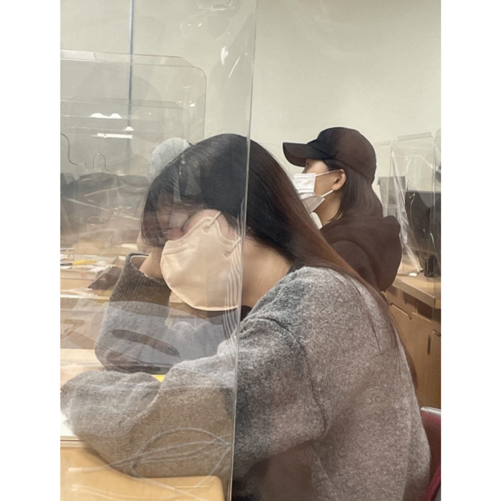
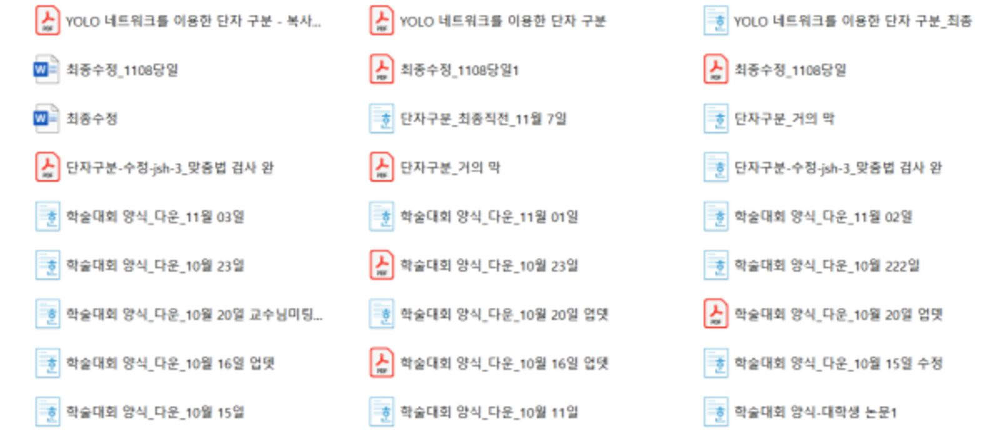
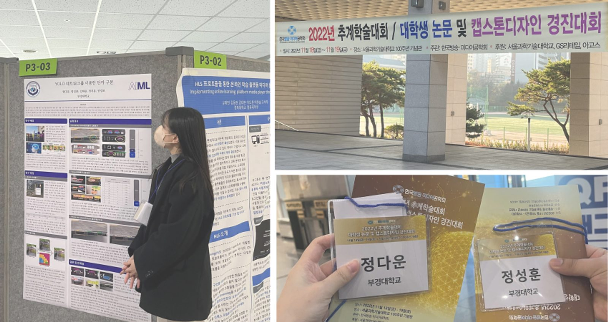
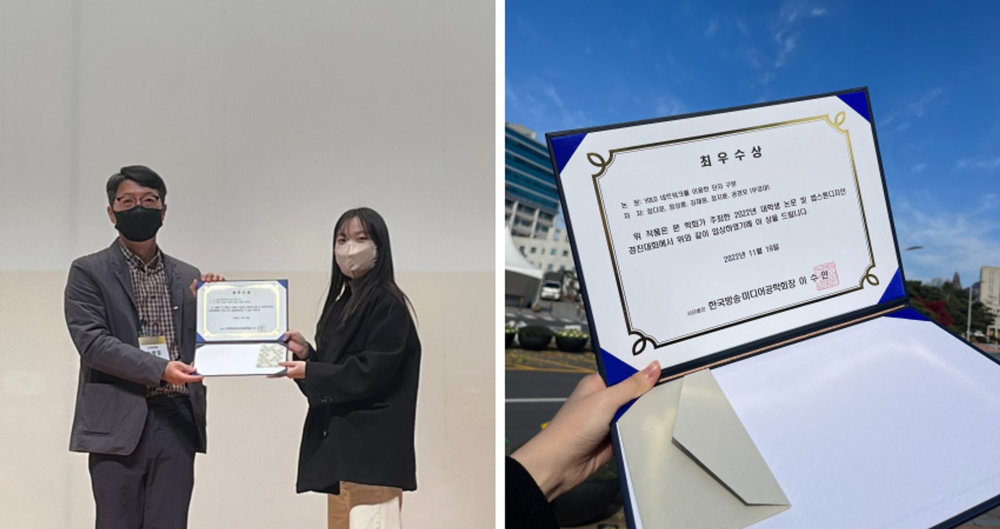

### **한국방송·미디어공학회 최우수상! ㅇ...이게 되네?**

내가 얻은 것: 구글링 실력, 흰 머리, 공학 분야 학회 상장, 좋은 인연..

<figure class="board-fig"></figure>

### **잘 모르고 도전했던 인공지능**

제가 처음 인공지능에 대해 배운 것은 '인공지능미디어기초' 수업 시간이었습니다. 새로운 분야라 도전해 보고 싶었고, 요즘 뜨고 있는 키워드라 수강 계기는 이 분야에 대한 호기심이 8할을 차지했어요. 말 그대로 ‘노베이스’였다고 할 수 있어요.

조원들과 함께 아이디어 회의를 하고 수업 시간에 배운 인공지능 기술들을 활용할 수 있는 곳들을 찾았습니다. 많은 의견 중 '방송 단자 구별'이 조원들 사이에서도 괜찮은 의견이라는 결론이 났습니다. 교수님께서도 '방송 단자를 구별하는 알고리즘'을 짜는 아이디어에 칭찬을 해주셨고, ‘이걸로 논문 써서 학회 가보자’는 말씀을 해주셨습니다.

이때까지만 해도 교수님이 하시는 말씀이 그저 우리를 칭찬해 주시려는 말씀인 줄 알았습니다. 

하여튼!

우리는 일상생활에서 쓰이는 방송 단자들의 사진을 모아 정답 데이터를 입력하는 ‘라벨링’에 착수했고, 이미 구성이 완료된 코드를 활용하여 실험을 진행했습니다. 파일명을 통일해 주는 것부터, 모델 하나를 바꿀 때마다 수정해 주어야 하는 까다로운 코드로 실험 한 번 돌리기는 여간 어려운 일이 아니었습니다. 하지만 이것저것 하나씩 고치고, Shift+Enter(셀 실행)를 딱 눌렀는데 초록 불이 켜지며 돌아가던 그 순간에 큰 희열을 느꼈습니다.

<figure class="board-fig"></figure>

이때 시험공부도 하면서 실험을 진행했어요! epoch도, 모델 사이즈도 변경해가면서 어떤 최적의 결과를 이끌어내기 위해 계속 실험을 이어나가고 결과를 기록했던 기억이 납니다!

### **새로운 재미를 알게 된 여름**

학기 중에는 완성된 알고리즘으로 데이터셋과 파일명만 손보며 실험을 했다면 7월 한 달 동안은 파이썬으로 딥러닝을 어떻게 구현하는지 배우기 시작했습니다.

<figure class="board-fig"><figcaption markdown="span">비가 오나 눈이 오나 열심히 출근하며 공부하러 다녔던 것 같아요.</figcaption></figure>

강의를 듣고 공부한 상태로, 매주 교수님과 미팅하면서 부족한 부분을 채웠습니다. 새로운 분야이기도 하고 어려워서 이해할 때 어려움을 겪었지만 마음은 즐거웠습니다.

이해가 안 되는 부분이 있으면 교수님께서 몇 번이고 설명해주셨어요. 봉사활동을 하러 울산에 갔을 때도 밤엔 강의를 들으며 공부하고, 놀러 가서도 밤엔 시간을 쪼개어 공부했던 기억이 납니다.

<figure class="board-fig"></figure>

사실 수식도 너무 어렵게 생겼고, 이해하는 데에도 너무 오랜 시간이 걸렸습니다. 들었던 부분을 또 듣고, 멈췄다가 또 듣고를 반복했었습니다. 너무 오랜 시간이 걸려서 좌절할 때도 있었지만 교수님께서 처음 배우는 것이니 어려운 게 당연하다는 말씀을 해주셨어요!

### **될 때까지 한다.**

그렇게 텐서플로우 기반에서 딥러닝을 파이썬으로 구현하는 방법을 배운 뒤 학기 중 진행했던 팀 프로젝트를 논문으로 발전시키기 위해 실험을 진행했습니다. 

YOLOv4로 실험을 진행하기 위해 구글링하여 친절한 설명이 있는 곳을 찾아 코드를 짜기 시작했습니다. 이때 교수님, 조교님께서 많은 도움 주셨습니다. 

YOLOv4에서 Darknet framework로 실험을 거의 한 달간 진행했습니다. wow 진짜 실험 한 번 돌리기가 너무 힘들었습니다. 

사실 힘들다는 말로는 다 표현할 수 없었어요. 이때 성훈 조교님도 함께 고생 많이 해주셨습니다. ~~이 실험을 진행하면서 흰 머리가 하나 났습니다. 저에겐 얼마나 힘들었는지 가늠이 가실까요. 큰 도전이었습니다.~~

셀 하나를 실행시키는 데에도 너무 오랜 시간이 걸렸고, 열심히 했는데도 이렇다 할 성과가 보이지 않아 낙담했습니다.

심지어

zip파일 압축 해제하는 데만 하루를 통째로 사용한 날도 있었습니다. 실험 성공의 기미가 보이지 않았습니다. 

초반에 시간을 많이 써서 힘이 빠졌지만, 중간쯤 갔을 땐 오기가 생겨버려서 끈질기게 매달렸습니다. 그렇게 한 달이 지났습니다. 성공은 못 했습니다.

실험 진행 중이던 Darknet framework가 원래 실험이 힘들기로 악명이 높다고 하셨어요. 그래서 모든 걸 다 리셋하고, 다시 다른 방법으로 시작했습니다. 조금 더 난이도를 낮춰 시도했더니 조금은 순조로워졌습니다. 그래도 쉽지 않았지만 끝까지 두드리고 시도하여 끝내 성공해냈습니다.

> **중요한 건 꺾이지 않는 마음**

근데 막 기쁘다기보단 그토록 원하던 것이 되기 시작하니까 얼떨떨했습니다. 살면서 이렇게 하나에 끈질기게 매달려본 적이 또 있나 싶어요.

### **이제 내가 잘 하는 것!**

그렇게 실험결과를 가지고 글을 쓰기 시작했습니다. 저는 글의 전체 틀을 다 잡고 나서 글을 써내려간 후, 몇 번이고 고칩니다. 군더더기 없는 글을 쓰는 게 저의 목표였습니다!

해당 표현을 쓰는 것이 맞는지 사실 확인을 하고 써야 해서 검색도 많이 하고 다른 사람의 논문을 참고하기도 했습니다.

글을 써서 갈 때마다 교수님께서 글을 잘 쓴다고 칭찬해 주셨습니다. 조교님께서도 “오 진짜 네가 쓴거야?”하시면서 극찬을 해주셨습니다. 이런 표현을 쓰면 더 좋다는 조언까지 해주셨습니다! 최고! 논문에 쓰기에 어색한 표현을 고쳐주셨습니다.

자신감이 붙어 글을 쓰는 데에 박차를 가했습니다. 실험결과를 표로 구성하고, 제가 실험했던 네트워크를 글로 설명했습니다. 밤늦게 글을 써야 잘 나오기 때문에 매번 늦게 자서 수업 중 쉬는 시간에 잠을 보충하곤 했습니다.

<figure class="board-fig"></figure>

그렇게 여러 번의 수정 끝에 글이 완성됐고, 제출했습니다.

<figure class="board-fig"></figure>

### **학회 당일. 상‘안’받을 뻔한 썰 푼다.**

26팀 정도가 제출했었는데, 11팀이 포스터 세션에서 발표를 할 수 있게 됐습니다. 그중에 저도 있었구요! 포스터를 며칠 밤을 새워 만들고, 조교님과 함께 인쇄도 맡겼습니다.

서울 과기대에서 방송·미디어공학회 학술대회가 열렸습니다. 새벽같이 나와 조교님과 서울로 향했습니다.

포스터 세션에 포스터를 잘 붙여두고 맥모닝을 먹으러 나갔습니다. 다시 돌아왔을 땐 많은 학생이 거의 와 있었는데 다들 전자 공학과, 컴퓨터 공학부 등 공학 계열을 전공한 학생들이었습니다.

<figure class="board-fig"></figure>

포스터도 제 것과는 다르게 글보다 그림이 더 많았고 다들 똑똑해 보였습니다. 그런데 우리가 만든 포스터도 절대 꿀리지 않았습니다. 열심히 교수님, 조교님과 함께 만들어낸 결과라 자부심이 있었습니다.

공대생들 사이에서 미디어커뮤니케이션학부가 저 혼자라 잠시 의기소침해졌지만 금방 자신감을 되찾아 발표했습니다. 좌장님께서 갑자기 시키신 발표에 떨지 않고 발표한 것만 해도 다행이었습니다. 좌장님의 질문에도 당황하지 않고 대답하여 성훈 조교님께서 제가 제일 잘했다고 칭찬해 주셨습니다!

저보다 뒤 순서인 학생들의 발표도 듣는데 참 다들 설명도 잘하고 비범해 보였습니다. 아이디어들이 다들 재밌고, 저와 같은 YOLO 네트워크를 사용한 실험도 재밌게 봤습니다. 발표 준비를 다들 해온 듯 깔끔하게 잘 하더라구요!

포스터 세션 시간이 끝나고, 점심은 뭐먹지~ 하면서 짐들을 챙겨 밖으로 나왔습니다. 뒤에 시상식이 있었지만 어차피 상은 기대도 안 했기에 시상식에 참석하지 않을 생각이었습니다.

건물에서 나와 5분 정도 걸었을까요, 성훈 조교님께서 그래도 시상식은 보고 가자고 하셔서 다시 발걸음을 돌려 대강당으로 향했습니다.

점심은 뭘 먹으러 갈지 검색해보고 있는 와중, 우수상부터 시상이 시작되었습니다. 솔직히 조금은 기대했으나 이름이 불리지 않았습니다. 우수상 아니면 불릴 일이 없다고 생각했습니다. 게다가 우수상 세 팀중 포스터 발표 때 제 양옆에 있던 두 팀이 우수상을 받았습니다. 잘한 팀이었습니다. 그래도 최소 장려상은 확보했으니 다행이다 싶었습니다. 이름이 불리지 않은 학생은 자동으로 장려상이라고 하더라구요!

열심히 박수쳤습니다. 최우수상 두팀 발표를 하는 와중에 맨 위에 

> ‘YOLO 네트워크를 이용한 단자 구분 / 정다운, 정성훈, 김재윤, 정지훈, 공경보 (부경대)’

저희 이름이 떴습니다. 얼른 뛰어나가 상을 받고 얼떨떨하게 악수도 하고 사진도 찍었습니다.

<figure class="board-fig"></figure>

기분이 날아갈 것만 같았습니다. 나오면서도 얼떨떨하고 기분이 벅차올라서 조교님과 한참 떠들었던 기억이 납니다.

조교님께서 밥도 사주셨습니다! 힘들었던 시간은 하나도 생각나지 않고 고생에 대한 보상이 너무 과한 것 같기도 했습니다.

### **중요한 건 꺾이지 않는 마음!**

한 가지에 이렇게 매달려 본 일이 손에 꼽을 정도로 적은데, 이번 일을 계기로 끈기의 힘이 얼마나 강한지 배우게 됐습니다. 게다가 결과까지 좋아서 함께 고생해주신 조교님과 교수님께서도 기쁘실 것 같아 다행이었습니다. 인공지능에 대해서 전혀 몰랐던 저를 인내심을 갖고 이끌어주셨던 공경보 교수님께 정말 감사드립니다.

또한, 옆에서 저의 궁금증을 풀어주시고 귀찮을 수 있는 데도 항상 친절하게 알려주시고 해결 방법을 함께 강구해주신 정성훈 조교님께도 감사드립니다!
