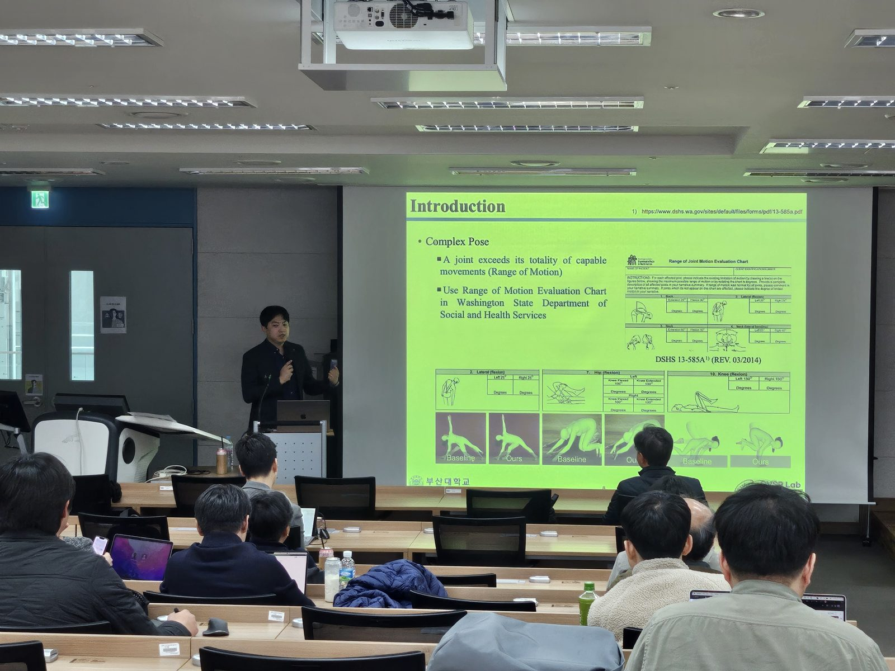
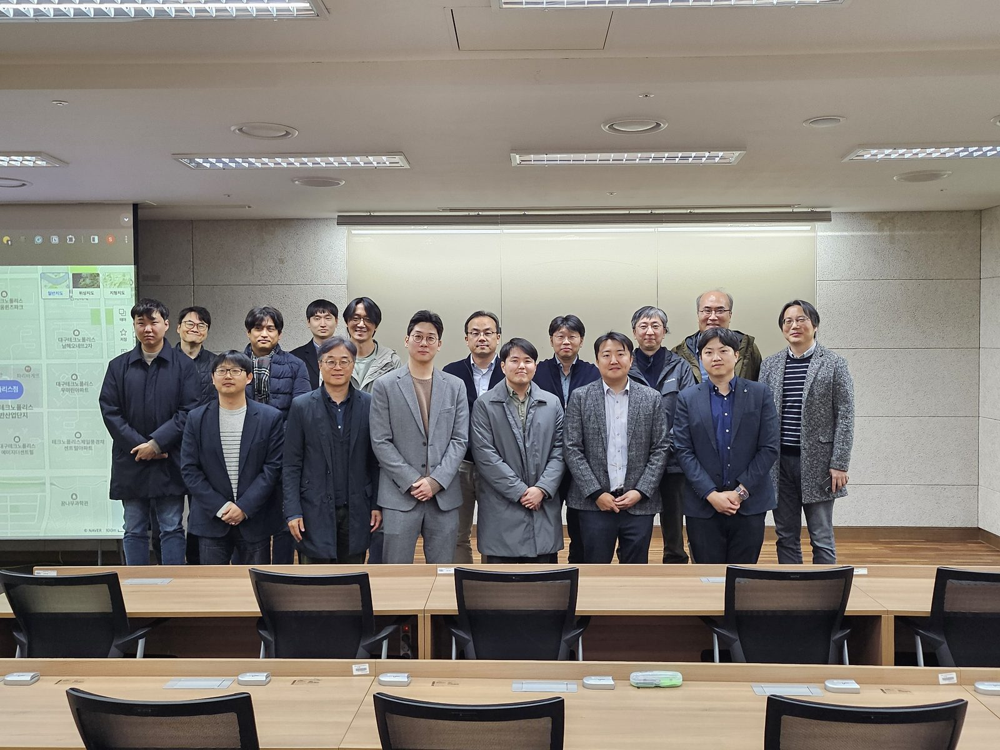

<figure class="board-fig"><figcaption markdown="span">발표주제: Complex Human Pose Estimation and Its Application</figcaption></figure>

<figure class="board-fig"></figure>

<figure class="board-fig"></figure>
