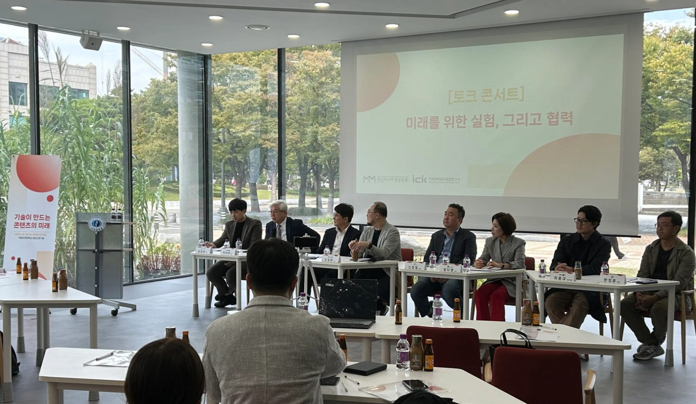
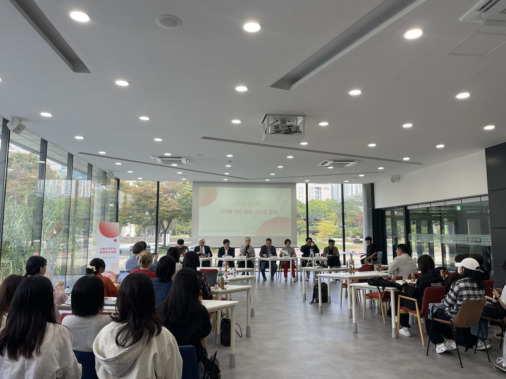
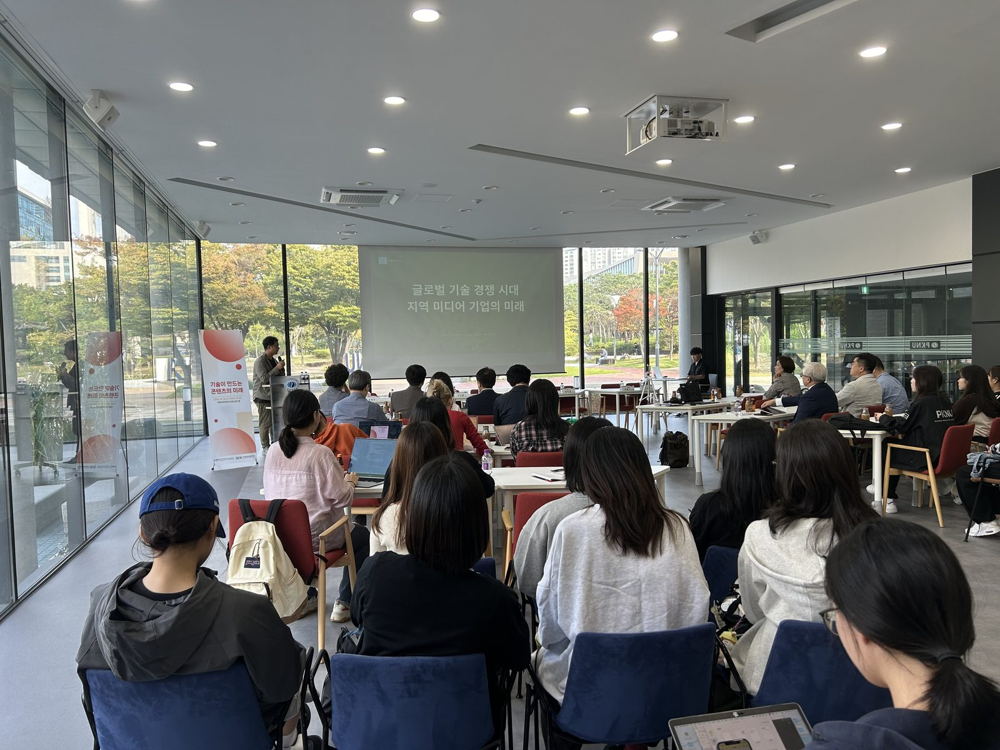
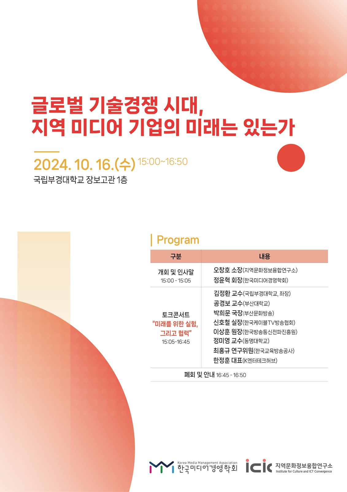

10월 16일 열린 “미래를 위한 실험, 그리고 협력” 토크 콘서트(Title of seminar: 글로벌 기술경쟁 시대, 지역 미디어 기업의 미래는 있는가)에 공경보 교수님께서 패널로 참석하셨습니다.

<figure class="board-fig"></figure>

<figure class="board-fig"></figure>

<figure class="board-fig"></figure>

<figure class="board-fig"></figure>
