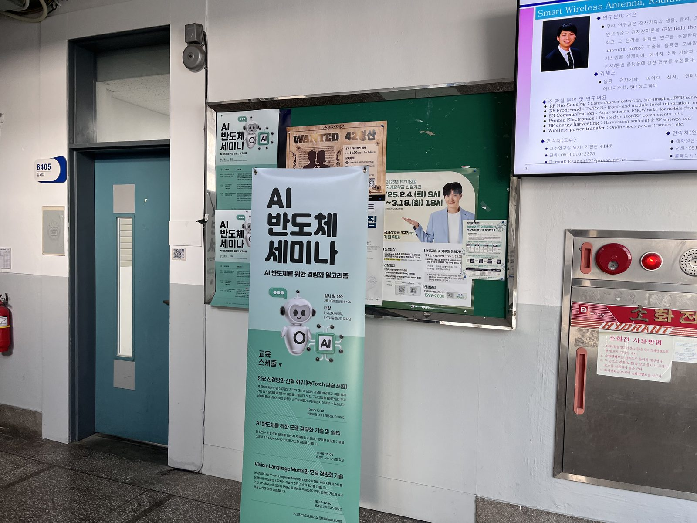
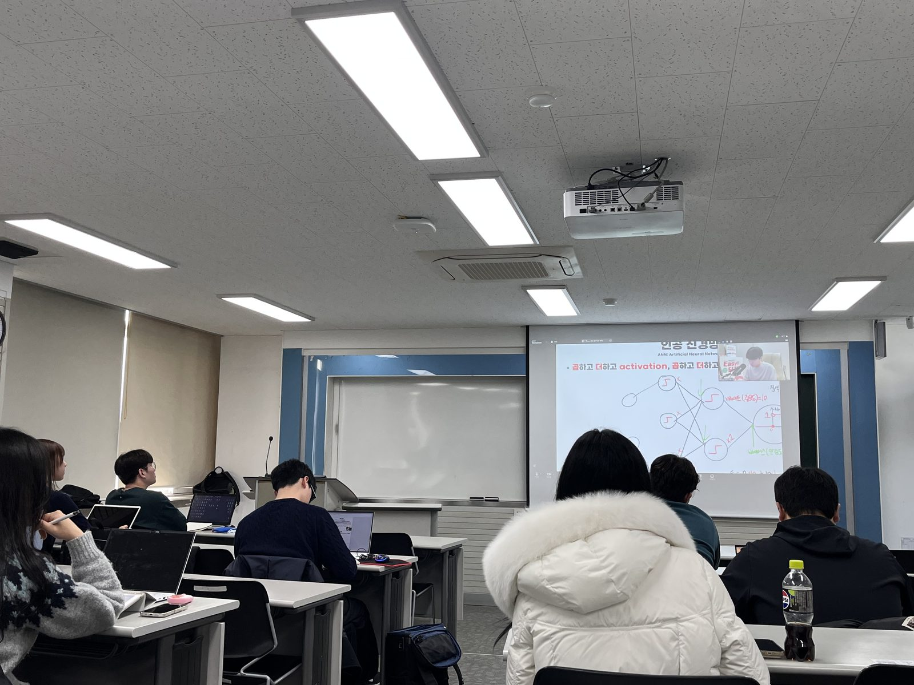
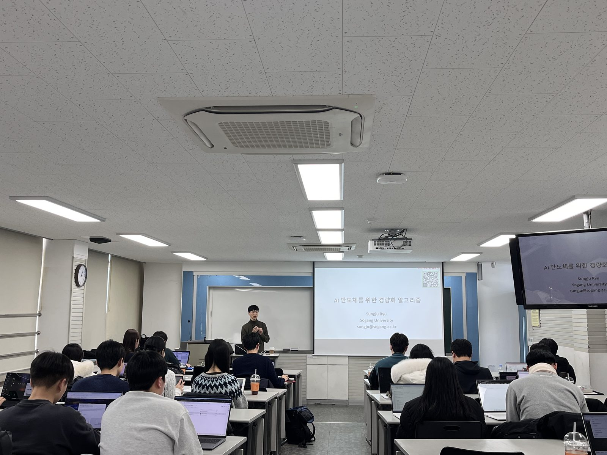
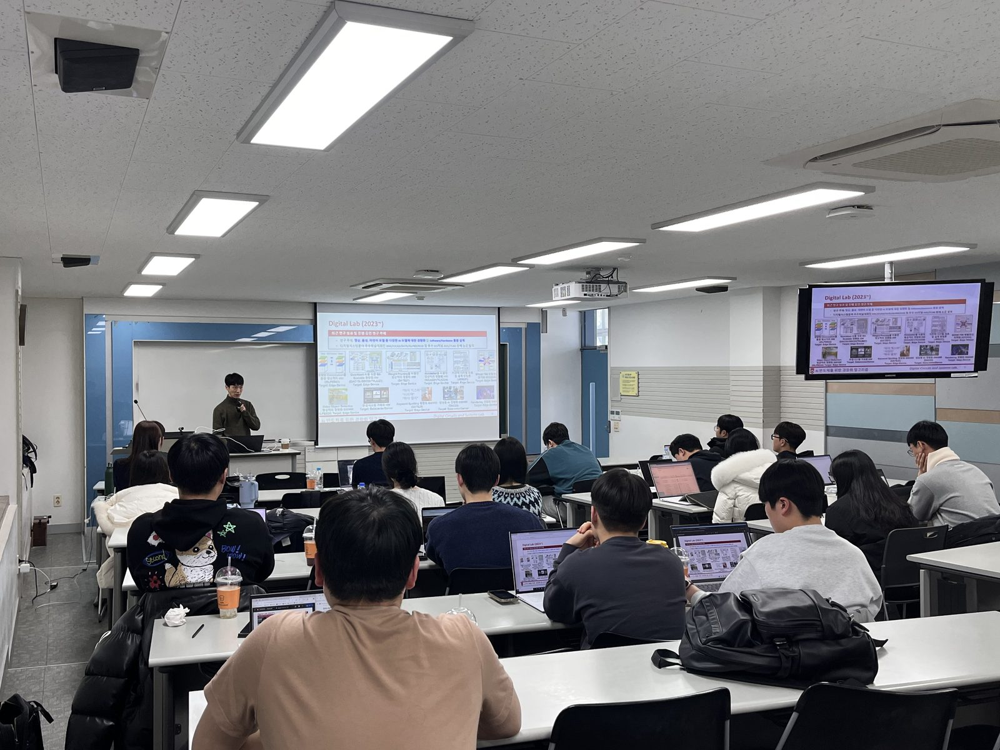
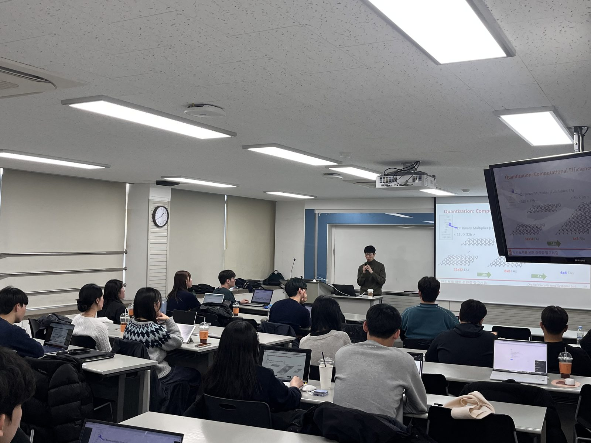
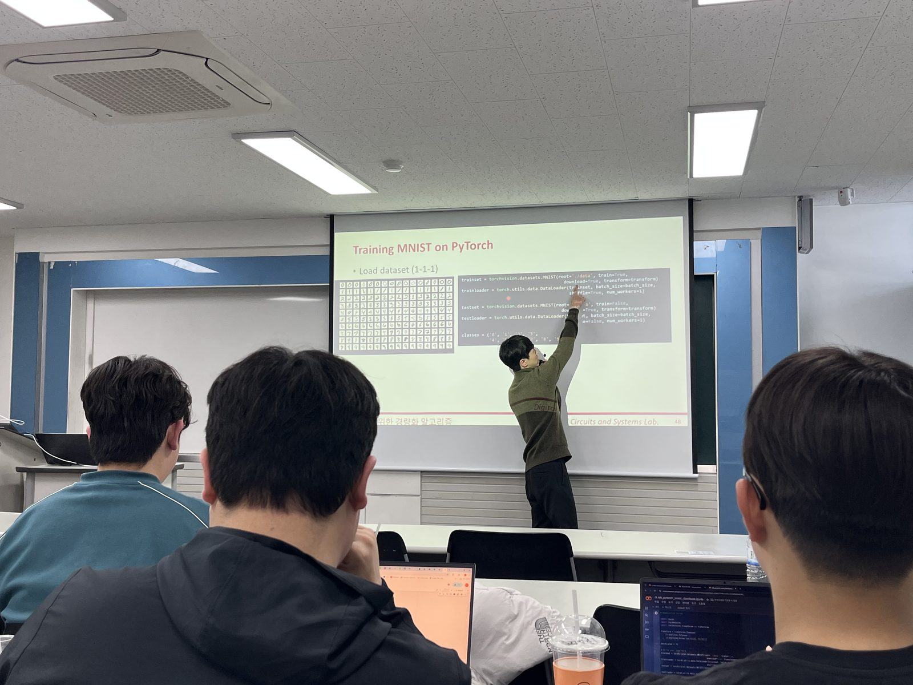
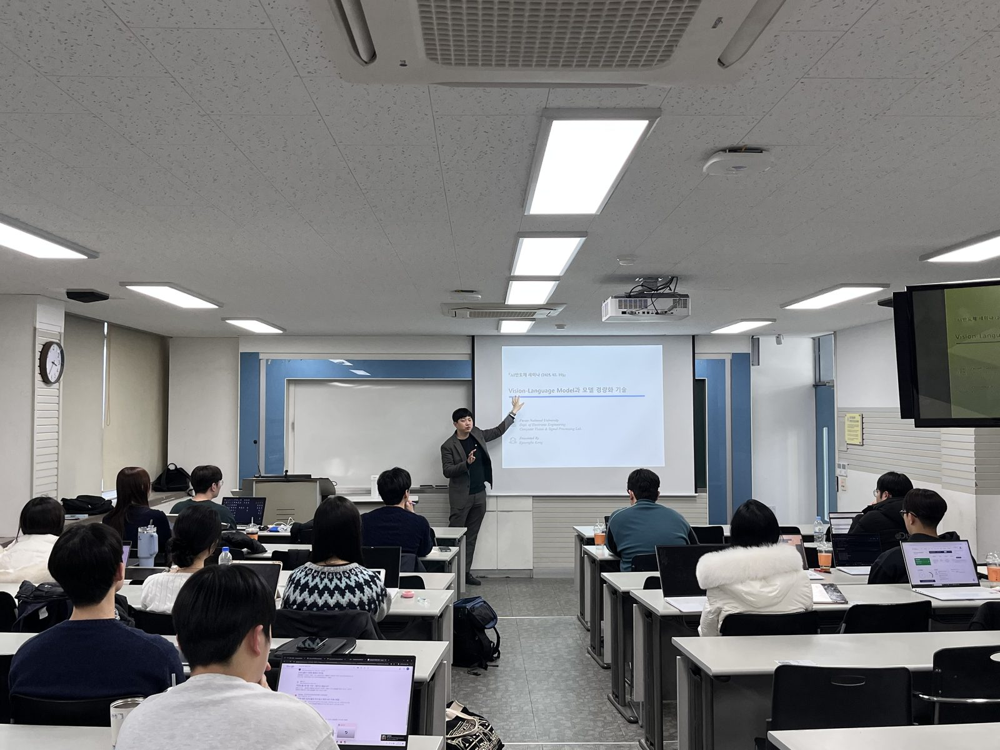
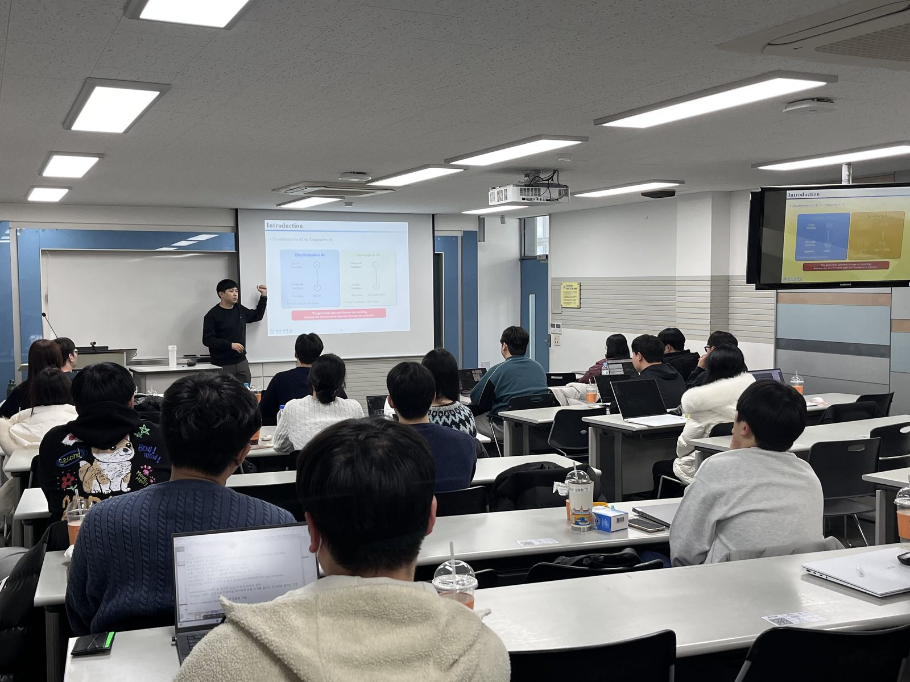

2월 10일 월요일 10시부터 5시 30분까지 항공관 8405에서 AI반도체를 위한 경량화 알고리즘 특강이 열렸습니다. 

1교시는 인공 신경망과 선형회귀(PyTorch 실습)라는 주제로 혁펜하임 아카데미의 혁펜하임 대표님께서 강의해주셨습니다. 2교시는 AI 반도체를 위한 모델 경량화 기술 및 실습을 주제로 서강대학교 류성주 교수님께서 강의해주셨습니다. 마지막 교시는 Vision-Language Model과 모델 경량화 기술에 대한 내용을 부산대학교 공경보 교수님께서 강의하셨습니다.

<figure class="board-fig"></figure>

<figure class="board-fig"><figcaption>1교시: 인공 신경망과 선형회귀(PyTorch 실습) - 혁펜하임 아카데미 혁펜하임 대표님</figcaption></figure>

<figure class="board-fig"><figcaption>2교시: AI 반도체를 위한 모델 경량화 기술 및 실습 - 서강대학교 류성주 교수님</figcaption></figure>

<figure class="board-fig"></figure>

<figure class="board-fig"></figure>

<figure class="board-fig"></figure>

<figure class="board-fig"><figcaption>3교시 : Vision-Language Model과 모델 경량화 기술 - 부산대학교 공경보 교수님</figcaption></figure>

<figure class="board-fig"></figure>
