올해 전자공학과에서 주최하는 \[전자인의 날\]을 맞아 오픈랩 행사를 성공적으로 마쳤습니다. 이날 연구실은 찾아온 학부생들에게 우리 연구 분야에 대해 소개하는 시간을 가졌습니다. 또한 학부연구생 김소현 학생이 공학종합설계과제 전시 포스터 발표를 진행하여 다같이 응원하러 다녀왔습니다.

행사 준비부터 마무리까지 열정적으로 참여하고 고생해주신 모든 학생분들의 협조에 진심으로 감사드립니다.

<figure class="board-fig">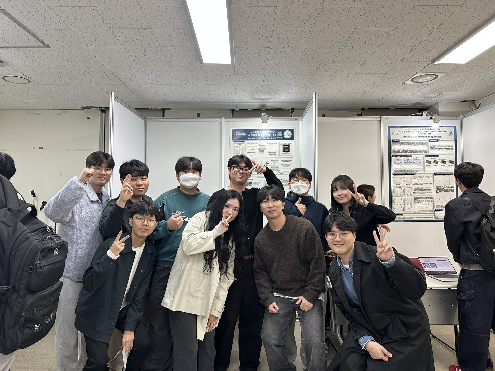</figure>

<figure class="board-fig">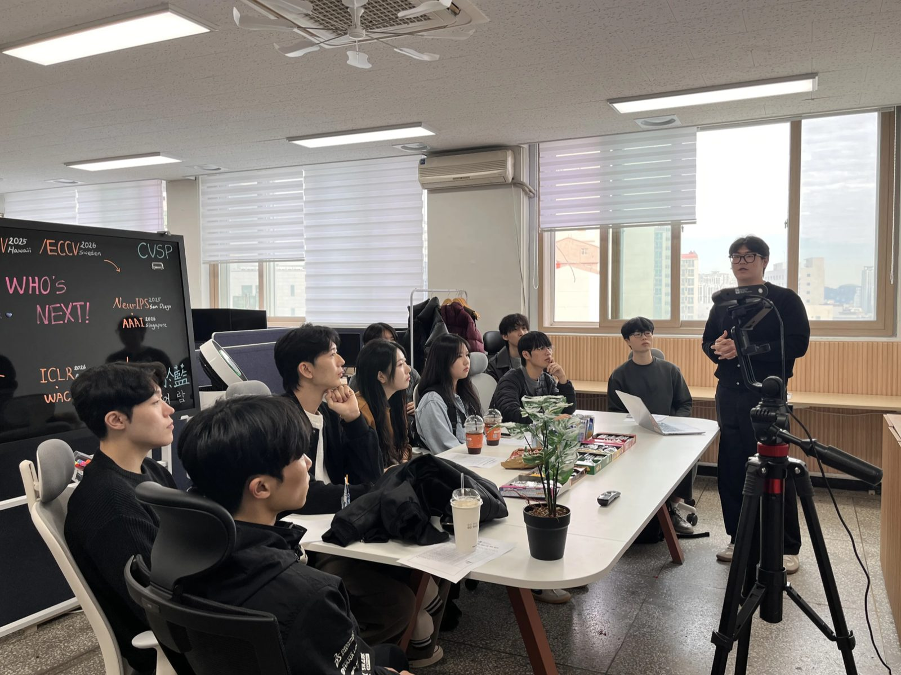</figure>

<figure class="board-fig">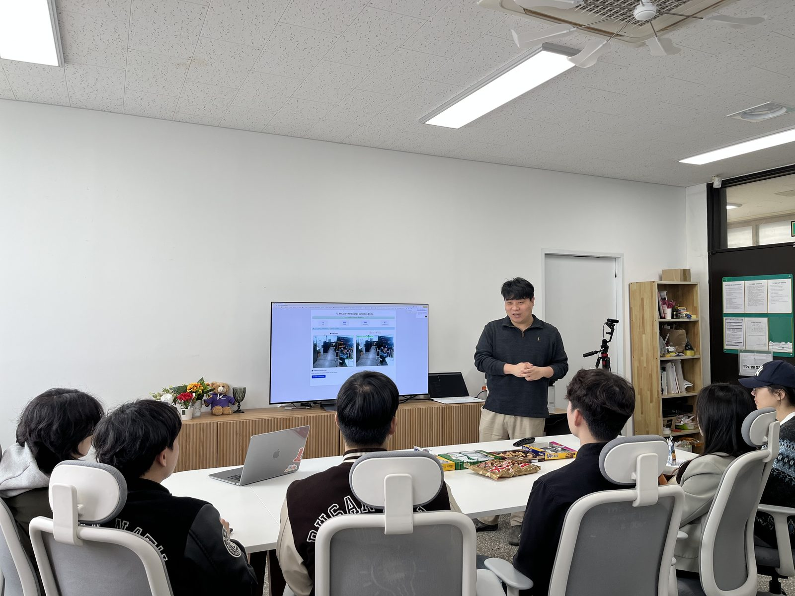</figure>

<figure class="board-fig">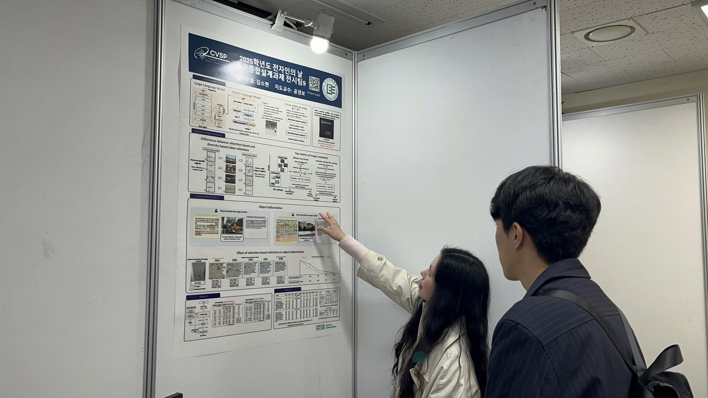</figure>

<figure class="board-fig">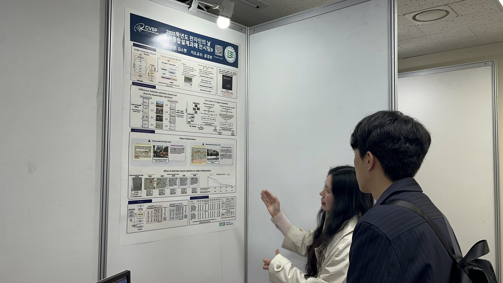</figure>

<figure class="board-fig">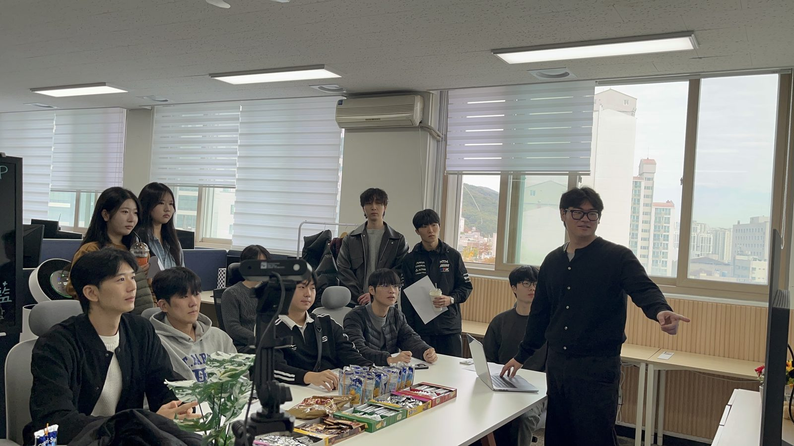</figure>

<figure class="board-fig">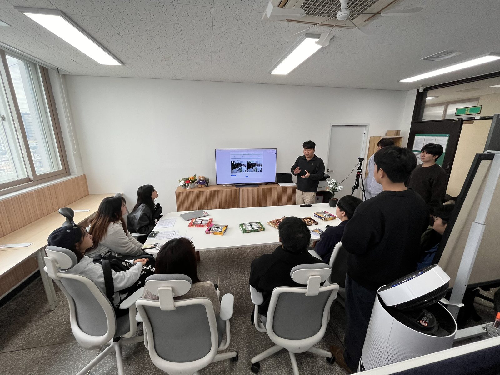</figure>

<figure class="board-fig">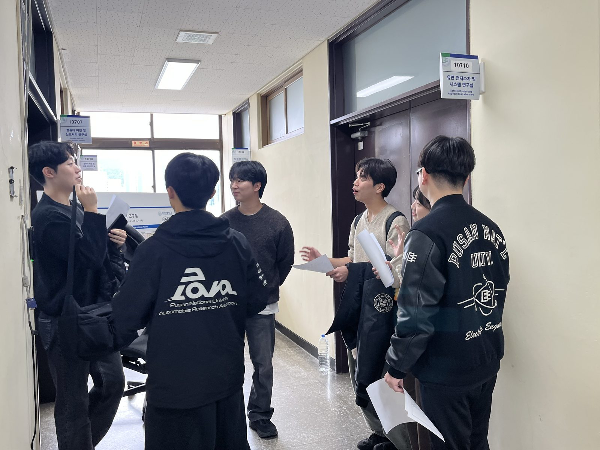</figure>

<figure class="board-fig">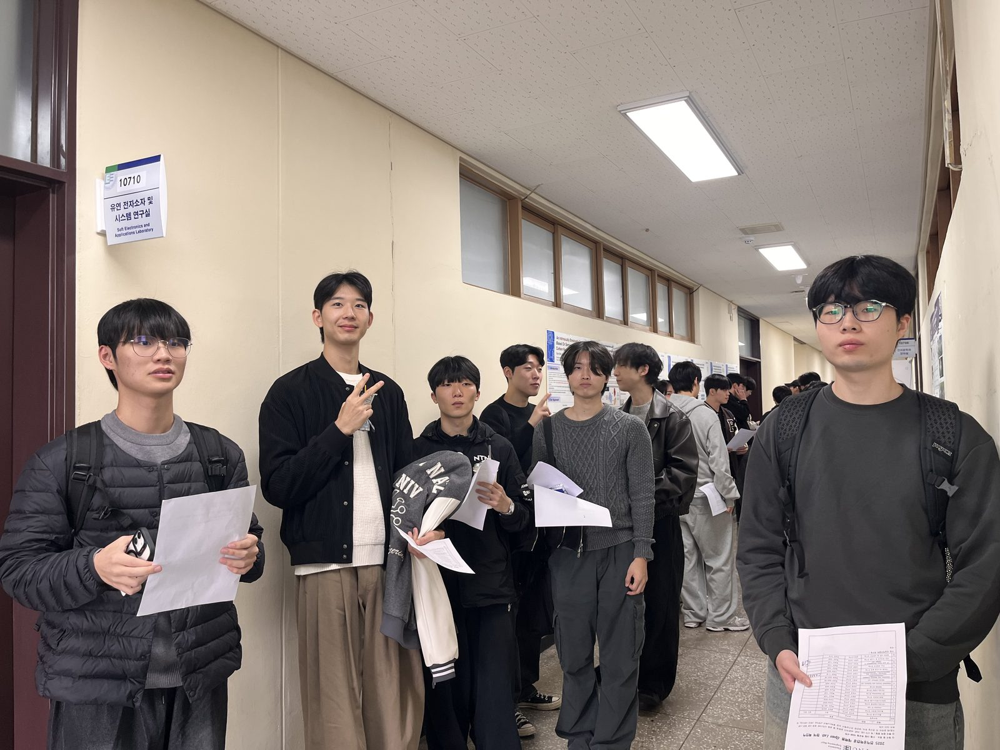</figure>

<figure class="board-fig">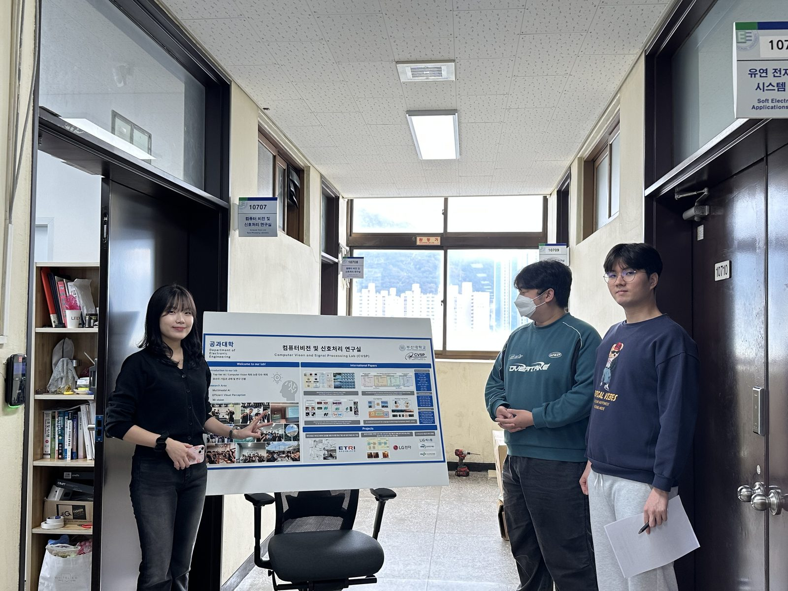</figure>

<figure class="board-fig">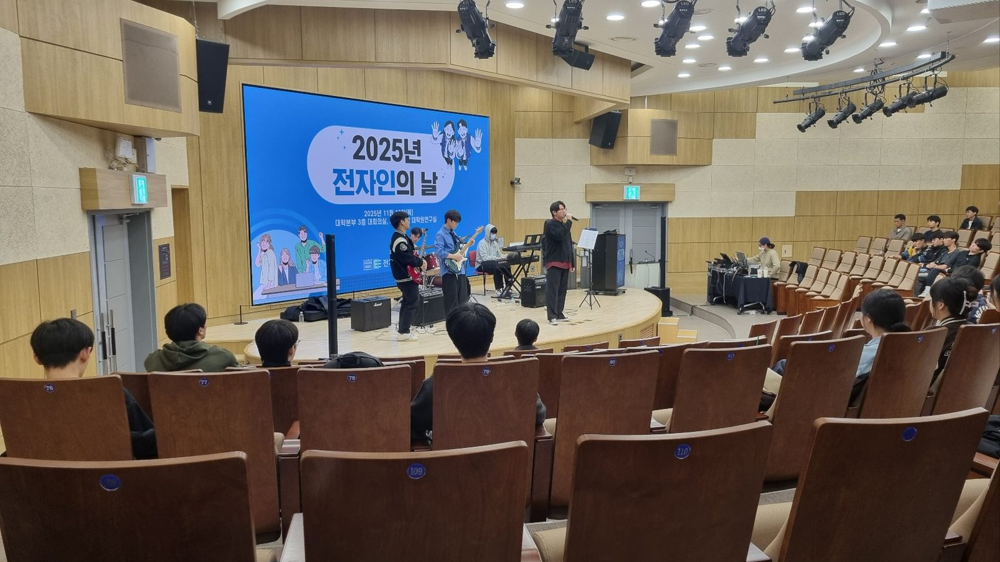<figcaption markdown="span">범권이 공연!</figcaption></figure>
