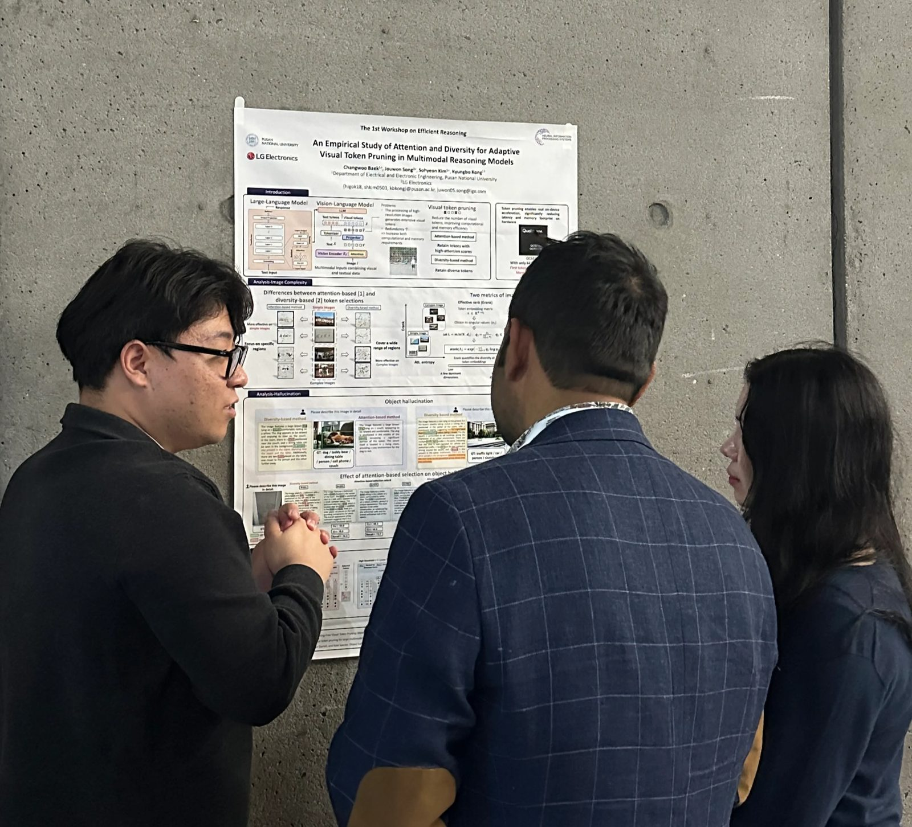
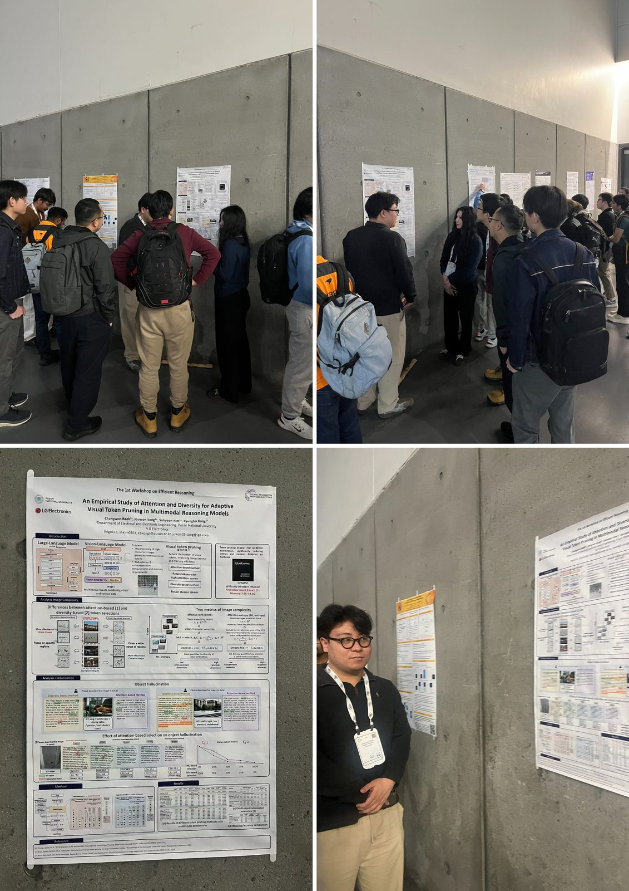
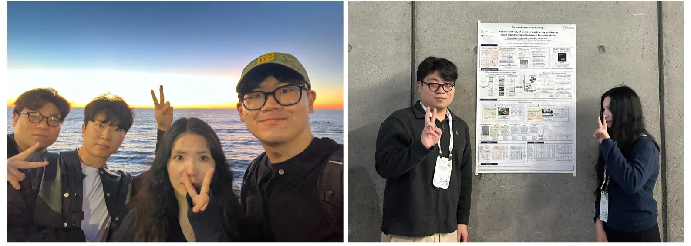
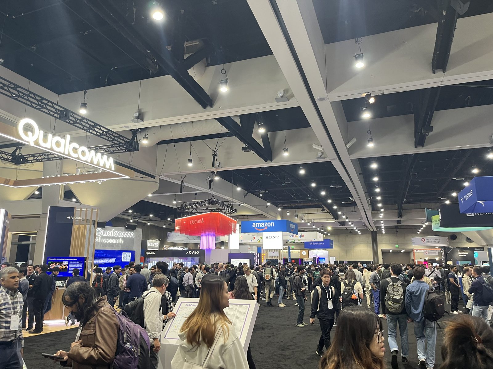
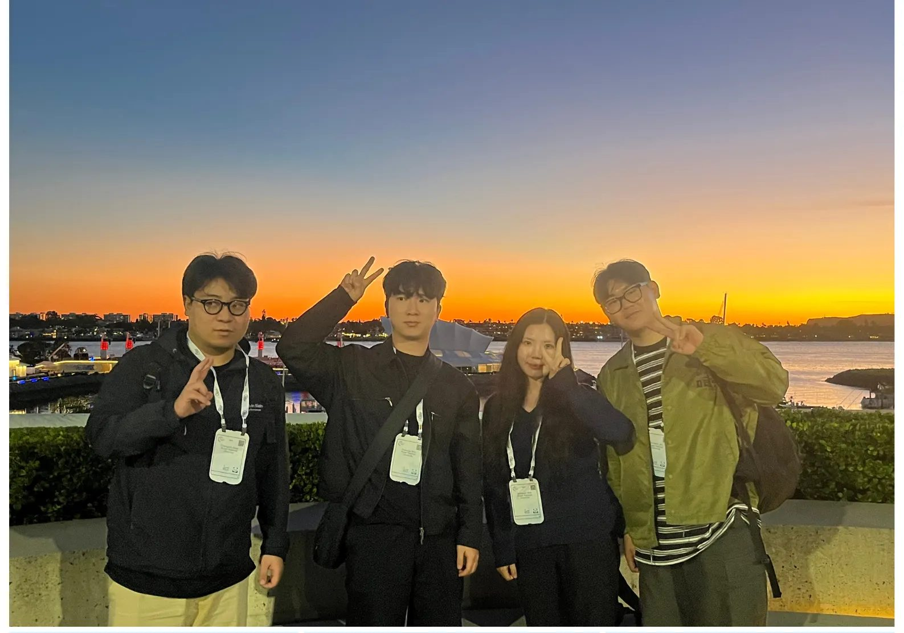
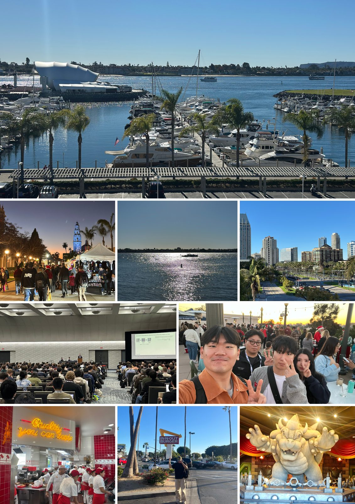
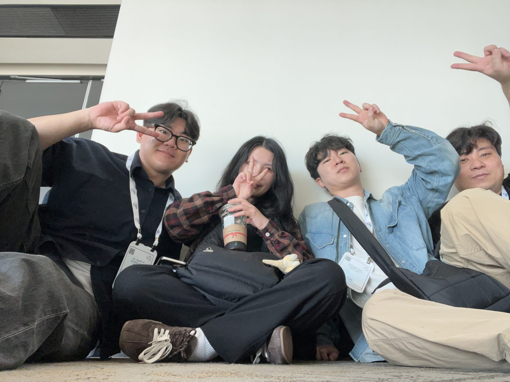
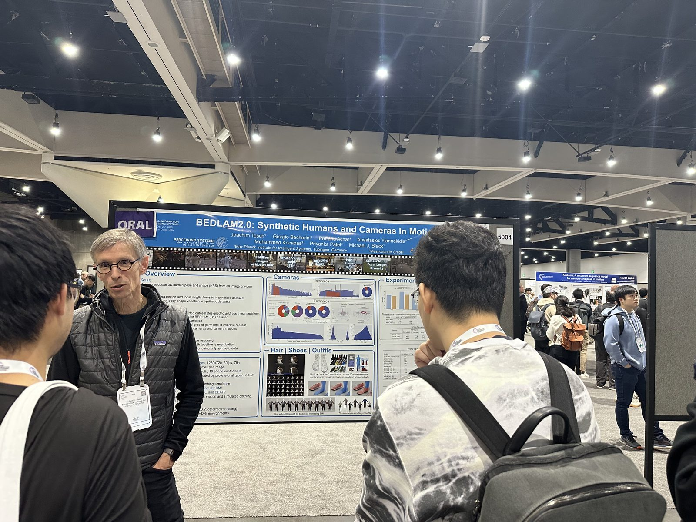
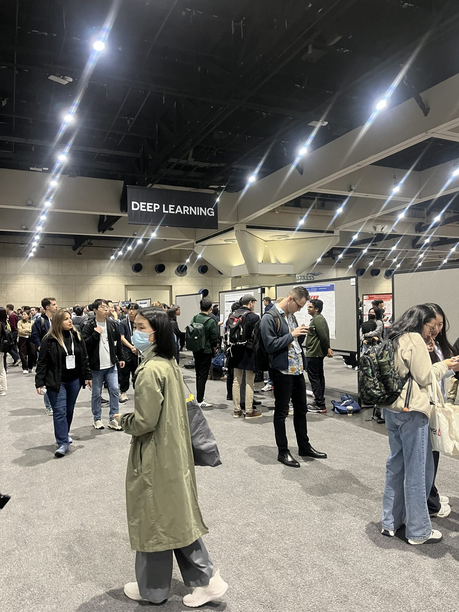

지난 12월 우리 연구실 백창우(석사과정), 김소현(학부연구생), 진인환(석사과정), 문형주(석사과정) 학생이 미국 San Diego에서 열린 NeurIPS 2025에 참석하여 다양한 연구들을 접하고 왔습니다.

특히 백창우, 김소현 학생은 NeurIPS workshop에 accept되어 poster session 발표를 마치고 돌아왔습니다.

<figure class="board-fig"></figure>

<figure class="board-fig"></figure>

<figure class="board-fig"><figcaption markdown="span">LA 해변 산타모니카</figcaption></figure>

<figure class="board-fig"></figure>

<figure class="board-fig"></figure>

<figure class="board-fig"></figure>

<figure class="board-fig"></figure>

<figure class="board-fig"></figure>

<figure class="board-fig"></figure>

