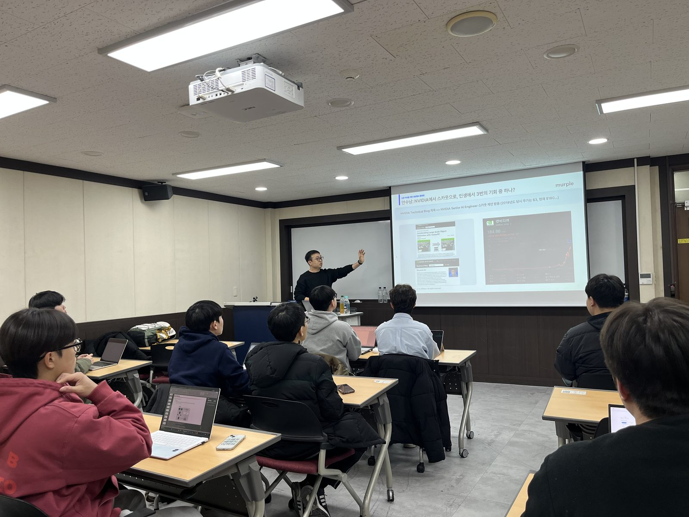
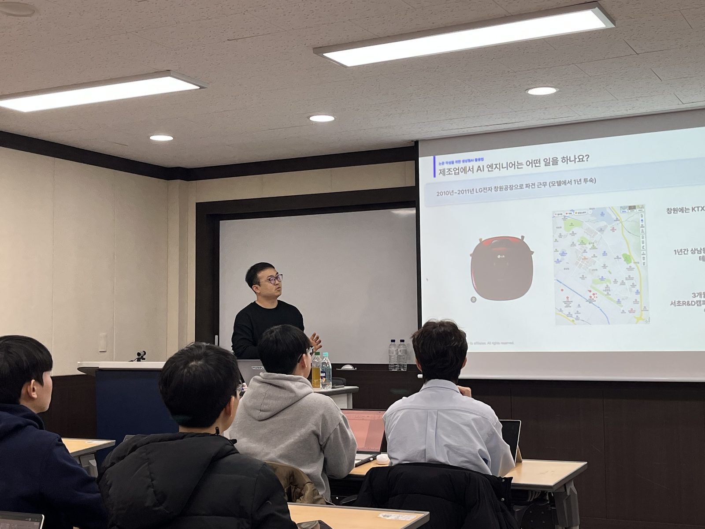

**[BK21 전문가 초청 세미나]** 1월 14일, 공경보 교수님께서 초청하신 머플 주식회사 안수남 대표님의 세미나가 진행됐습니다. 세미나에 우리 연구실 학생들이 참석하여 ‘AI를 활용한 좋은 논문 작성법’에 대해 깊이 있게 배우는 시간을 가졌습니다.

안수남 대표님은 AI·머신러닝 분야 국제 학회의 최신 동향부터 연구 주제 발굴, 체계적인 연구 설계 전략까지 아낌없이 전수해 주셨습니다. 특히 상위권 학회 투고를 위한 실험 설계와 연구 기여 정리, 논문 구성 등 실전 노하우를 직접 들을 수 있어 우리 연구실 학생들에게 정말 큰 동기부여가 된 유익한 시간이었습니다.

<figure class="board-fig"></figure>

<figure class="board-fig"></figure>
