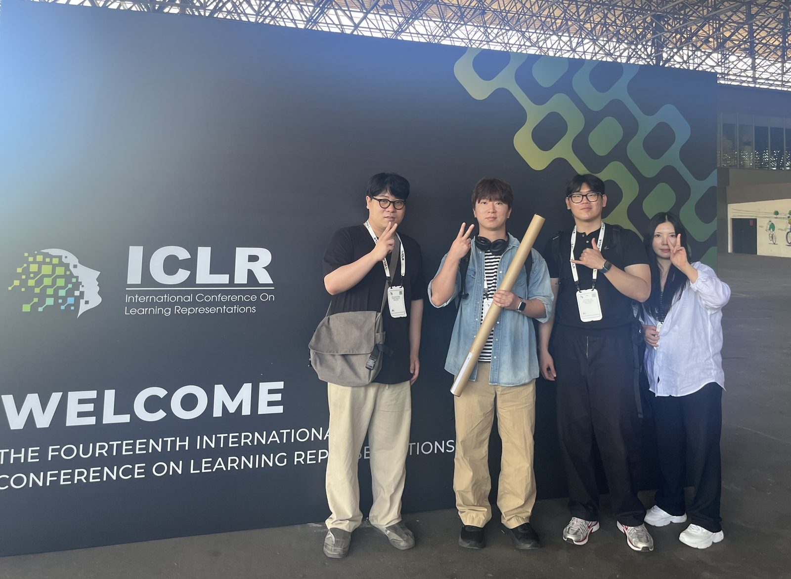
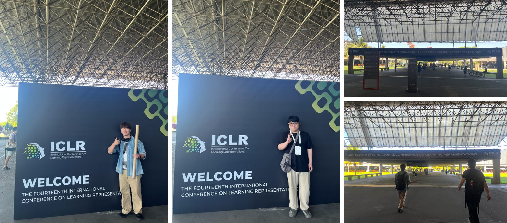
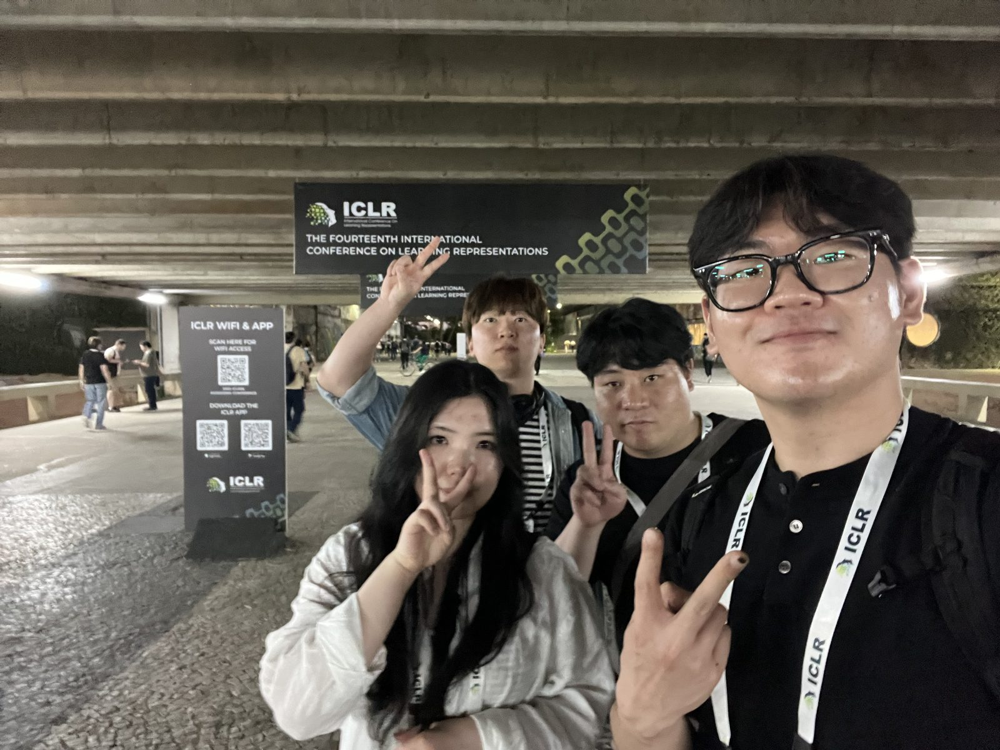
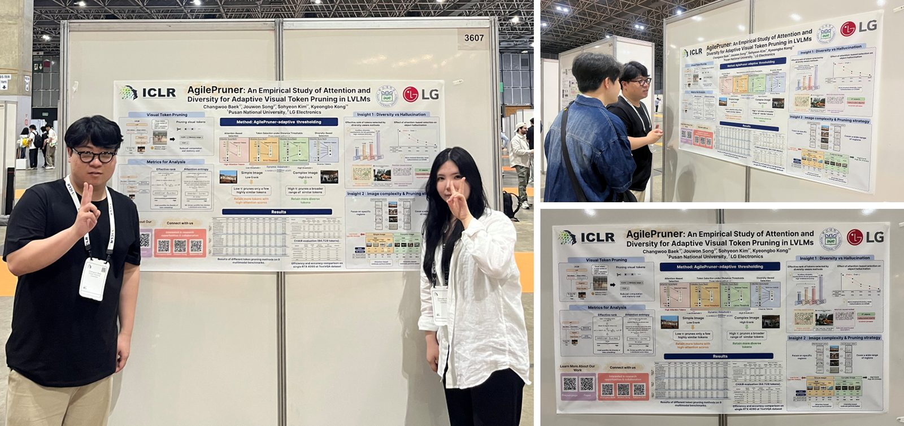
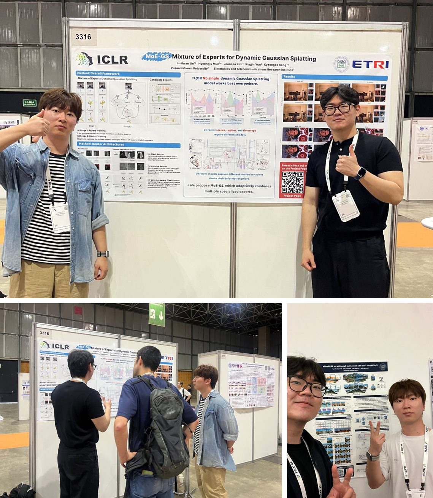
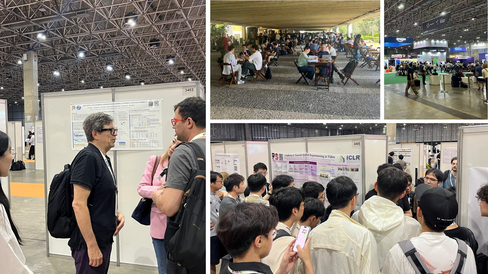
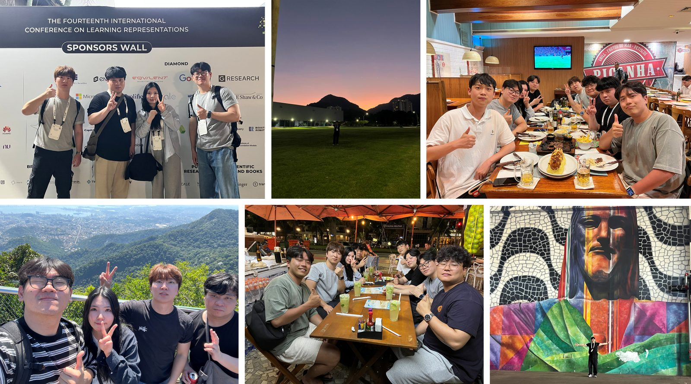

지난 4월 CVSP 연구실의 **백창우**(석사과정) **진인환**(석사과정) **문형주**(석사과정) **김소현**(석사과정) 학생이 브라질 리우데자네이루에서 개최된 2026 ICLR에 참석하여, 최신 연구 동향을 파악하고 다양한 글로벌 학술 교류를 진행하고 왔습니다. 이번 학회에서 백창우·김소현 학생은 'AgilePruner'를 , 진인환·문형주 학생은 'MoE-GS'를 포스터 세션에서 발표하며 전 세계 연구자들의 큰 관심을 받았습니다.

<figure class="board-fig"></figure>

<figure class="board-fig"></figure>

<figure class="board-fig"></figure>

**백창우, 김소현** 학생은 이미지 복잡도에 맞춰 Attention과 Diversity을 조절하는 적응형 Visual Token Pruning 기법을 연구하여 발표했습니다. 이 기술은 LVLM의 연산 효율을 높이면서도 모델의 Hallucination 현상을 효과적으로 억제하여 큰 관심을 받았습니다.

<figure class="board-fig"></figure>

**진인환, 문형주** 학생은 MoE 구조를 3DGS에 접목한 동적 장면 재구성 프레임워크(MoE-GS)를 연구하여 발표했습니다. Volume-aware Pixel Router를 통해 복잡한 움직임이 있는 장면에서도 끊김 없이 정교하고 일관된 고품질 렌더링을 구현해 냈습니다.

<figure class="board-fig"></figure>

😵💦 엄청난 인파.. (with Yann LeCun) 

<figure class="board-fig"></figure>

😎 연구실 단합 🧡

<figure class="board-fig"></figure>

✌️ 마지막 날 🍹
