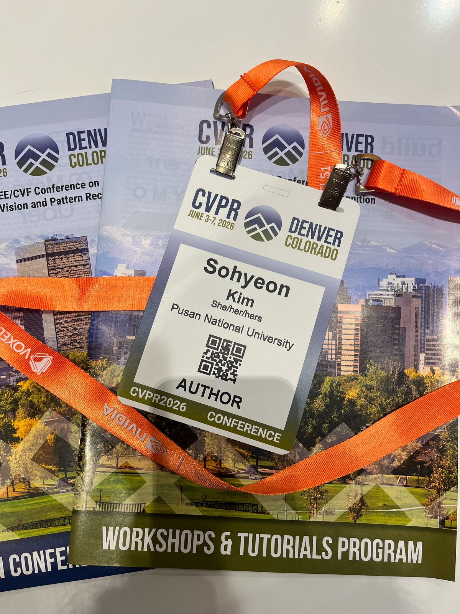
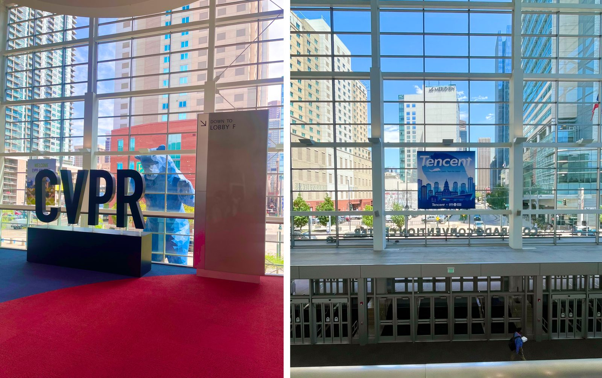
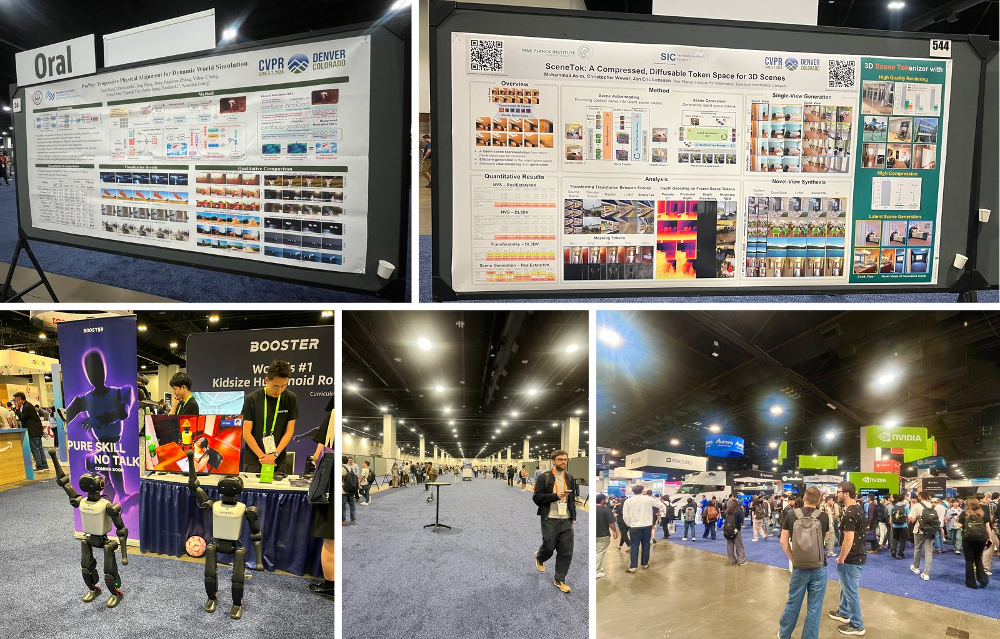
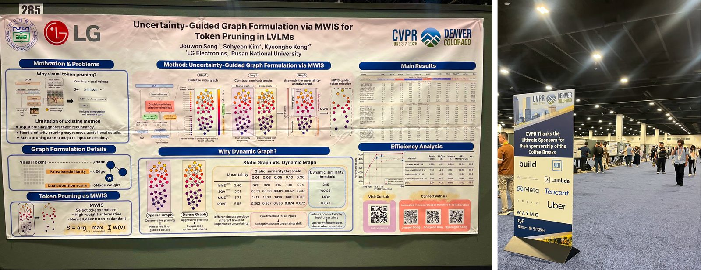
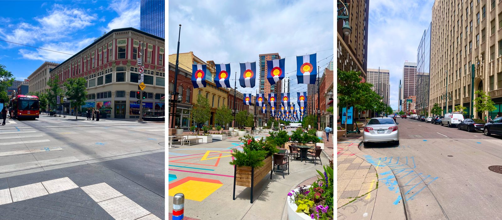

지난 6월 CVSP 연구실의 **김소현**(석사과정) 학생이 미국 덴버에서 개최된 CVPR 2026에 참석하여 최신 Computer Vision 및 Multimodal AI 연구 동향을 접하고 왔습니다. 

<figure class="board-fig"></figure>

<figure class="board-fig"></figure>

<figure class="board-fig"></figure>

이번 학회에서 **김소현** 학생은 **“Uncertainty-Guided Graph Formulation via MWIS for Token Pruning in LVLMs”** 논문을 발표하며, 대규모 비전-언어 모델에서의 효율적인 시각 토큰 프루닝 연구를 소개하였습니다.

<figure class="board-fig"></figure>

<figure class="board-fig"></figure>
