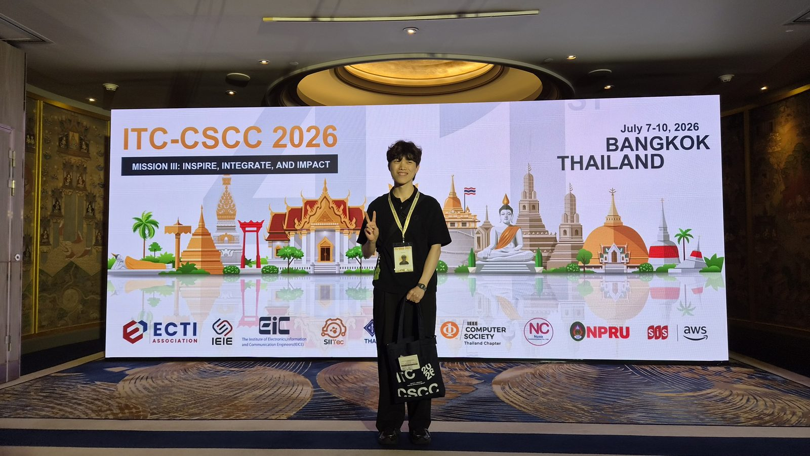
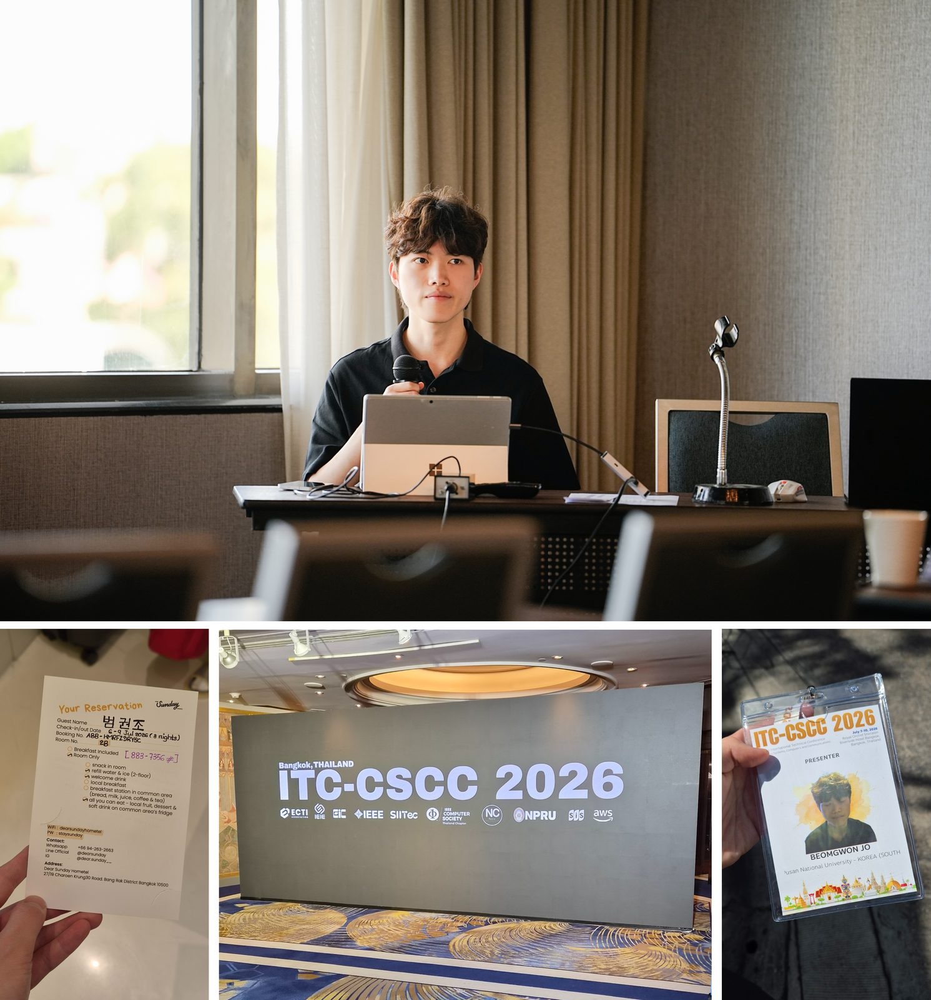
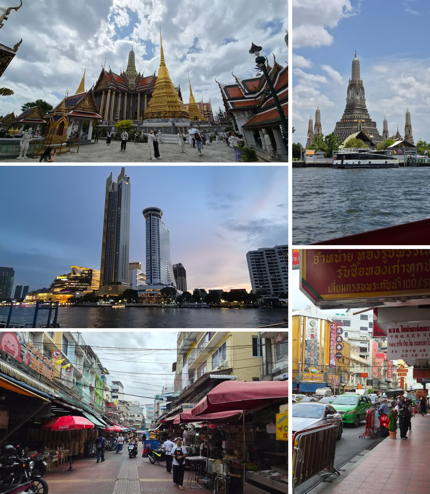
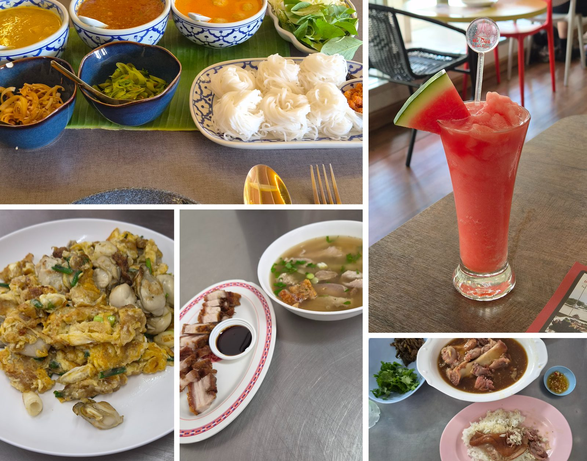

지난 7월 우리 연구실 **조범권**(학부연구생) 학생이 태국 Bangkok에서 열린 ITC-CSCC 2026에 참석하였습니다.

특히 이번 학회에서 조범권 학생은 연구 논문이 accept 되어, oral presentation을 성공적으로 마쳤으며, 전 세계 연구자들과 성과를 공유하며 학술적 교류를 가졌습니다.

<figure class="board-fig"></figure>

<figure class="board-fig"></figure>

<figure class="board-fig"></figure>

<figure class="board-fig"></figure>
