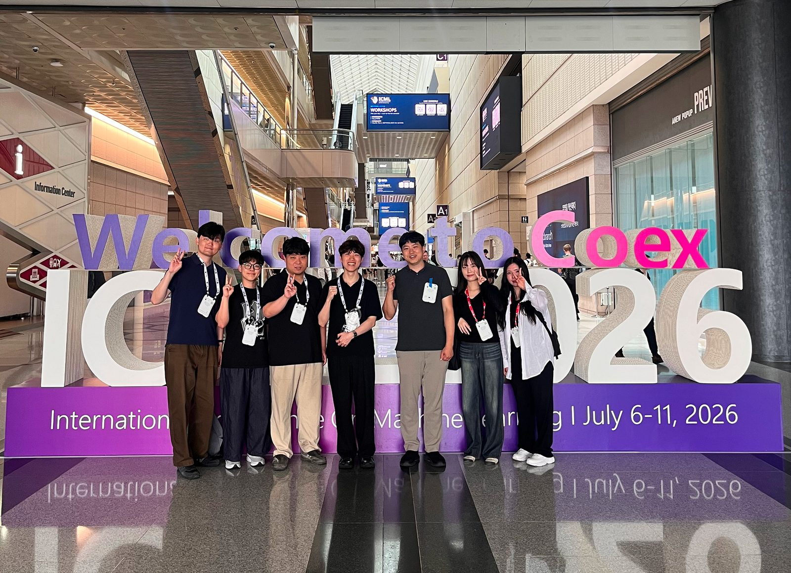
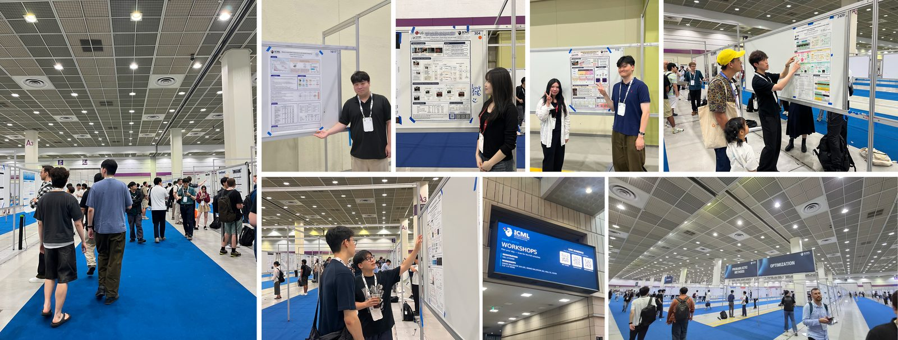
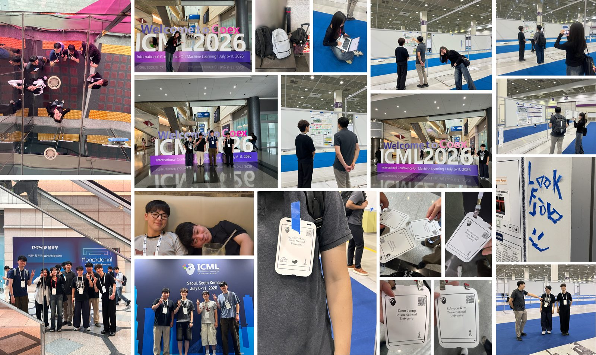
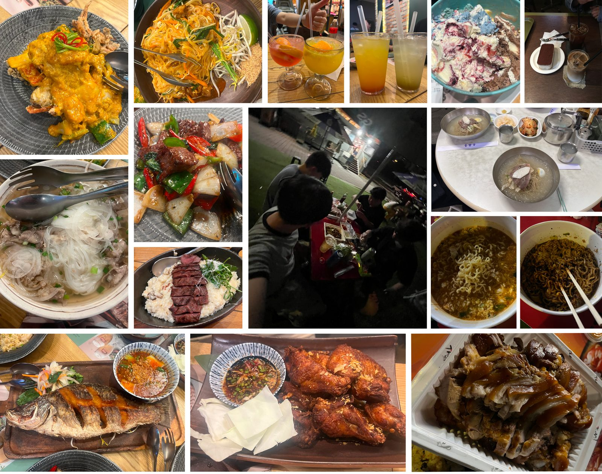
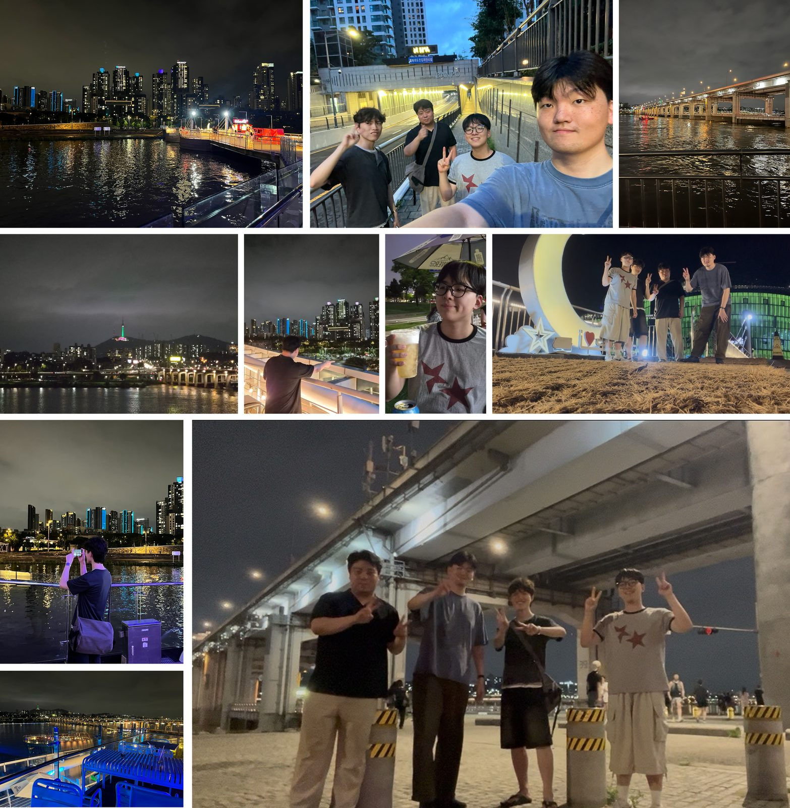

지난 7월 우리 연구실 **정다운**(석사과정), **백창우**(석사과정), **김소현**(석사과정), **조범권**(학부연구생), **김우형**(학부연구생), **윤상연**(학부연구생) 학생이 Seoul에서 열린 ICML 2026에 참석하여 다양한 연구들을 접하고 왔습니다.

특히 위 학생들은 ICML workshop에 accept되어 poster session 발표를 마치고 돌아왔습니다.

<figure class="board-fig"></figure>

<figure class="board-fig"></figure>

<figure class="board-fig"></figure>

<figure class="board-fig"></figure>

<figure class="board-fig"></figure>
