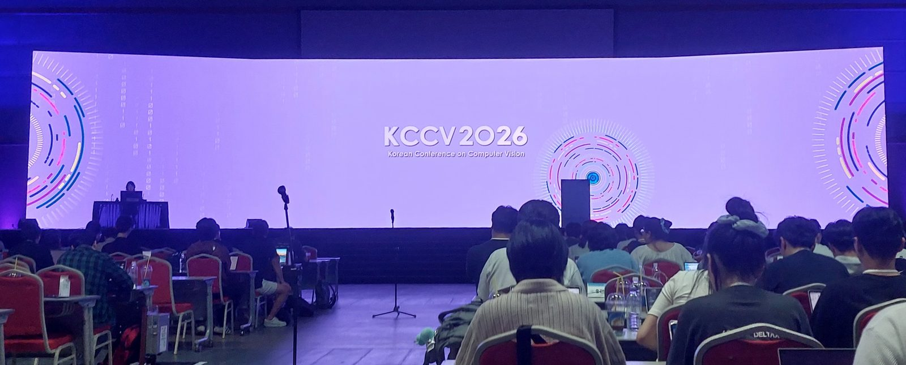
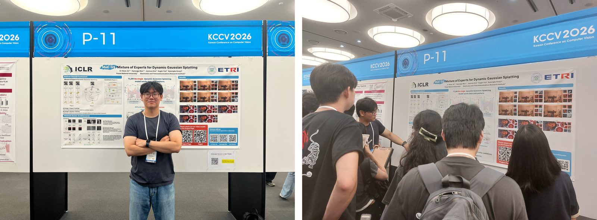
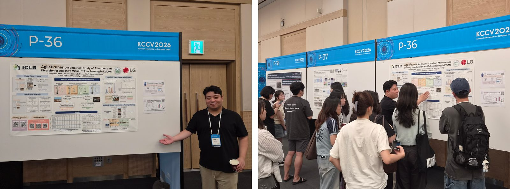
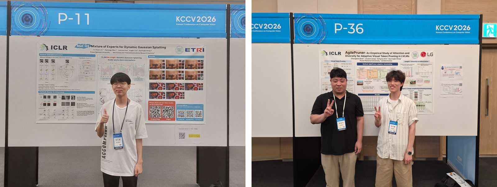

지난 8월 우리 연구실 진인환(석사과정), 백창우(석사과정), 최지훈(학부연구생) ,조범권(학부연구생) 학생이 Busan에서 열린 KCCV 2026에 참석하여 다양한 연구들을 접하고 왔습니다.

<figure class="board-fig"></figure>

특히 진인환, 백창우 학생은 “KCCV 2026 Poster session에서 ICLR 2026에 게재된 연구를 발표하며 연구 성과를 공유하고 돌아왔습니다.

> **MoE-GS: Mixture of Experts for Dynamic Gaussian Splatting** In-Hwan Jin\*, Hyeongju Mun\*, Joonsoo Kim, Kugjin Yun, Kyeongbo Kong†

<figure class="board-fig"></figure>

> **AgilePruner: An Empirical Study of Attention and Diversity for Adaptive Visual Token Pruning in Large Vision-Language Models** Changwoo Baek\*, Jouwon Song\*, Sohyeon Kim\*, Kyeongbo Kong†

<figure class="board-fig"></figure>

<figure class="board-fig"></figure>

