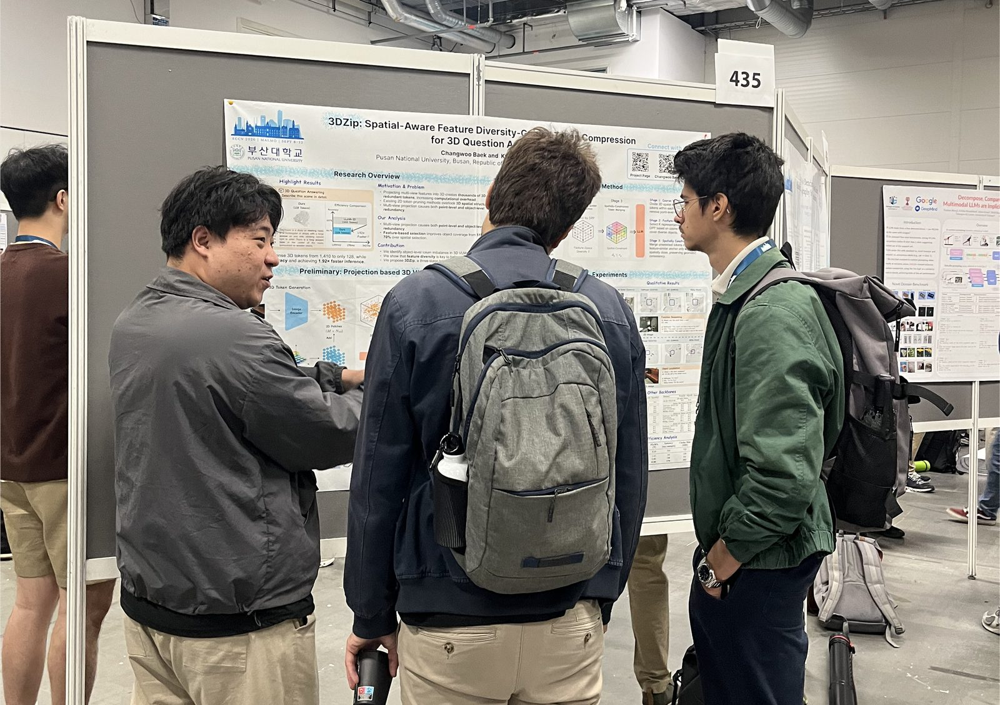
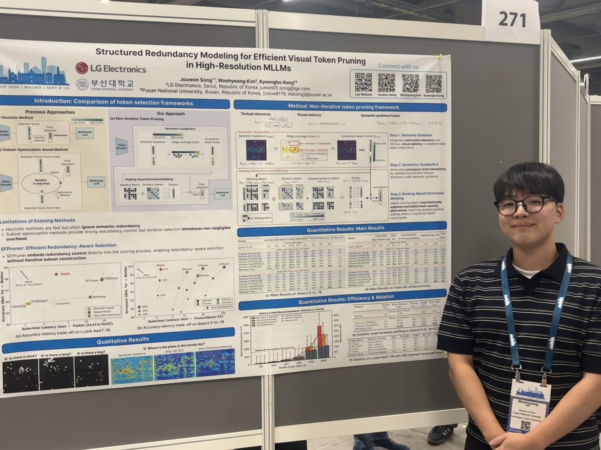
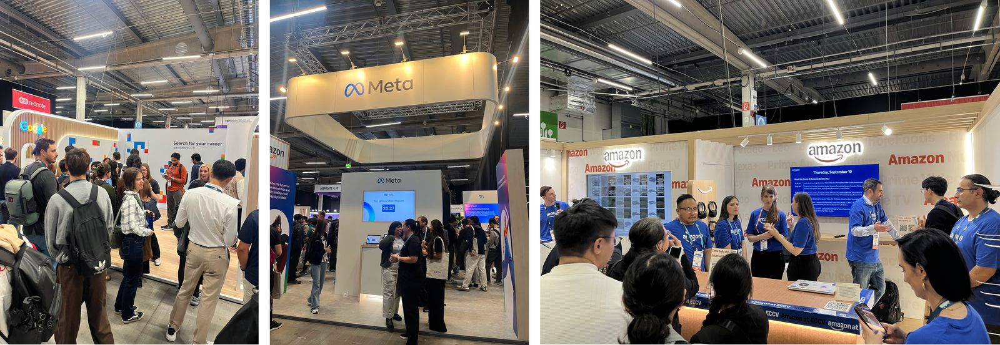
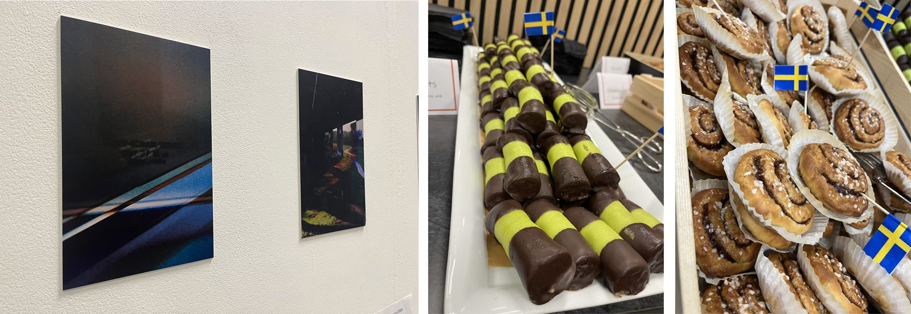
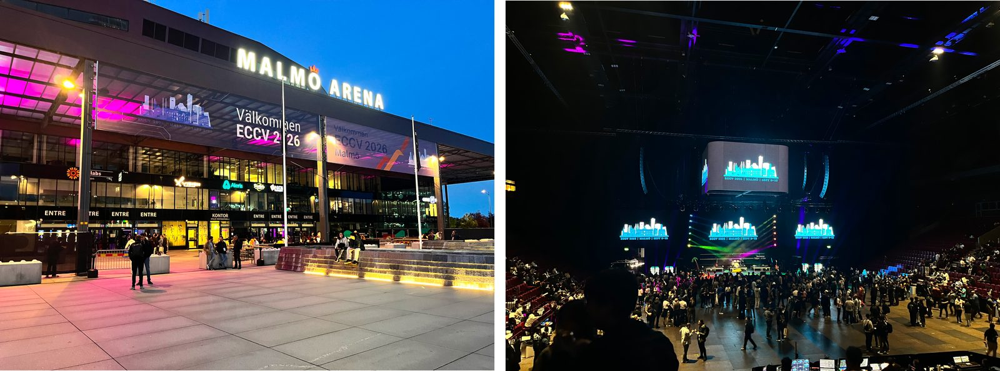
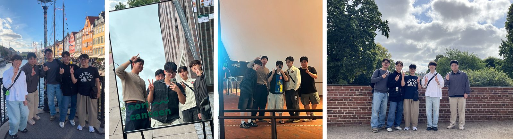
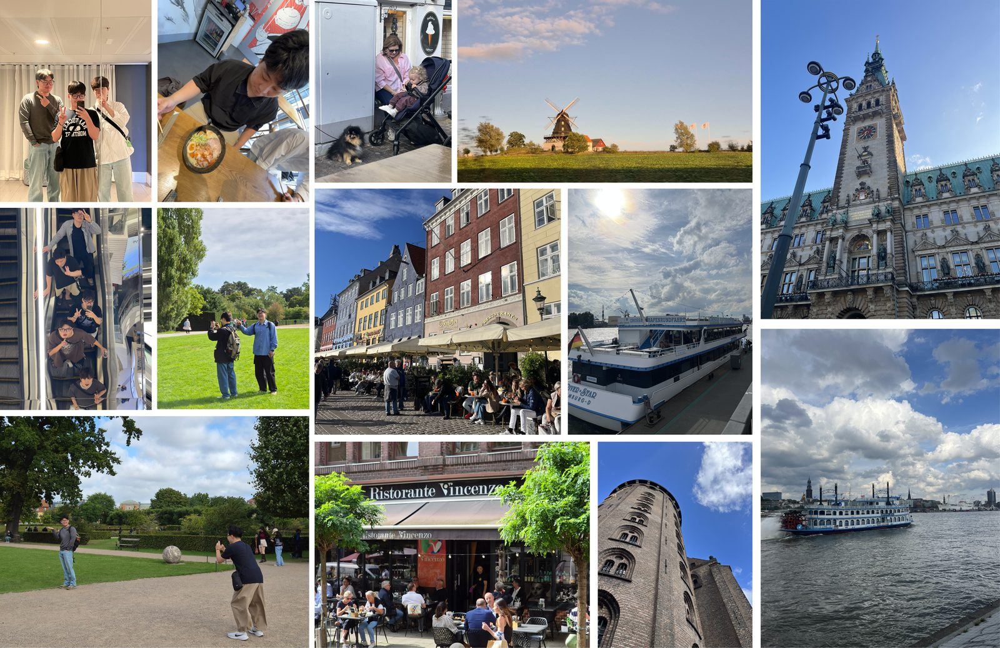

지난 9월 CVSP 연구실의 **진인환**(석사과정), **문형주**(석사과정), **백창우**(석사과정), **김소형**(학부연구생), **조범권**(학부연구생), **김우형**(학부연구생) 학생이 Sweden Malmö에서 개최된 ECCV 2026에 참석하여 최신 컴퓨터 비전 연구 동향을 파악하고 세계 각국의 연구자들과 학술 교류의 시간을 가졌습니다.

이번 학회에서는 **백창우** 학생이 '**3DZip'**, **진인환·문형주·김소형** 학생이 '**LivingWorld**', **김우형** 학생이 '**SFPruner**' 연구를 포스터 세션에서 발표하며 연구 성과를 공유하였습니다.

<figure class="board-fig"></figure>

> **LivingWorld: Interactive 4D World Generation with Environmental Dynamics** Hyeongju Mun\*, In-Hwan Jin\*, Sohyeong Kim, Kyeongbo Kong†

<figure class="board-fig"></figure>

> **3DZip: Spatial-Aware Feature Diversity-Guided Token Compression for 3D Question Answering** Changwoo Baek\*, Kyeongbo Kong†

<figure class="board-fig"></figure>

> **Structured Redundancy Modeling for Efficient Visual Token Pruning in High-Resolution MLLMs** Jouwon Song\*, Woohyeong Kim, Kyeongbo Kong†

<figure class="board-fig"></figure>

🏛️ 학회장 🌍

<figure class="board-fig"></figure>

<figure class="board-fig"></figure>

<figure class="board-fig"></figure>

🇪🇺 유럽 일대기 ✈️

<figure class="board-fig"></figure>

<figure class="board-fig"></figure>

<figure class="board-fig"></figure>
