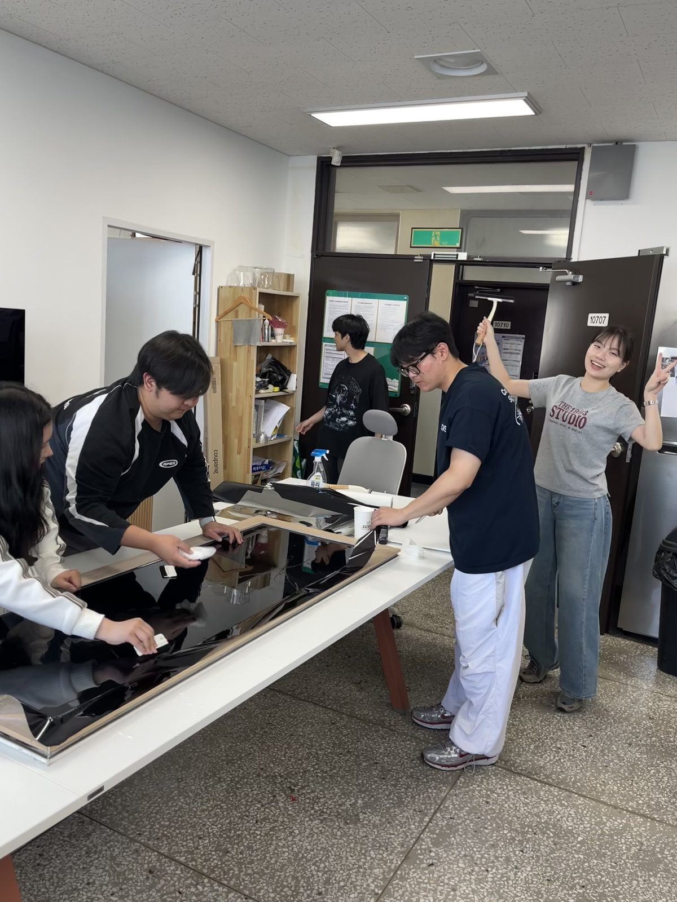
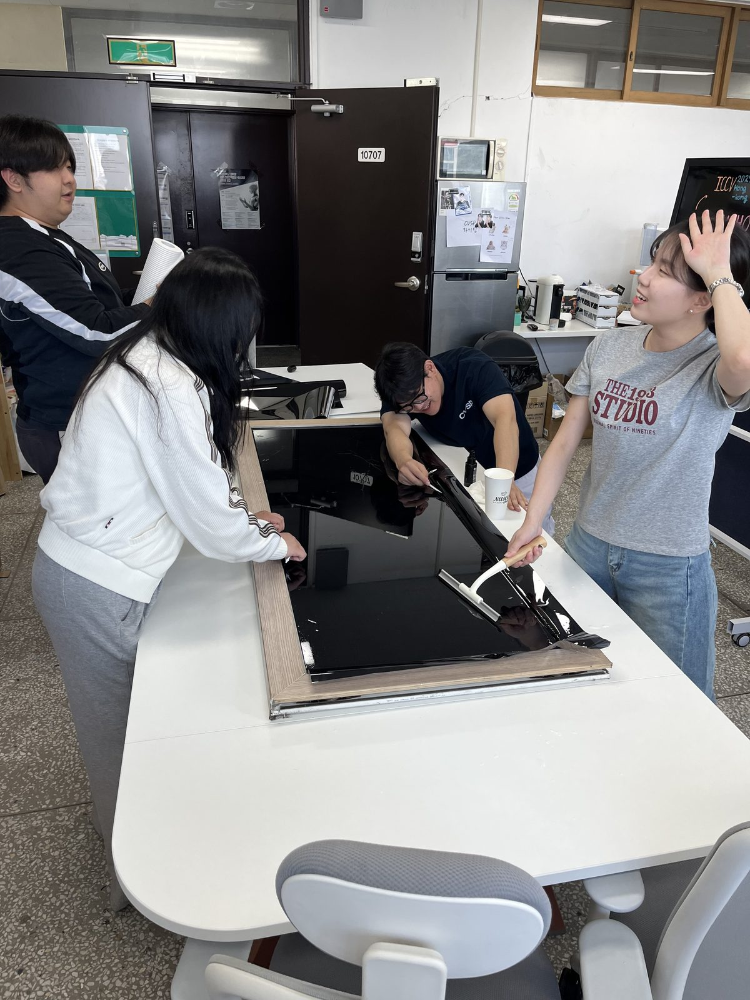
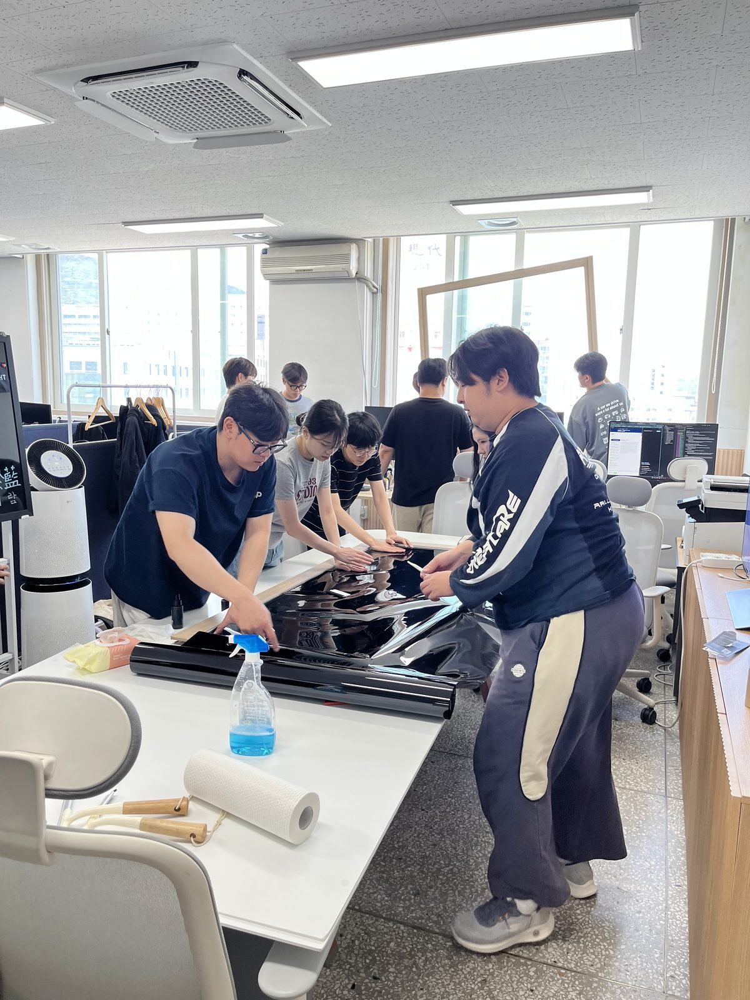
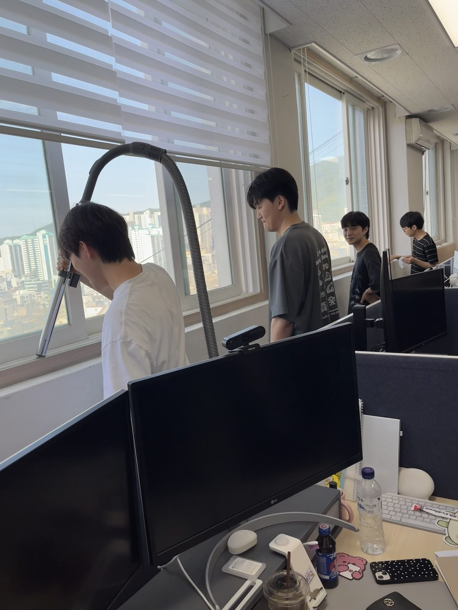
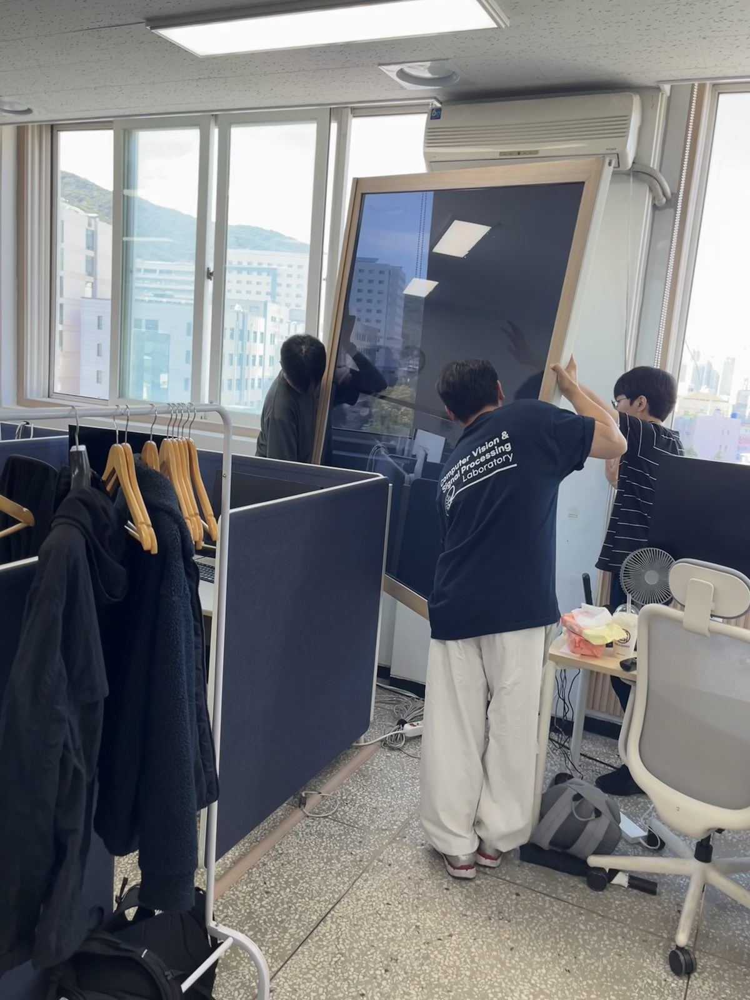
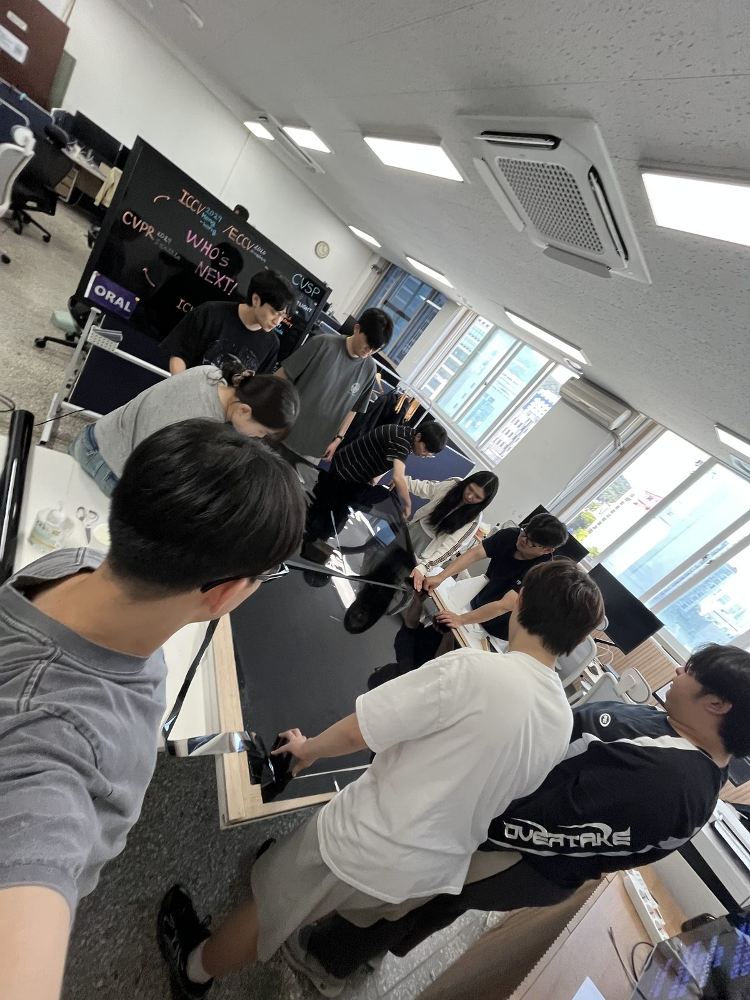
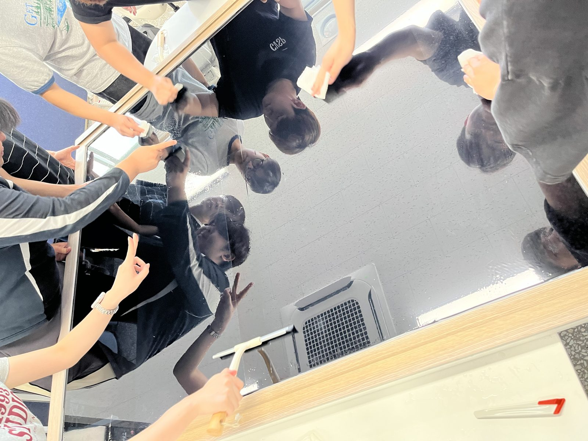

연구실에 햇빛이 많이 들어와서 창문을 renewal 했습니다~! ✨

<figure class="board-fig"></figure>

<figure class="board-fig"></figure>

<figure class="board-fig"></figure>

<figure class="board-fig"></figure>

<figure class="board-fig"></figure>

선배 힘들까봐 시원하게 해드리기💨

<figure class="board-fig"></figure>

<figure class="board-fig"></figure>

땀 뻘뻘 💦

<figure class="board-fig"></figure>

<figure class="board-fig"></figure>

<figure class="board-fig"></figure>

<figure class="board-fig"></figure>

<figure class="board-fig"></figure>

<figure class="board-fig"></figure>

