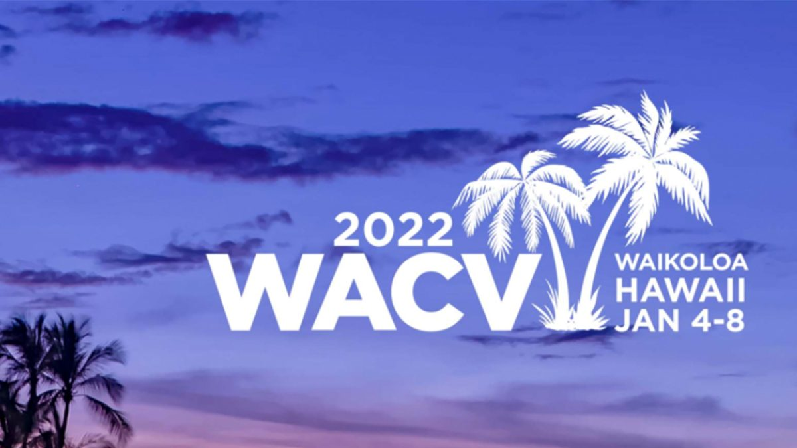

<figure class="board-fig"></figure>

# Image-Adaptive Hint Generation via Vision Transformer for Outpainting

IEEE/CVF Winter Conference on Applications of Computer Vision (**WACV**), Jan. 2022. (**Second-tier AI Conference**) [\[Paper\]](https://openaccess.thecvf.com/content/WACV2022/papers/Kong_Image-Adaptive_Hint_Generation_via_Vision_Transformer_for_Outpainting_WACV_2022_paper.pdf)
