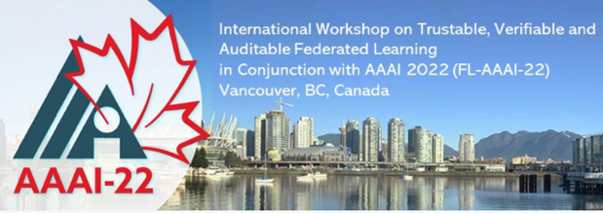

<figure class="board-fig"></figure>

# AnoSeg: Anomaly Segmentation Network Using Self-Supervised Learning

AAAI workshop on AI for Design and Manufacturing (**AAAI**), Mar. 2022. (**Top-tier AI Conference Workshop**) [\[Paper\]](https://openreview.net/pdf?id=x-Tw-P777R)
