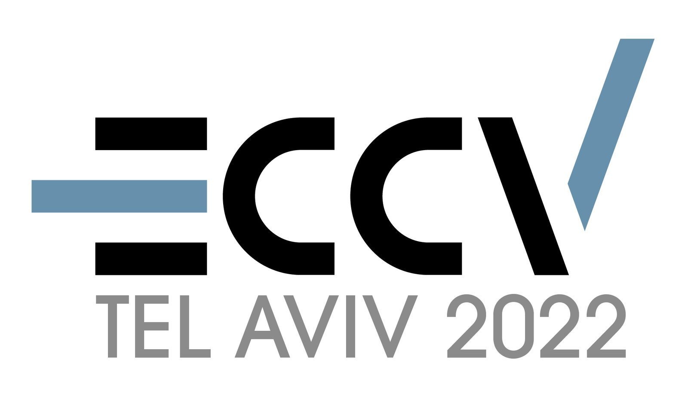

<figure class="board-fig"></figure>

# Selective TransHDR: Transformer-based selective HDR Imaging using Ghost Region Mask

European Conference on Computer Vision (**ECCV**), Oct. 2022. (**Top-tier AI Conference**)

Jou Won Song\*, Ye In Park\*, **Kyeongbo Kong**, Jaeho Kwak, Suk-Ju Kang
