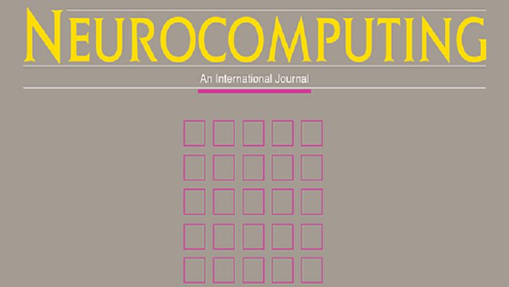

<figure class="board-fig"></figure>

# Penalty based Robust Learning with Noisy Labels

**Kyeongbo Kong**, Junggi Lee, Youngchul Kwak, Young-Rae Cho, Seong-Eun Kim, Woo-Jin Song

Neurocomputing, 2022. (IF: 5.719)
