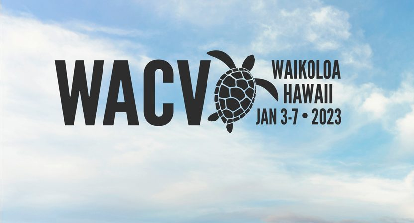

<figure class="board-fig"></figure>

# An Unified Framework for Language Guided Image Completion

IEEE/CVF Winter Conference on Applications of Computer Vision (**WACV**), Jan. 2023 (**Second-tier AI Conference**)

Jihyun Kim*, **Seong-Hun Jeong***, **Kyeongbo Kong***, Suk-Ju Kang†
