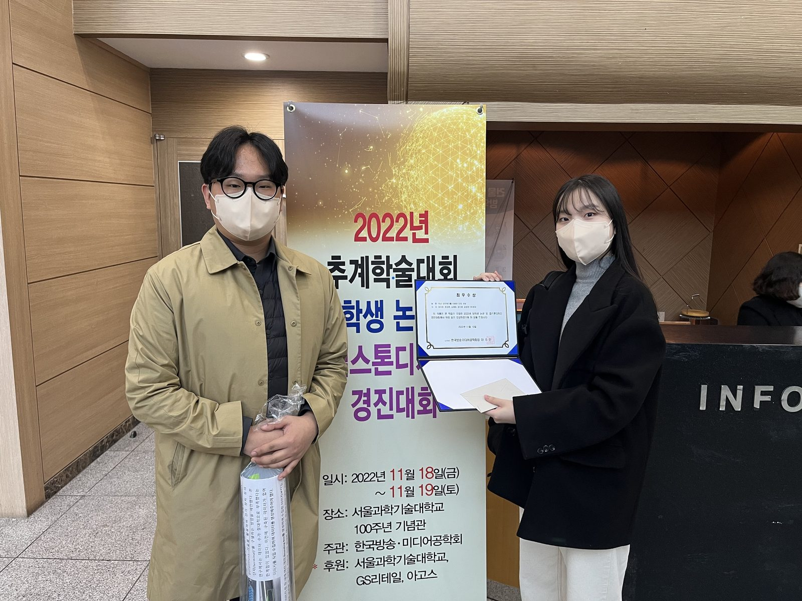
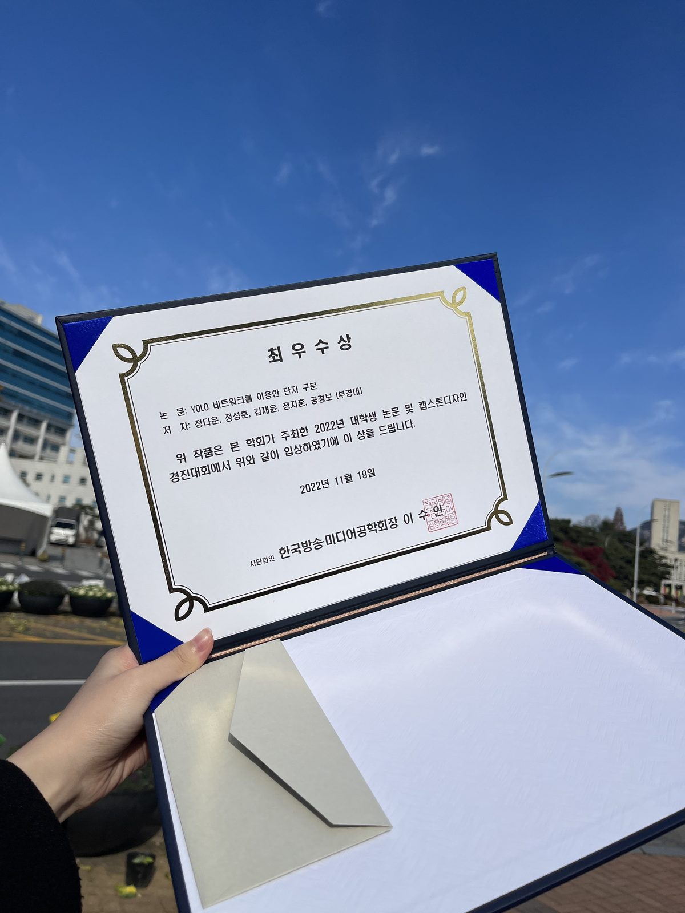
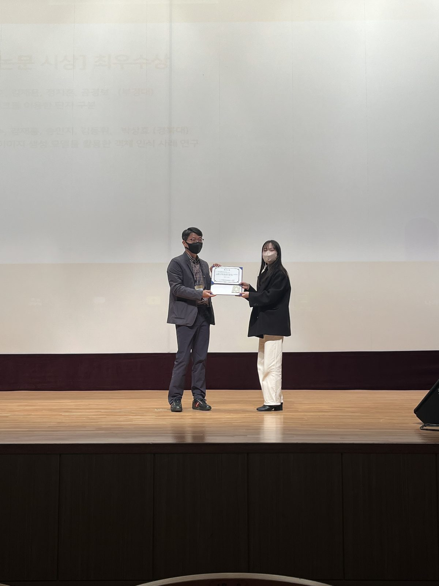
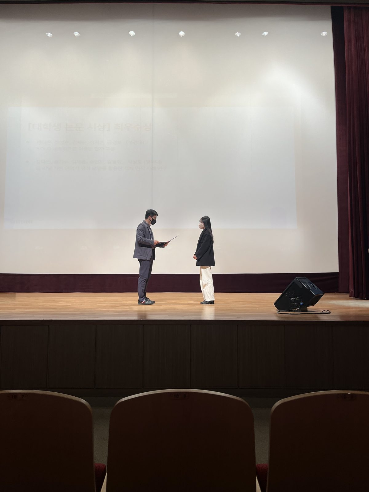
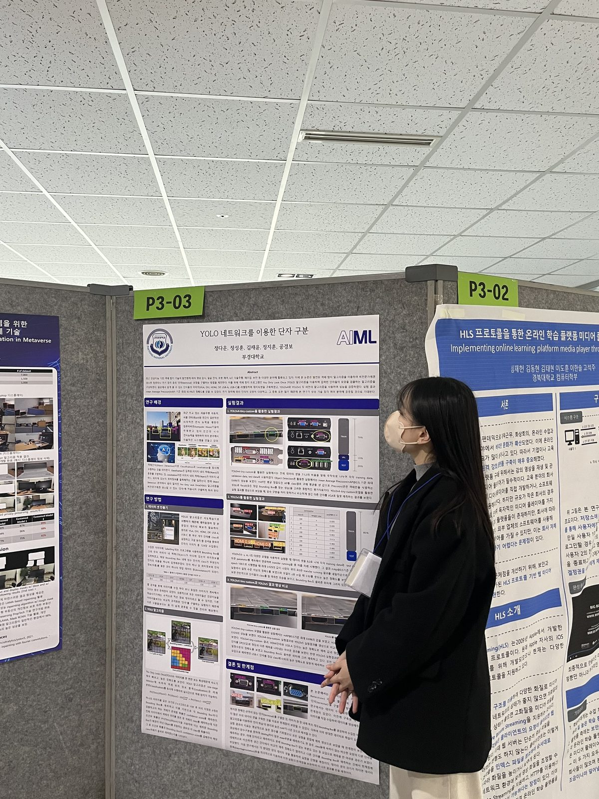

<figure></figure><figure></figure><figure></figure><figure></figure><figure></figure>

국립부경대학교(총장 장영수)는 미디어커뮤니케이션학부 3학년 정다운·김재윤·정지훈 석사과정 정성훈 팀이 2022년 한국방송·미디어공학회 대학생 논문 및 캡스톤디자인 경진대회에서 최우수상을 수상했다고 밝혔다.

부경대생들은 최근 서울과학기술대에서 한국방송·미디어공학회 추계학술대회와 함께 열린 이번 경진대회에서 논문 ‘YOLO 네트워크를 이용한 단자 구분’(지도교수 공경보)을 발표해 우수 연구성과를 인정받았다.

부경대생들은 이번 수상 논문에서 복잡한 방송통신 장비의 단자를 구분하기 위해 직접 데이터세트를 구축하고, 인공지능 기반 객체 탐지(object detection) 모델별 성능을 비교한 연구결과를 제시해 우수한 평가를 받았다.

공경보 지도교수는 “인문계 학생들을 대상으로 개설한 휴먼ICT융합전공 교과목인 인공지능미디어기초 수업에 학생들이 참가해 실생활에 활용될 수 있는 서비스를 직접 설계하는 프로젝트를 진행한 것이 이번에 좋은 성과로 이어진 것 같다.”라고 밝혔다.

한국방송·미디어공학회는 방송과 미디어 기술인을 위한 한국연구재단 등재 논문지와 학회지를 발간하는 방송·미디어 기술 전문 학회다. 기술 워크숍·학술대회 개최 등 다양한 학술활동으로 우리나라 방송미디어산업과 학문 발전에 기여하고 있다.

Link: [article1](https://www.pknu.ac.kr/main/51?action=view&no=708702), [article2](http://www.kookje.co.kr/news2011/asp/newsbody.asp?code=0300&key=20221201.99099000297), [article3](https://www.busan.com/view/newsunicollvill/view.php?code=2022120118291260837)
