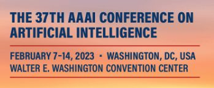

<figure class="board-fig"></figure>

# FeedFormer: Revisiting Transformer Decoder for Efficient Semantic Segmentation (Acceptance Rate: 19.6%)

Thirty-Seventh Association for the Advancement of Artificial Intelligence (**AAAI**), Feb. 2023 (**Top-tier AI Conference**)

Jae-hun Shim*, Hyunwoo Yu*, **Kyeongbo Kong***, Suk-Ju Kang†, 

Link: [article1](https://ee.sogang.ac.kr/kor/community/notice01.php?m=v&idx=1073)
