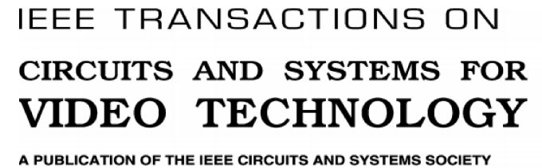

<figure class="board-fig"></figure>

# Out-of-Focus Image Deblurring for Mobile Display Vision Inspection

IEEE Transactions on Circuits and Systems for Video Technology (**TCSVT**), 2023. (IF: 5.859)

Sung-Jun Min\*, **Kyeongbo Kong\***, Suk-Ju Kang
