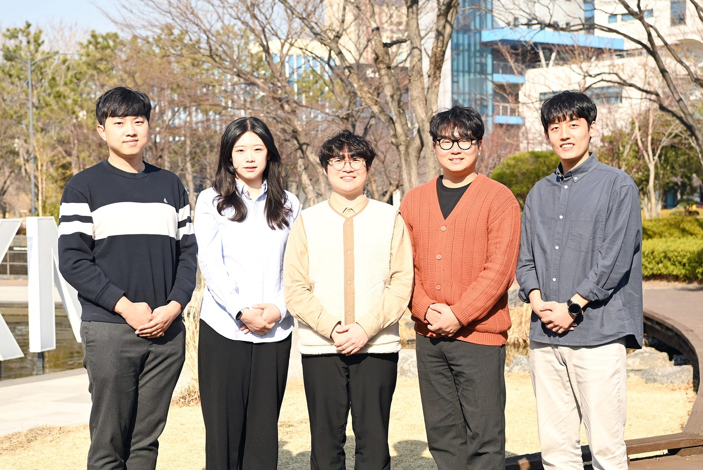
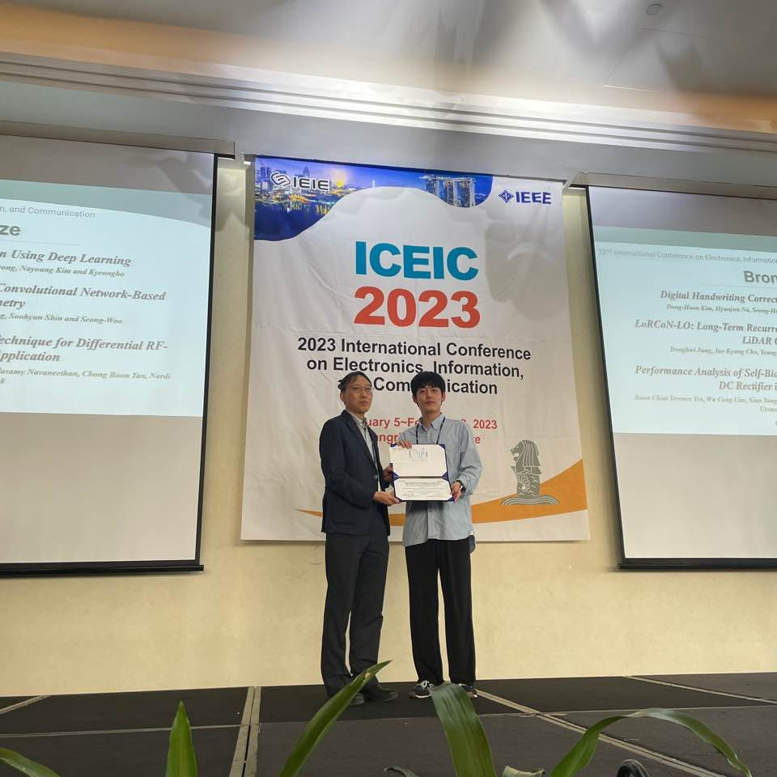
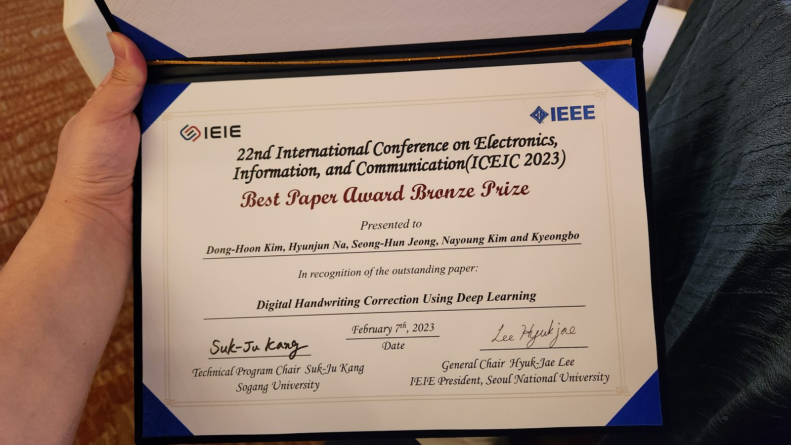
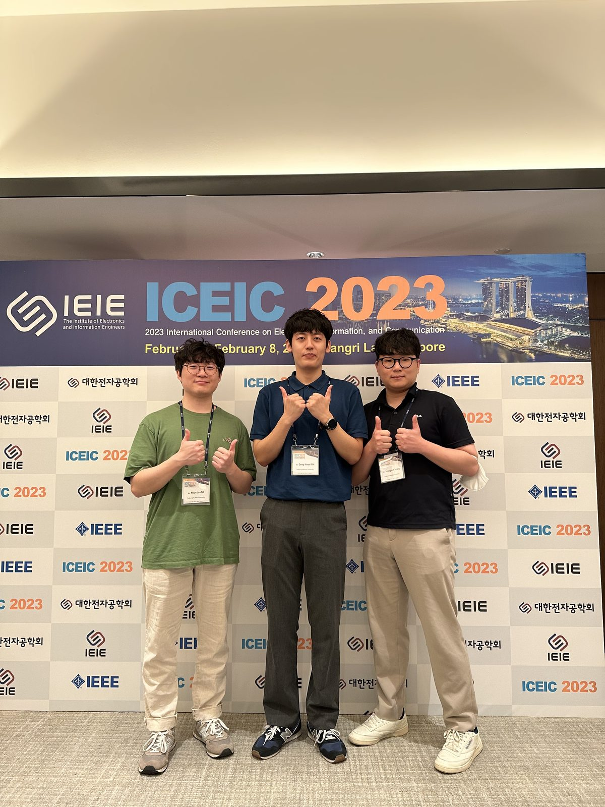

<figure></figure><figure></figure><figure></figure><figure></figure>

국립부경대학교(총장 장영수)는 미디어커뮤니케이션학부 휴먼ICT융합전공 3학년 김동훈, 나현준, 김나영, 석사과정 정성훈 팀이 최근 싱가포르에서 열린 국제학술대회 ‘ICEIC 2023’에서 최우수논문상(Best Paper Award)을 수상했다고 밝혔다.

이들은 12개국 300편 이상의 논문이 발표된 이번 국제학술대회에서 논문 ‘Digital Handwriting Correction Using Deep Learning’(지도교수 공경보)을 발표해 이 상을 받았다.

부경대생들은 이 논문에서 태블릿 환경에서 맞춤법 오류를 검출하고 사용자의 손글씨와 유사한 폰트로 수정해주는 알고리즘을 개발한 연구성과를 제시해 우수한 평가를 받았다.

공경보 지도교수는 “인공지능 미디어 기초수업 프로젝트로 학생들이 일상생활에서 느꼈던 불편 사항을 서비스로 제안하고 직접 설계한 것이 이번에 좋은 성과로 이어진 것 같다.”라고 밝혔다.

한편 미국 전자전기공학자협회(IEEE)와 대한전자공학회(IEIE)가 공동 주관한 ‘ICEIC 2023(International Conference on Electronics, Information, and Communication 2023)’은 전자·인공지능 분야의 기술 정보와 결과물을 교류하기 위해 세계 산·학·연 연구자와 엔지니어가 참여하는 국제학술대회다.

Link: [article1](https://www.pknu.ac.kr/main/51?action=view&no=709681)
