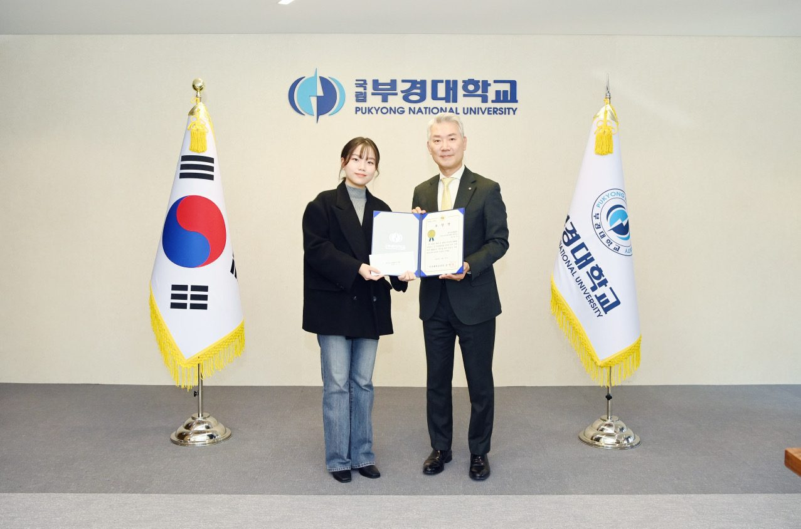
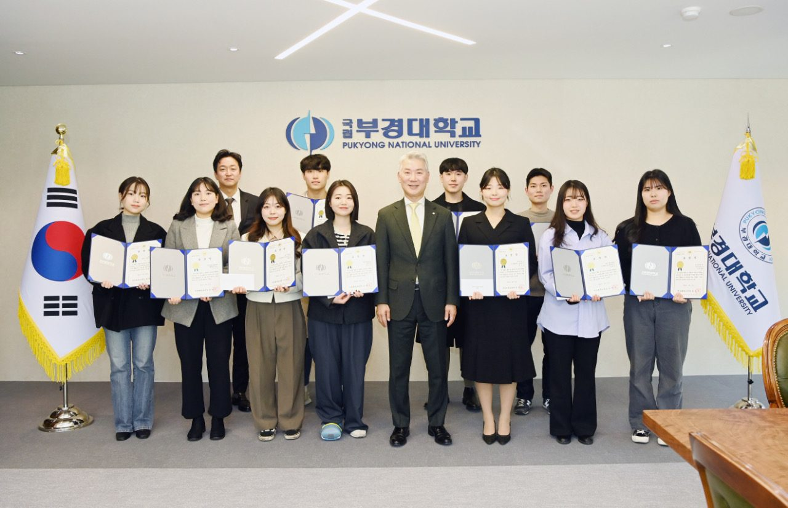

<figure></figure><figure></figure>

**국립부경대학교(총장 장영수)는 2월 27일 오후 대학본부 3층 총장실에서 ‘2022년도 학교를 빛낸 얼굴’ 시상식을 개최했다.**

**부경대는 지난 한 해 동안 전국 경진대회 수상, 연구성과, 봉사활동 등을 통해 학교 위상과 명예를 높인 학생 82명(37개 팀)을 선정하고 이날 총장상을 전달했다.**

**경진대회 분야에서는 ‘제3회 AI, 블록체인 아이디어 경진대회’ 대상을 받은 컴퓨터공학부 학생 등 32명, 명예 선양 분야에서는 SCI급 국제학술지에 논문을 게재한 물리학과 학생 등 43명이 수상의 영예를 안았다.**

**이어 봉사 분야에서는 총학생회와 총동아리연합회, 사회공헌봉사단, UN서포터즈 소속 학생 등 7명이 총장상을 받았다.**

**한편 부경대는 수상이나 우수 연구성과, 선행 등으로 지역사회에 공헌한 학생들을 표창하고 격려하기 위해 지난 2006년부터 개인 또는 단체를 선정해 총장상을 수여하고 있다. \<부경투데이\>**
