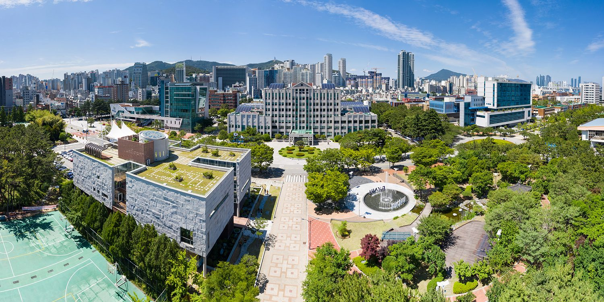

# **부경대, 데이터사이언스 전문가 키운다**

- **과기정통부 ‘2023 데이터사이언스 융합인재양성사업’ 선정**

  <figure class="board-fig"></figure>

**국립부경대학교(총장 장영수)가 과학기술정보통신부 주관 ‘2023 데이터사이언스 융합인재양성사업’에 선정돼 데이터사이언스 전문가 양성에 나선다.**

**부경대는 데이터사이언스 분야의 핵심 지식을 다양한 분야에 접목하는 융합인재 양성을 위한 이번 사업에 K-DS 컨소시엄(Korean Data Science Consortium)으로 참여해 신규 선정됐다.**

**이 컨소시엄은 주관대학인 경북대를 비롯해 부경대와 부산대, 강원대, 전남대 등 5개 국립대학으로 구성됐으며, 앞으로 7년간 매년 약 50억 원씩 총 337억 원을 지원받아 데이터사이언스 전문가를 양성한다.**

**컨소시엄은 일반대학원의 학과/협동과정과 전문대학원을 융합한 추진체계를 구축해 글로벌 데이터사이언스 혁신을 선도하는 융합형 지역 인재 양성에 나선다.**

**이를 위해 부경대는 정보융합대학을 중심으로 데이터사이언스 석사과정을 신설해 금융과 스마트물류를 융합한 △데이터 기반 프로세스 설계 △의료 생체 빅데이터 분석 △인공지능 금융 빅데이터 분석 등의 교과과정을 특화한다는 계획이다.**

**이와 함께 컨소시엄 대학 간 공유 협력 체계를 구축해 데이터사이언스수학, 데이터프로그래밍, 데이터사이언스통계, 데이터컴퓨팅, 데이터시각화, 딥러닝, 머신러닝, 데이터사이언스 윤리와 법제 등 공통 교과과정도 운영한다.**

**특히 부경대 데이터사이언스 대학원은 우수 학생 유치와 전문가 양성을 위해 학·석사연계과정 입학생에게 학부 3~4학년 등록금, 석사 1~4학기 등록금 등 4년간 등록금 전액을 장학금으로 지급할 예정이다. 또 석사 재학 중 매월 100만 원 이상의 연구비를 지급하고 해외연수 기회도 제공한다.**

**송하주 부경대 정보융합대학장은 “이번 사업으로 금융, 스마트물류 등 부산 전략산업의 경쟁력을 키울 수 있는 데이터사이언스 분야 인재를 양성하고, 지역사회 전반의 데이터사이언스 역량을 높이는 계기가 될 것으로 기대한다.”라고 말했다. \<부경투데이\>**

# **PKNU sets to fosters data science experts**

- **selected for the 'fostering project for data science convergence human resources 2023' run by the Ministry of science and ICT**

**Pukyong National University (President Jang Young-Soo) was selected for the 'fostering project for data science convergence human resources 2023' hosted by the Ministry of science and ICT, and started to nurture data science experts.**

**As a member of the K-DS consortium (Korean data science consortium), Pukyong National University was newly selected for this project, which aims to foster convergence human resources to apply core knowledge in the data science field to various fields.**

**This consortium consists of five national universities, Pukyong National University, Pusan national university, Kangwon national university, and Chonnam national university, including Kyungpook national university, and will receive about 5 billion won each year for the next seven years, a total of 33.7 billion won for training data science experts.**

**It plans to establish a promotion system that combines departments of general graduate schools, cooperative courses, and professional graduate schools to nurture convergence-type regional talents that lead global data science innovation.**

**Along with this, Pukyong National University plans to specialize in the course and establish a data science master's course centered on the College of information technology and convergence to provide subjects such as design of data-based processes that converge finance and smart logistics, analysis of medical biometric big data, and analysis of artificial intelligence and financial big data.**

**In addition, by establishing a shared cooperation system among the consortium universities, Pukyong National University also operates a common curriculum including data science mathematics, data programming, data science statistics, data computing, data visualization, deep learning, machine learning, data science ethics and legislation.**

**Especially, to encourage excellent students and to foster experts, Pukyong National University data science graduate school provides full tuition scholarships for 4 years, including tuition support for the 3rd and 4th years of undergraduate and 1st and 4th semesters of masters, to students who admitted to the bachelor & masters integrated program. In addition, students studying in the master's program will be provided with over 1 million won per month in research expenses during their enrollment period and are provided with opportunities for overseas training.**

**Song Ha-Joo, dean of College of information technology and convergence in Pukyong National University, said, "With this selection of our university for this project, I expected that we will serve it as an opportunity to nurture outstanding talents in the data science field that can enhance the competitiveness of strategic industries in Busan, such as finance and smart logistics, and to enhance the data science capabilities of the entire community." \<Pukyong Today\>**

Link: [article1](https://www.pknu.ac.kr/main/51?action=view&no=710573)
