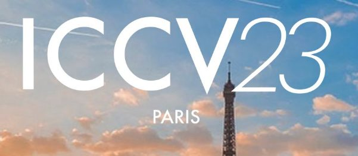

<figure class="board-fig"></figure>

# **SEFD: Learning to Distill Complex Pose and Occlusion**

International Conference on Computer Vision (**ICCV**), Oct. 2023. **(Top-tier AI Conference, Acceptance Rate: 26.8%)**

ChangHee Yang\*,  **Kyeongbo Kong\***, Sung-Jun Min\*, Geonho Cha, Ho-Deok Jang, Dongyoon Wee, Suk-Ju Kang

Project page: [https://yangchanghee.github.io/ICCV2023\_SEFD\_page/](https://yangchanghee.github.io/ICCV2023_SEFD_page/)

Collaboration with NAVER CLOUD

Link: [article1](https://ee.sogang.ac.kr/kor/community/notice01.php?m=v&idx=1359&pNo=1&code=news), [article2](https://his.pusan.ac.kr/ee/ee-focus.do?enc=Zm5jdDF8QEB8JTJGYmJzJTJGZWUlMkYyNjQwJTJGMTIzMjYyNiUyRmFydGNsVmlldy5kbyUzRmJic09wZW5XcmRTZXElM0QlMjZpc1ZpZXdNaW5lJTNEZmFsc2UlMjZzcmNoQ29sdW1uJTNEJTI2cGFnZSUzRDElMjZzcmNoV3JkJTNEJTI2cmdzQmduZGVTdHIlM0QlMjZiYnNDbFNlcSUzRCUyNnBhc3N3b3JkJTNEJTI2cmdzRW5kZGVTdHIlM0QlMjY%3D)
