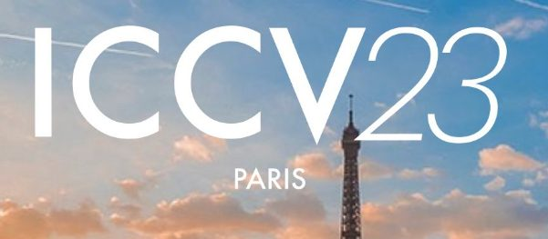

<figure class="board-fig"></figure>

# **Enhancing Text-to-Video Editing with Motion Map Injection**

ICCV workshop on AI for Creative Video Editing and Understanding (**ICCVw**), Oct. 2023. (**Top-tier AI Conference Workshop**)

**(Oral Presentation Invitation)** [**참가후기**](https://humanict.pknu.ac.kr/humanict/5227?action=view&no=9947502)

**Seong-Hun Jeong\*, Inhwan Jin\*, Haesoo Choo\*, Hyunjun Na\*, Kyeongbo Kong†**

Project page: [https://currycurry915.github.io/MMI/](https://currycurry915.github.io/MMI/)

# **Text-Based Video Generation with Human Motion and Controllable Camera**

ICCV workshop on AI for Creative Video Editing and Understanding (**ICCVw**), Oct. 2023. (**Top-tier AI Conference Workshop**)

**Taehoon Kim\*,** Chanhee Kang\*, **Jaehyuk Park\*, Daun Jeong\*,** ChangHee Yang\*, Suk-Ju Kang†**, Kyeongbo Kong†**

Project page: [https://anonymous.4open.science/w/HMTV\_docs-1801/](https://anonymous.4open.science/w/HMTV_docs-1801/)

# **A Novel Framework for Generating In-the-Wild 3D Hand Datasets**

ICCV workshop on Observing and Understanding Hands in Action (**ICCVw**), Oct. 2023. (**Top-tier AI Conference Workshop**) 

Junho Park\*, **Kyeongbo Kong**\***,** Suk-Ju Kang†
