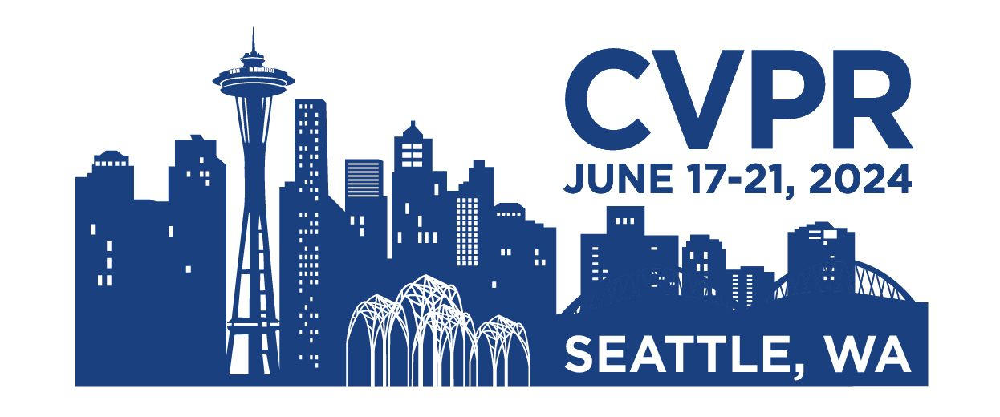

<figure class="board-fig"></figure>

# Person in Place: Generating Associative Skeleton-Guidance Maps for Human-Object Interaction Image Editing

The IEEE/CVF Conference on Computer Vision and Pattern Recognition (**CVPR**), Jun.2024. (**Top-tier AI Conference**, **Acceptance Rate: 23.6%**)

ChangHee Yang*, Chan Hee Kang*, **Kyeongbo Kong*,** Hanni Oh, Suk-Ju Kang† 

Link: [article1](https://blog.naver.com/sogangpr/223379649328?viewType=pc)
