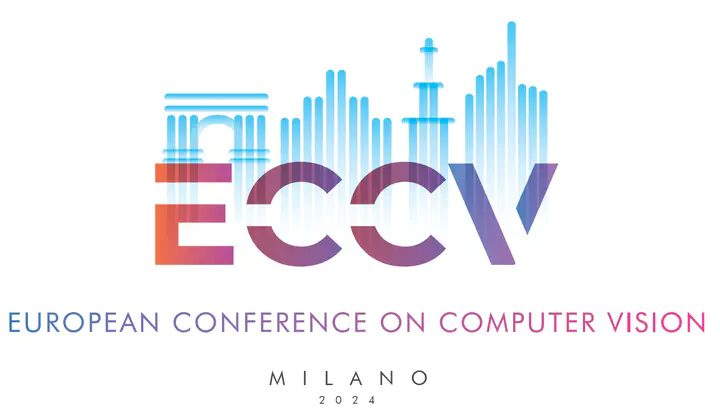

<figure class="board-fig"></figure>

# Embedding-Free Transformer with Inference Spatial Reduction for Efficient Semantic Segmentation

European Conference on Computer Vision (**ECCV**), Oct 2024. **(Top-tier AI conference, Acceptance Rate: 27.9%)**

Hyunwoo Yu\*, Yubin Cho\*, Beoungwoo Kang\*, Moon Seunghun\*, **Kyeongbo Kong**\*, Suk-Ju Kang†

# AttentionHand: Text-driven Controllable Hand Image Generation for 3D Hand Reconstruction in the Wild

European Conference on Computer Vision (**ECCV**), Oct 2024. **(Top-tier AI conference, Acceptance Rate: 27.9%)**

Junho Park\*, **Kyeongbo Kong**\*, Suk-Ju Kang†
