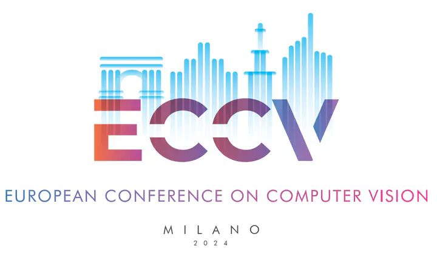

<figure class="board-fig"></figure>

# AttentionHand: Text-driven Controllable Hand Image Generation for 3D Hand Reconstruction in the Wild **(Oral)**

European Conference on Computer Vision (**ECCV**), Oct 2024. **(Top-tier AI conference, Oral Presentation Acceptance Rate: 2.3%)**  

Junho Park\*, **Kyeongbo Kong**\*, Suk-Ju Kang†
