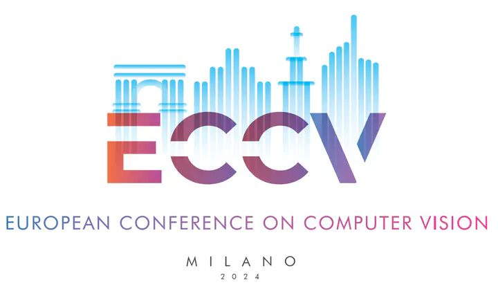

<figure class="board-fig"></figure>

# **Dynamic Scene Reconstruction from Single Landscape Image Using 4D Gaussian in the Wild**

ECCV workshop on Wild3D: 3D Modeling, Reconstruction, and Generation in the Wild (**ECCVw**), Oct. 2024. (**Top-tier AI Conference Workshop**)

**Inhwan Jin\*, Haesoo Choo\*, Seong-Hun Jeong**, Heemoon Park, Junghwan Kim, Oh-joon Kwon, **Kyeongbo Kong†**

# Revealing Uncertainty in Medical Application Using Bayesian Neural Network with Latent Variable Model

ECCV workshop on 3rd Uncertainty Quantification for Computer Vision (**ECCVw**), Oct. 2024. (**Top-tier AI Conference Workshop**)

Joseph Kihoon Kim\*, **Kyeongbo Kong\***, Suk-Ju Kang†

# Interactive 3D Room Generation for Virtual Reality via Compositional Programming **(Oral)**

ECCV workshop on 3rd Computer Vision for Metaverse (**ECCVw**), Oct. 2024. (**Top-tier AI Conference Workshop**) 

Jihyun Kim\*, Junho Park\*, **Kyeongbo Kong\***, Suk-Ju Kang†

# AttentionHand: Text-driven Controllable Hand Image Generation for 3D Hand Reconstruction in the Wild **(Invited)**

ECCV workshop on Observing and Understanding Hands in Action (**ECCVw**), Oct. 2024. (**Top-tier AI Conference Workshop**) 

Junho Park\*, **Kyeongbo Kong\***, Suk-Ju Kang†

