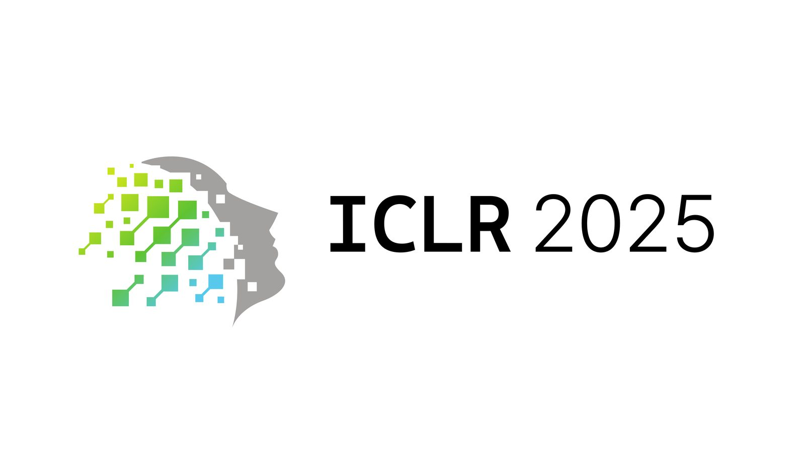

<figure class="board-fig"></figure>

# **Optimizing 4D Gaussians for Dynamic Scene Video from Single Landscape Images**

**ICLR**, Apr, 2025   (**Top-tier AI conference**, Acceptance Rate: 32.08%)

**In-Hwan Jin\***, **Haesoo Choo\***, **Seong-Hun Jeong**, Heemoon Park, Junghwan Kim, Oh-joon Kwon, **Kyeongbo Kong†**

<iframe src="https://www.youtube.com/embed/ZaSHPHY4lE0" allowfullscreen loading="lazy"></iframe>

