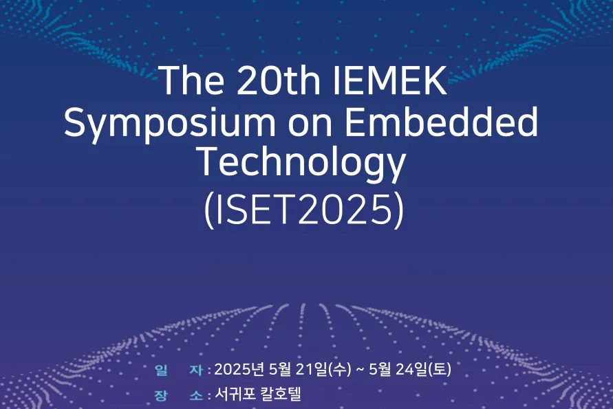
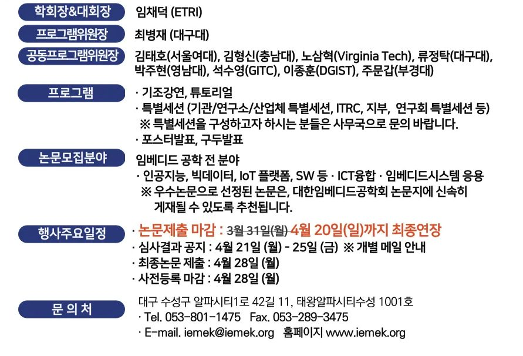
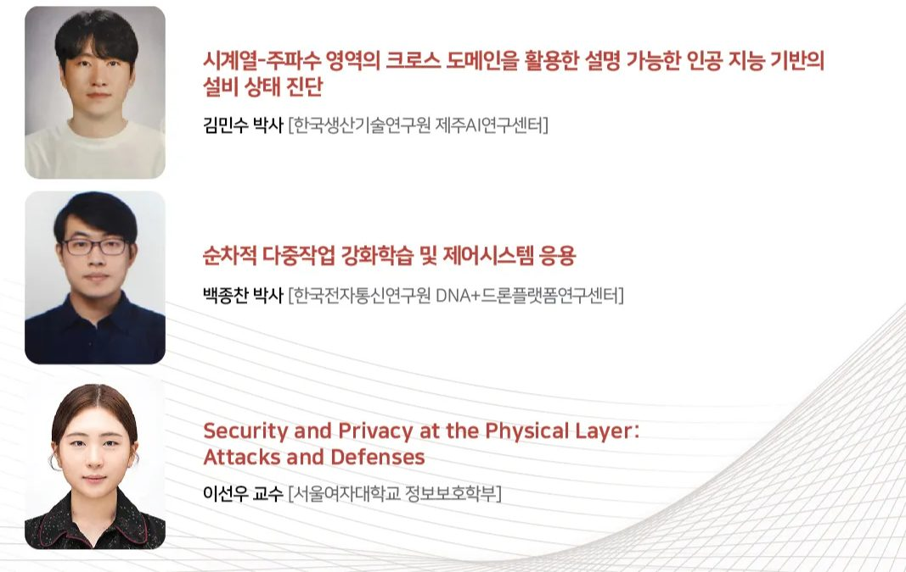
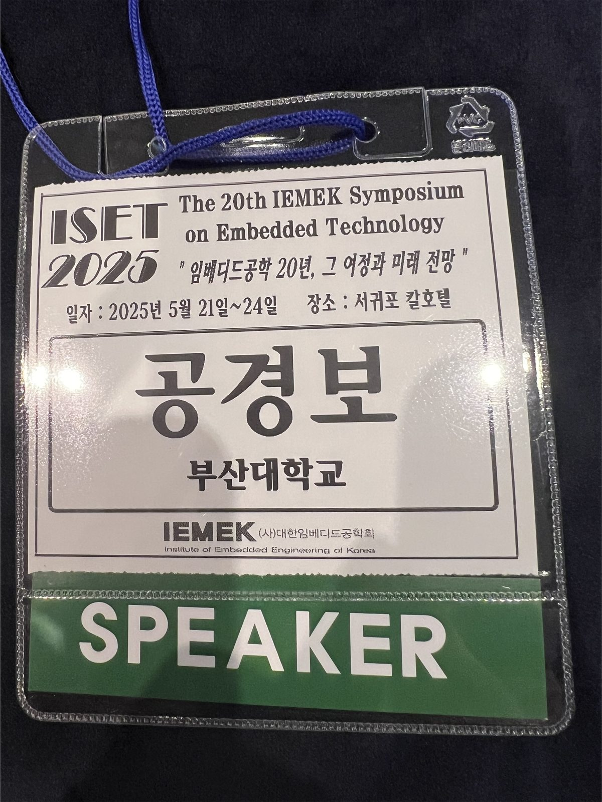

### ISET 2025 신진연구자 세션 연사로 교수님 초청 발표

2025년 5월 23일, 제주특별자치도 서귀포시에서 개최된 제20회 임베디드기술 심포지엄 (ISET 2025, The 20th IeMeK Symposium on Embedded Technology)에서 교수님께서  대한임베디드공학회 신진연구자 초청 세션에 연사로 초청받아 발표하셨습니다. 

<figure class="board-fig"></figure>

<figure class="board-fig"></figure>

<figure class="board-fig"></figure>

<figure class="board-fig"></figure>

<figure class="board-fig"></figure>
