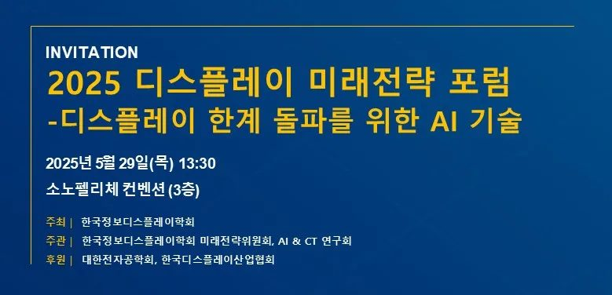
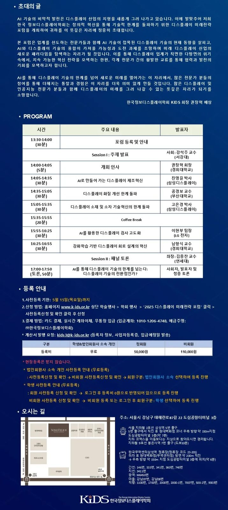
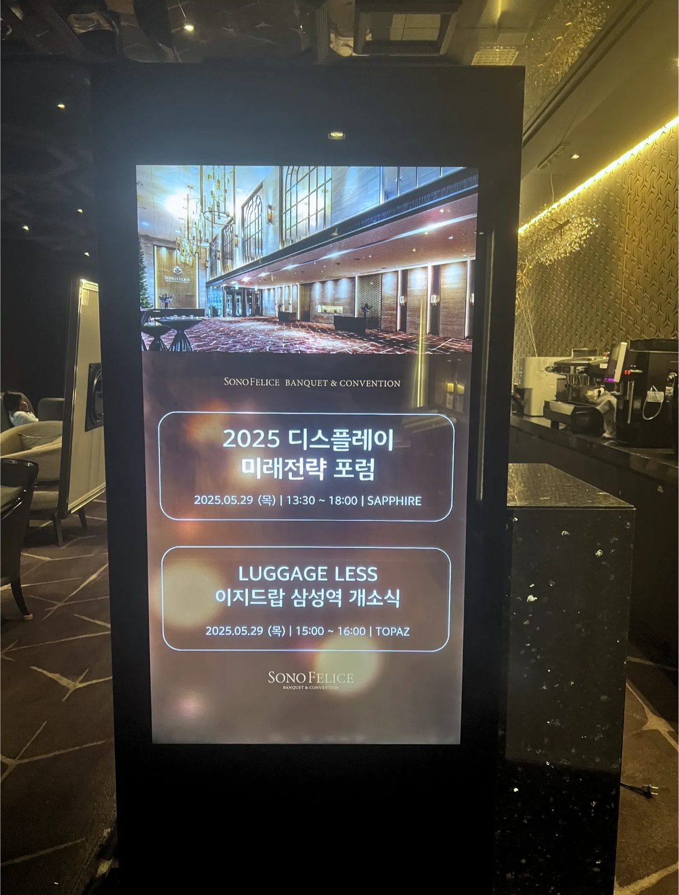
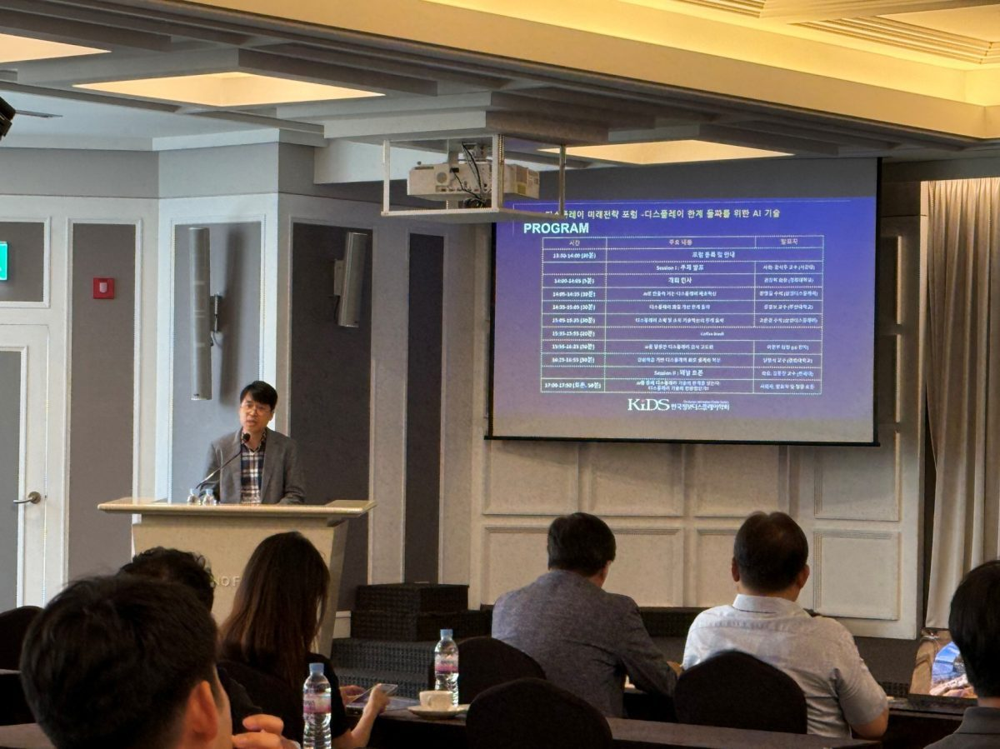

### 교수님, 2025 디스플레이 미래전략 포럼서 ‘AI 기반 화질 개선’ 발표

교수님께서 지난 달 5월 29일 목요일 열린 2025 디스플레이 미래 전략 포럼(주최:한국정보디스플레이학회)에서 ‘AI기반 화질 개선’을 주제로 발표하였습니다.

<figure class="board-fig"></figure>

<figure class="board-fig"></figure>

<figure class="board-fig"></figure>

<figure class="board-fig"><figcaption>세션 1 사회로 참여하신 강석주 교수님(서강대학교 전자공학과)입니다.</figcaption></figure>
