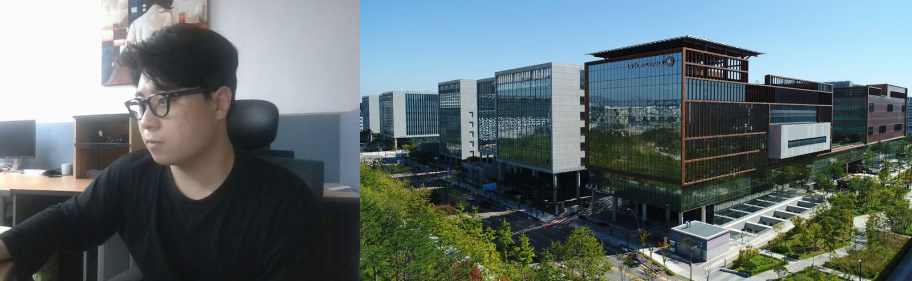

<figure class="board-fig"><figcaption>Computer Vision &amp; Signal Processing Lab 석사 과정 1년차 백창우 학생</figcaption></figure>

### 우리 연구실 석사과정 백창우 학생이 2025년 상반기 LG전자 석·박사 산학장학생 모집에서 CTO 부문에 최종 합격하였습니다!

이번 선발을 통해 백창우 학생은 LG전자의 장학금 지원은 물론 졸업 후 취업이 확정되는 기회를 얻게 되었습니다.  
그동안의 노력과 열정에 박수를 보내며 다시 한 번 진심으로 축하의 마음을 전합니다!

앞으로의 멋진 활약을 기대합니다!
