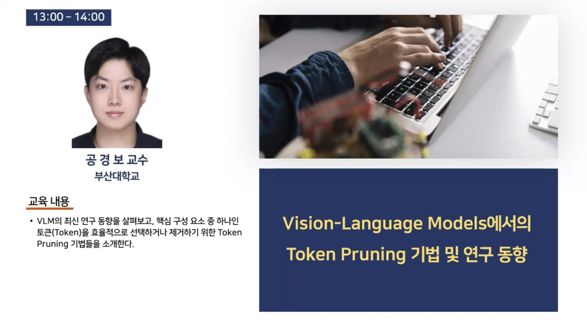
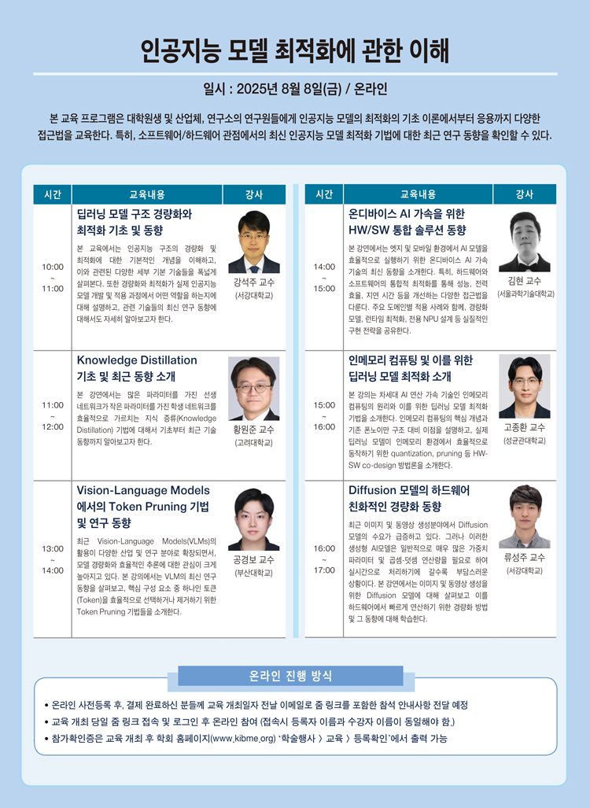

2025년 8월 8일 열린 한국방송·미디어공학회 ‘인공지능 모델 최적화에 관한 이해’ 프로그램에서 공경보 교수님께서 “Vision-Language Models에서의 Token Pruning 기법 및 연구 동향”을 주제로 강연을 진행하였습니다.

이번 교육 프로그램은 대학원생과 산업계·연구소 연구원들을 대상으로 인공지능 모델 최적화의 기본 이론부터 실제 응용까지 폭넓게 다루며, 소프트웨어와 하드웨어 양 측면에서 최신 최적화 기법과 연구 흐름을 공유하는 자리였습니다.

<figure class="board-fig"></figure>

<figure class="board-fig"></figure>
