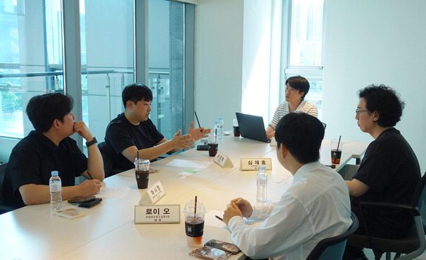
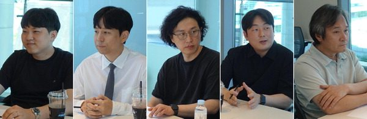

<figure class="board-fig"></figure>

<figure class="board-fig"></figure>

우리 교수님께서 지난 7월 25일 부산영상위원회에서 열린 전문가 좌담회에 참석하셨습니다.

이번 좌담회는「영상 생태계 판 흔드는 AI」를 주제로 진행되었으며, 교수님께서는 “AI 영화 창작·개발 교육의 세분화 필요성과 지역 기업 매칭의 중요성”에 대해 의견을 나누셨습니다.

좌담회에는 영화·영상 분야 및 AI 산업 전문가들이 함께 참여하여 AI와 영상 생태계의 변화, 산업 협력 방안 등에 대해 심도 있는 논의가 이루어졌습니다.

관련 기사 [바로가기📰](https://www.kookje.co.kr/news2011/asp/newsbody.asp?code=0500&key=20250818.22006004562)
