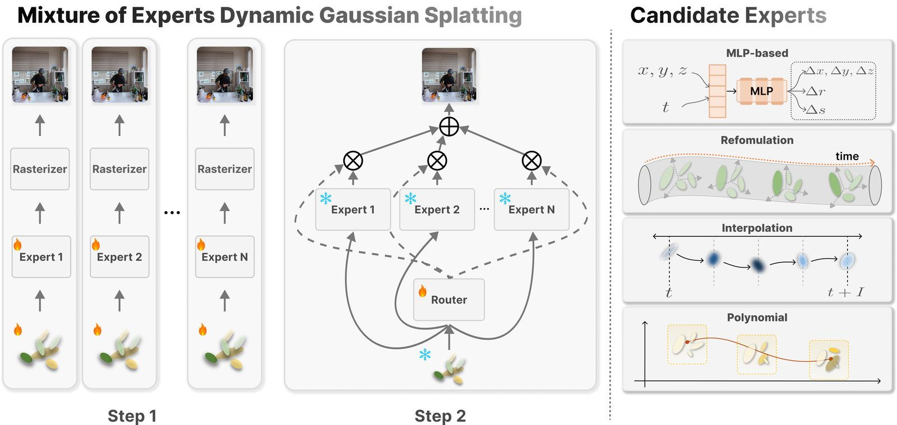
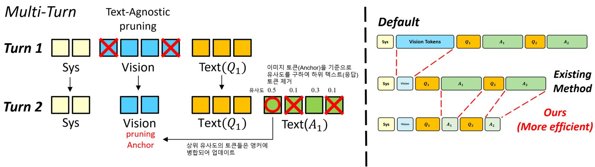

<figure class="board-fig"><figcaption markdown="span">왼쪽부터 문형주 석사과정생, 백창우 석사과정생</figcaption></figure>

<figure class="board-fig"></figure>

### 시공간 적응형 다중 전문가 기반 동적 장면 합성 기술 개발 **-** [**문형주**](/members/hyeong-ju/)

**Development of Spatiotemporally Adaptive Dynamic Scene Synthesis Technology Based on Mixture of Experts (25.9~26.8)**

- 시공간적 다양성과 복잡성이 존재하는 4D 장면에서 일관되고 고품질의 시점 합성을 실현할 수 있는 다중 전문가 기반 4D Gaussian Splatting 연구
- Funded by National Reasearch Foundation (한국연구재단 2025년도 이공분야 학술연구지원사업 - 석사과정생연구장려금지원사업)

<figure class="board-fig"></figure>

### **멀티모달 대형 언어 모델을 위한 효율적인 토큰 프루닝 기법 개발 -** [**백창우**](/members/changwoo/)

**Efficient Token Pruning for Multi-modal Large Language Models (25.9~26.8)**

- 멀티모달 대형 언어 모델(MLLM)의 추론 과정에서 입력 토큰을 효율적으로 줄이기 위한 토큰 프루닝 기법 연구
- Funded by National Reasearch Foundation (한국연구재단 2025년도 이공분야 학술연구지원사업 - 석사과정생연구장려금지원사업)

