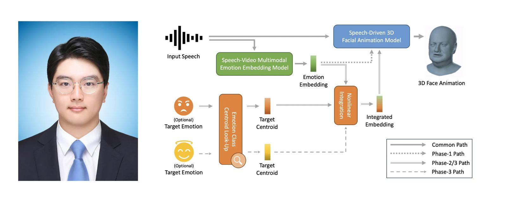

<figure class="board-fig"></figure>

### 멀티모달 감정 임베딩을 활용한 음성 기반 3D 얼굴 애니메이션의 감정 표현 및 제어 연구 - [박순찬 박사후연구원](/members.html)

### Research on Emotional Expression and Control in Speech-Driven 3D Facial Animation Using Multimodal Emotion Embedding (25.9 ~ 27.8)

- 멀티모달 감정 임베딩을 활용한 음성 기반 3D 얼굴 애니메이션의 감정 표현 및 제어 연구
- Funded by National Reasearch Foundation (한국연구재단 2025년도 이공분야 학술연구지원사업 - 박사후국내연수)
