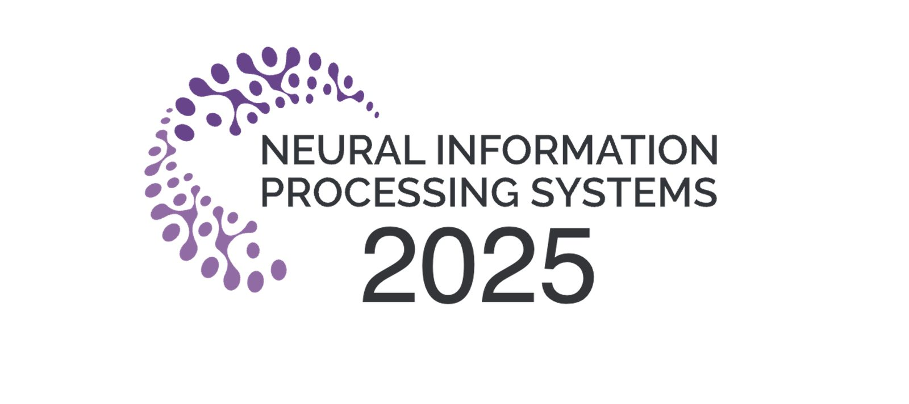

<figure class="board-fig"></figure>

# An Empirical Study of Attention and Diversity for Adaptive Visual Token Pruning in Multimodal Reasoning Models

NeurIPS Workshop on Efficient Reasoning (**NeurIPSw**), Dec. 2025. (**Top-tier AI Conference Workshop**)

Changwoo Baek\*, Jouwon Song\*, Sohyeon Kim\*, Kyeongbo Kong†
