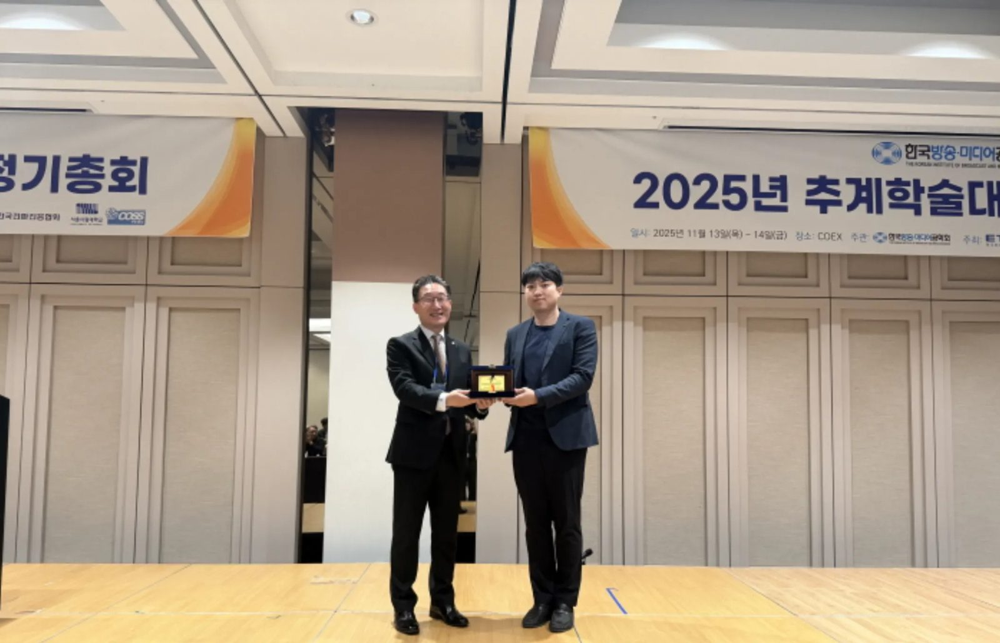
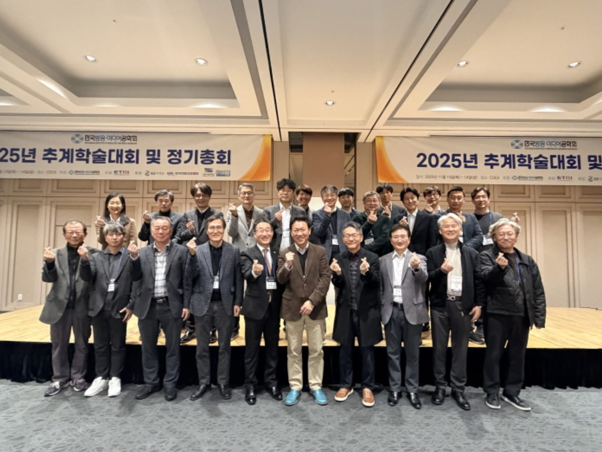

우리 교수님께서 지난 11월 13일 (목)에 개최된 2025년 한국방송·미디어공학회 추계학술대회에서 ‘신진연구자상’을 수상하였습니다.

한국방송·미디어공학회는 방송ꞏ미디어 공학 분야의 학술연구와 기술 개발을 통해 방송 관련 산업의 진흥과 발전에 기여를 목적으로 하는 학회로, 매년 관련 기술 연구에 공헌한 신진연구자를 선정하여 수상하고 있습니다.

정말 축하드립니다!

교수님 프로필 : [Kyeongbo Kong](https://www.pnu-cvsp.com/prof)

<figure class="board-fig"></figure>

<figure class="board-fig"></figure>
