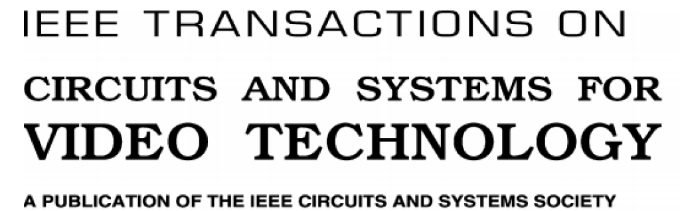

<figure class="board-fig"></figure>

### Realistic Human Image Animation with Dynamic Camera Effects

IEEE Transactions on Circuits and Systems for Video Technology (**TCSVT**), 2026. (IF: 11.1, JCR 2.7%)

Minseok Kang\*, Jihyun Kim\*, ChangHee Yang\*, Kyeongbo Kong\*, Suk-Ju Kang†
