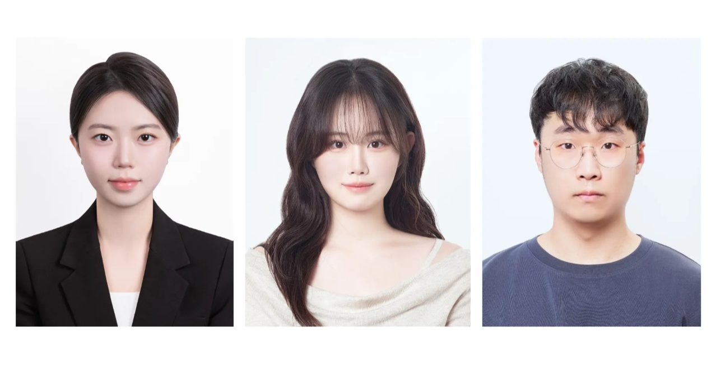

<figure class="board-fig"><figcaption>왼쪽부터 김민주, 유가연, 강성민 학생</figcaption></figure>

우리연구실에서 진행한 공학종합설계과제물에 참여한 김민주·유가연·강성민 학생이 참여한 논문이 한국방송·미디어공학회 동계학술대회 대학생 논문경진대회에서 최우수상을 수상했습니다.

해당 연구는 파노라마 이미지를 단일 시점에서 편집할 경우 발생하는 시점 간 의미 불일치 문제를 해결하기 위해, **VLM–LLM 기반 자동 편집 프레임워크**를 제안했습니다. 제안된 방법은 다중 시점 환경에서도 편집 의도를 일관되게 유지할 수 있도록 설계되었으며, 자동화된 편집 품질과 실용성을 동시에 향상시켰다는 평가를 받았습니다.
