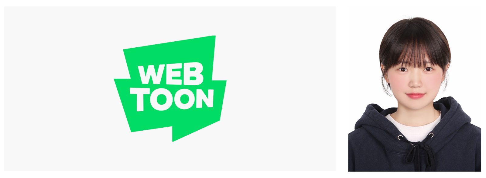

<figure class="board-fig"></figure>

**우리 연구실 추해수 학생이 국내 최대이자 글로벌 시장을 선도하는 웹툰 플랫폼인 ‘네이버웹툰(NAVER WEBTOON) 기업부설연구소 AI-agent 부서’ 인턴십 과정에 최종 합격 했습니다.**

이번 인턴십 합격은 치열한 경쟁을 뚫고 거둔 성과로 연구실에서 쌓아온 탄탄한 기술적 배경과 실무 적용 능력이 대한민국을 대표하는 IT 기업으로부터 인정받았다는 점에서 의미가 큽니다. 

네이버웹툰은 단순히 웹툰을 서비스하는 단계를 넘어 전 세계 150여 개국에서 8,500만 명 이상의 월간 활성 이용자(MAU)를 보유한 글로벌 스토리테크(Storytech) 플랫폼입니다. 특히 인공지능(AI)을 활용한 자동 채색, 불법 유통 방지 기술(Toon Radar), 개인화 추천 시스템 등 첨단 IT 기술을 콘텐츠 산업에 접목하며 기술 혁신을 주도하고 있습니다. 그동안의 노력과 열정에 박수를 보내며 다시 한 번 진심으로 축하의 마음을 전합니다! 앞으로 추해수 학생의 멋진 활약을 기대합니다! 

