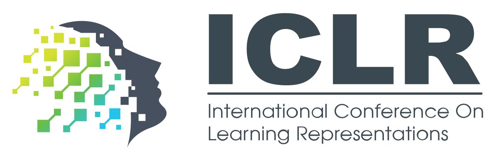

<figure class="board-fig"></figure>

# An Empirical Study of Attention and Diversity for Adaptive Visual Token Pruning in Large Vision-Language Models

International Conference on Learning Representations (**ICLR**), Apr. 2026. **(Top-tier AI Conference, Acceptance Rate: 28%)**

Changwoo Baek\*, Jouwon Song\*, Sohyeon Kim\*, Kyeongbo Kong†

# MoE-GS: Mixture of Experts for Dynamic Gaussian Splatting

International Conference on Learning Representations (**ICLR**), Apr. 2026. **(Top-tier AI Conference, Acceptance Rate: 28%)**

Inhwan Jin\*, Hyeongju Mun\*, Joonsoo Kim, Kugjin Yun, Kyeongbo Kong†
