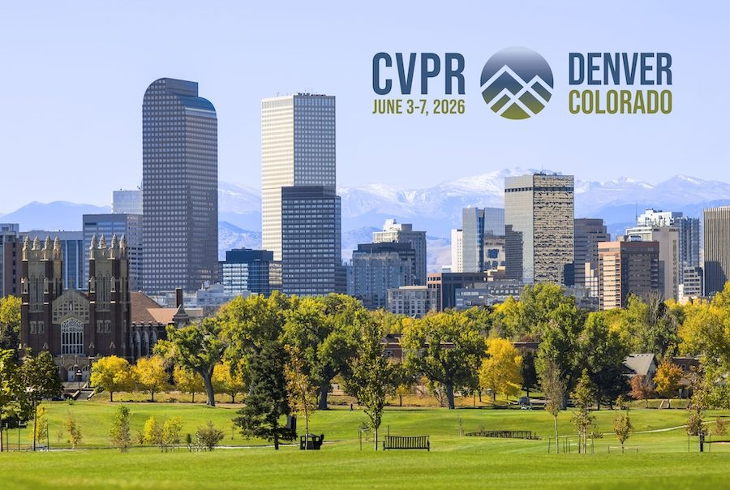

<figure class="board-fig"></figure>

# Uncertainty-Guided Graph Formulation via MWIS for Token Pruning in LVLMs

The IEEE/CVF Conference on Computer Vision and Pattern Recognition (**CVPR**) findings, Jun.2026. (**Top-tier AI Conference**)

Jouwon Song\*, Sohyeon Kim\*, Kyeongbo Kong†
