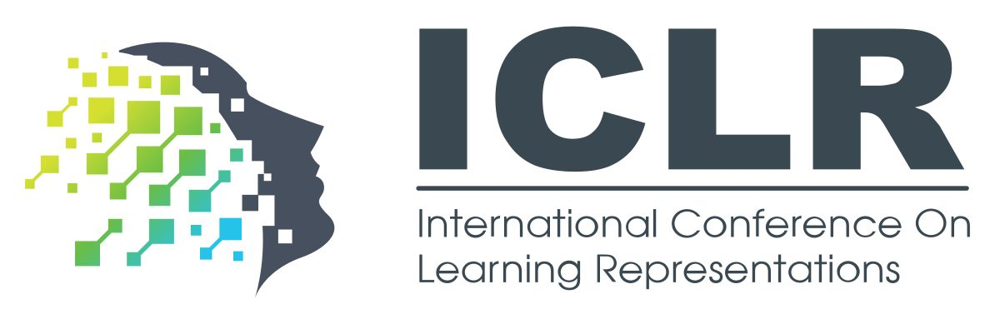

<figure class="board-fig"></figure>

# **FluIDWorld: Fluid-like Interactive Dynamics for 4D Worlds**

ICLR Workshop on World Models: Understanding, Modelling and Scaling (**ICLRw**), Apr. 2026.  (**Top-tier AI Conference Workshop**)

Hyeongju Mun*, In-Hwan Jin*, Sohyeong Kim, Kyeongbo Kong†
