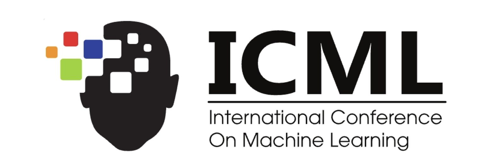

<figure class="board-fig"></figure>

# PADS-TAL: Padding-Annealed Diffusion Sampling in Text-Aware Latent Space for Robust and Diverse Text-to-Music Generation

International Conference on Machine Learning (ICML), Jul. 2026. (**Top-tier AI Conference**)

Taekoan Yoo\*, Wonkyung Jung\*, Kyunghun Kim\*, Kyeongbo Kong†
